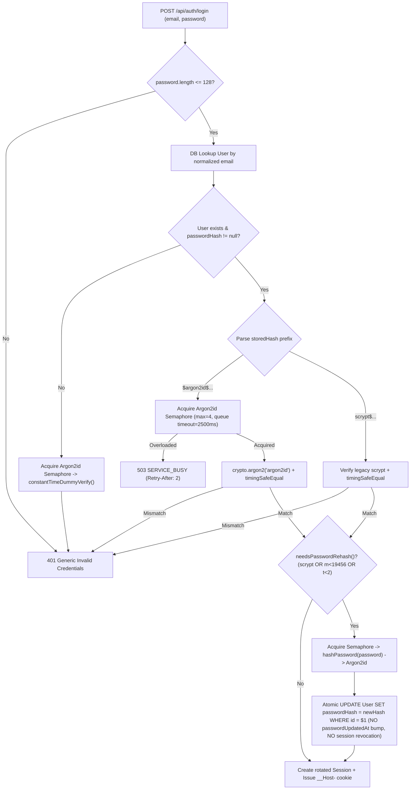
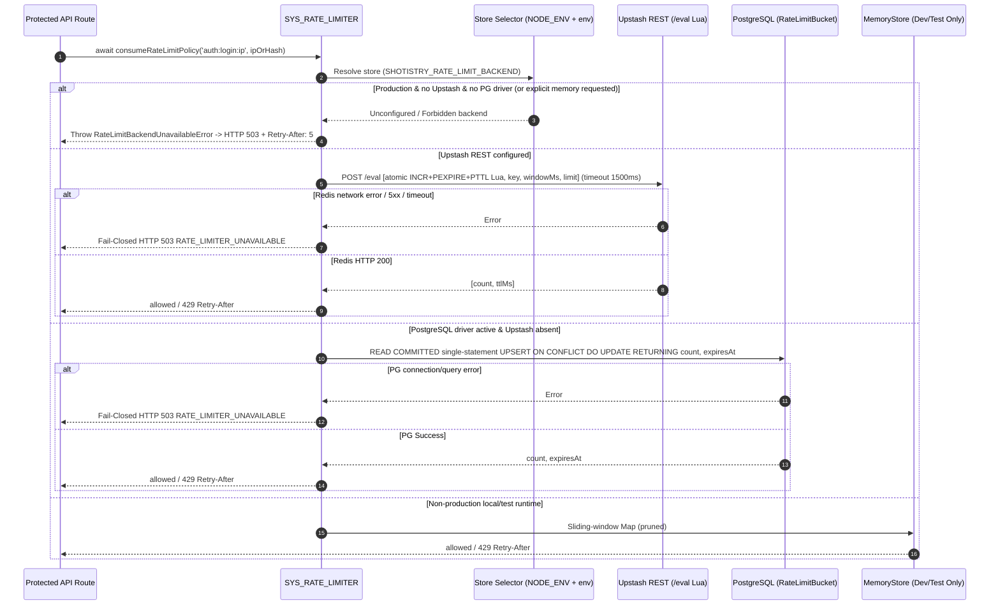
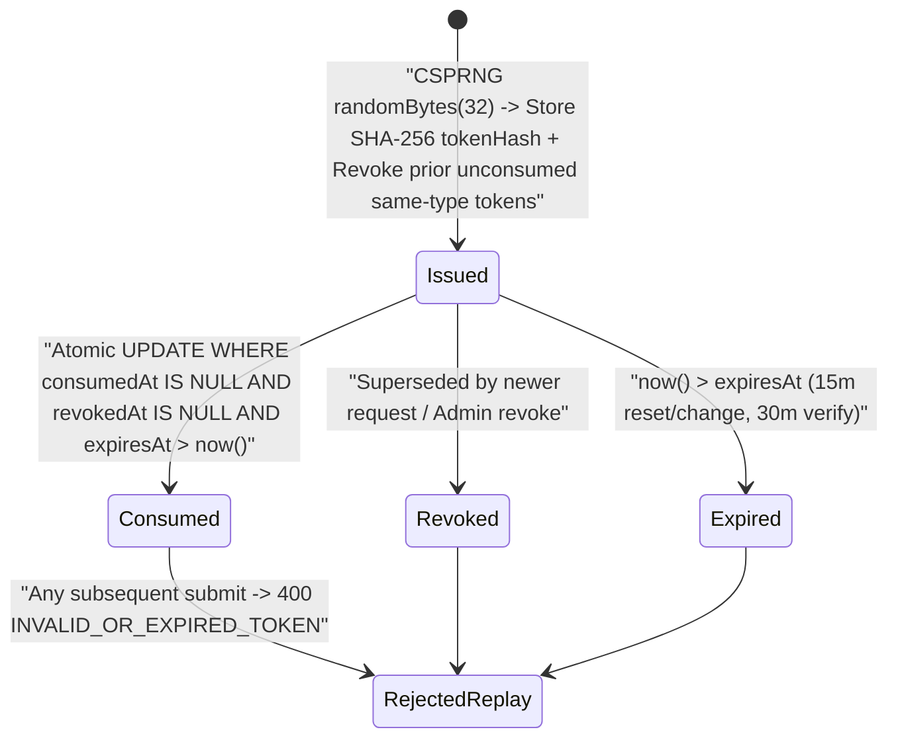
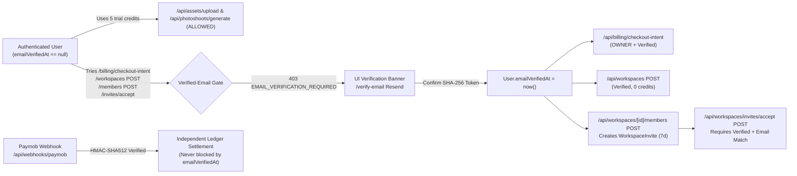
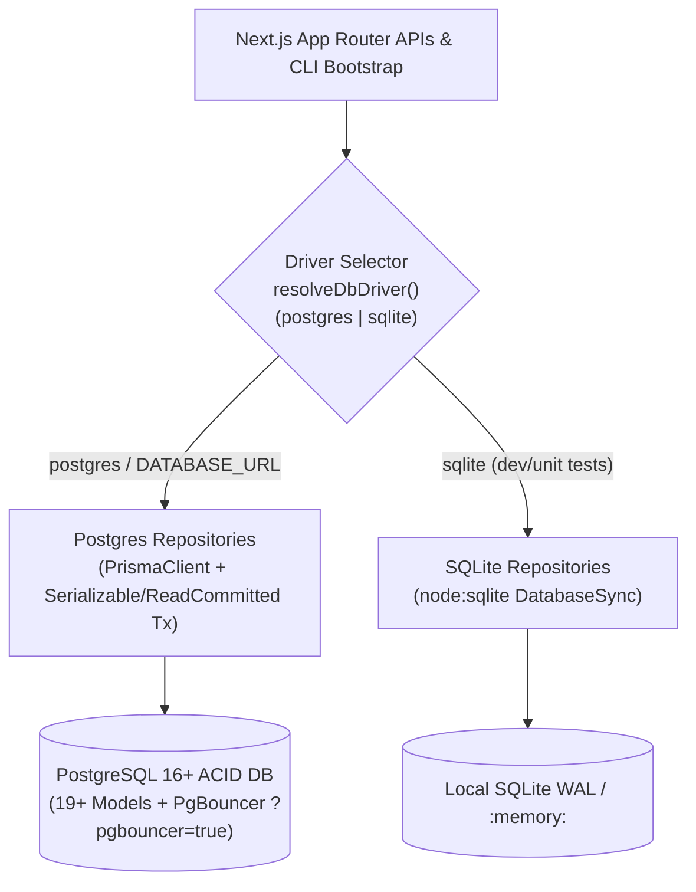

# Shotistry — Authentication Security Hardening & PostgreSQL Architecture Design

- **Document Status:** `PROPOSED ARCHITECTURE & VERIFIED BASELINE AUDIT`
- **Target Branch:** `audit/production-readiness` (Baseline HEAD: `f7ce154a5cff8f5496f08bbb65a13b15b84bd4f0` + uncommitted Option A session/RBAC changes)
- **Date:** November 8, 2026
- **Related ADRs:** [ADR-004](file:///Users/tasawk/StudioProjects/shotistry/docs/architecture/architecture-decisions/ADR-004-argon2id-password-hashing-and-migration.md), [ADR-005](file:///Users/tasawk/StudioProjects/shotistry/docs/architecture/architecture-decisions/ADR-005-distributed-rate-limiting-and-fail-closed-policy.md), [ADR-006](file:///Users/tasawk/StudioProjects/shotistry/docs/architecture/architecture-decisions/ADR-006-transactional-email-adapter-and-action-tokens.md), [ADR-007](file:///Users/tasawk/StudioProjects/shotistry/docs/architecture/architecture-decisions/ADR-007-verified-email-gating-and-workspace-invites.md), [ADR-008](file:///Users/tasawk/StudioProjects/shotistry/docs/architecture/architecture-decisions/ADR-008-postgres-auth-repository-and-actor-taxonomy-cleanup.md)
- **Implementation Plan:** [docs/implementation/auth-security-hardening-plan.md](file:///Users/tasawk/StudioProjects/shotistry/docs/implementation/auth-security-hardening-plan.md)

---

## 1. Implementation Status & Verification Boundary

To avoid overclaiming unbuilt capabilities, every statement in this document is explicitly categorized into one of four states observed during the November 8, 2026 repository audit:

| Classification | Scope in Shotistry Today (Observed on `audit/production-readiness`) |
|---|---|
| **Verified Existing Functionality** | Option A opaque SHA-256 `Session` lifecycle, `__Host-` cookie hardening, multi-tier `Role`/`WorkspaceRole` RBAC, CSRF origin + `x-csrf-token` validation, CLI admin bootstrap script, Sharp foreground isolation, `PostgresCreditLedgerService` (`PrismaClient`), local `scrypt(16384,8,1)` password hashing, in-memory `Map` rate limiter, and `User.emailVerifiedAt` nullable timestamp column in Prisma/SQLite. |
| **Proposed Architecture** | Scopes A–F defined in this document and formalized in ADR-004 through ADR-008 (Argon2id migration, distributed Redis/PostgreSQL fail-closed rate limiting, Resend email adapter + `AuthActionToken`, verified-email product policy + `WorkspaceInvite`, unified dual-driver SQLite/PostgreSQL persistence layer, and actor taxonomy cleanup). |
| **Planned Implementation** | Concrete 9-phase TDD execution roadmap in [`docs/implementation/auth-security-hardening-plan.md`](file:///Users/tasawk/StudioProjects/shotistry/docs/implementation/auth-security-hardening-plan.md). **Not yet implemented in `src/`, `prisma/`, or `tests/`.** |
| **Blocked Work Requiring External Credentials** | Live Upstash Redis REST verification (`UPSTASH_REDIS_REST_URL`, `UPSTASH_REDIS_REST_TOKEN`), live Resend email delivery & DNS DKIM/SPF/DMARC verification (`RESEND_API_KEY`, `EMAIL_FROM`), live production PostgreSQL cutover (`DATABASE_URL`), live Gemini (`GEMINI_API_KEY`), live Paymob (`PAYMOB_*`), and production secrets (`SHOTISTRY_ADMIN_BOOTSTRAP_SECRET`, `ASSET_SIGNING_SECRET`). |

### Critical Baseline Findings Discovered During Codebase Audit

1. **Dual-Driver PostgreSQL Coupling Gap:** Only [`CreditLedgerService`](file:///Users/tasawk/StudioProjects/shotistry/src/lib/ledger/credit-ledger-service.ts) currently branches to [`PostgresCreditLedgerService`](file:///Users/tasawk/StudioProjects/shotistry/src/lib/ledger/postgres-ledger-service.ts) when `SHOTISTRY_DB_DRIVER === 'postgres'`. All session queries in [`src/lib/auth/session.ts`](file:///Users/tasawk/StudioProjects/shotistry/src/lib/auth/session.ts), CLI bootstrap calls in [`src/lib/auth/admin-bootstrap.ts`](file:///Users/tasawk/StudioProjects/shotistry/src/lib/auth/admin-bootstrap.ts), and **10 API routes** (`auth/login`, `auth/password`, `workspaces/[id]/members`, `workspace/session`, `photoshoots/generate`, `jobs/[id]`, `billing/checkout-intent`, `webhooks/paymob`, `admin/metrics`, `admin/credits/adjust`) still call synchronous SQLite `getDb()` / `withSerializableTransaction()`.
2. **Synchronous `listActiveUserSessions()` Trap:** Currently `listActiveUserSessions()` in [`src/lib/auth/session.ts`](file:///Users/tasawk/StudioProjects/shotistry/src/lib/auth/session.ts#L488) is synchronous, whereas PostgreSQL queries via `PrismaClient` are inherently asynchronous. It must become `async` across the module, `/api/auth/sessions`, and tests.
3. **Missing Persistence Models:** `AuthActionToken`, `RateLimitBucket`, and `WorkspaceInvite` do not yet exist in `prisma/schema.prisma`, SQL migrations, or `src/lib/db/prisma.ts`.
4. **Local PostgreSQL 16 Test Database State:** Local host PostgreSQL `16.15` (`shotistry_audit_test` on `localhost:5432`) currently contains 17 tables from the older `20261105000000_init` schema, lacks the `Session` table from `20261108000000_sessions_rbac`, and has no `_prisma_migrations` table. Moreover, [`tests/postgres-ledger.test.mjs`](file:///Users/tasawk/StudioProjects/shotistry/tests/postgres-ledger.test.mjs#L49-L53) currently skips running migrations if `Session` already exists, which would skip a 3rd migration (`20261109000000_auth_security_hardening`).
5. **Runtime & TypeScript Strip-Types Constraints:** Local Node is `v24.11.1` (supporting native `crypto.argon2`), `package.json` runs tests with `node --experimental-strip-types --test tests/*.test.mjs`, `"@types/node"` is pinned to `^22.9.0` (`22.20.5` installed, which omits Node 24 `argon2` typings), `package.json` has no `"engines"` field, and neither `next.config.*` nor `src/middleware*` exists yet.

---

## 2. Official Technical Documentation Verified (Date Checked: `2026-11-08`)

| Topic | Source URL | Verified Facts Used in This Design | Date Checked |
|---|---|---|---|
| **Node.js `crypto.argon2`** | `https://nodejs.org/api/crypto.html` | `crypto.argon2(algorithm, parameters, callback)` and `crypto.argon2Sync` added in Node `v24.7.0`. Supports `'argon2id'`, `{ message, nonce, parallelism, memory, passes, tagLength, secret?, associatedData? }` (`memory` in KiB, must be `>= 8 * parallelism`). Returns raw derived key `Buffer` (not pre-formatted PHC string). | `2026-11-08` |
| **OWASP Password Storage** | `https://cheatsheetseries.owasp.org/cheatsheets/Password_Storage_Cheat_Sheet.html` | **Argon2id** recommended first choice with minimum `m=19456` (19 MiB), `t=2` iterations, `p=1` parallelism (or `m=47104, t=1, p=1` / `m=12288, t=3, p=1`). **`scrypt`** acceptable only when Argon2id is unavailable, minimum `N=131072 (2^17), r=8, p=1` (**128 MiB**). Legacy password migration should verify old hash on login and transparently rehash without breaking active user workflows. | `2026-11-08` |
| **Vercel Node.js Runtime & Limits** | `https://vercel.com/docs/functions/runtimes/node-js`<br>`https://vercel.com/docs/functions/limitations` | Supports Node `24.x` selected via `package.json` `"engines": { "node": "24.x" }`. Fluid Compute memory defaults to up to **2 GB** on Hobby and **2 GB default / 4 GB max** on Pro (300s active CPU max). Functions share instance memory across concurrent invocations under Fluid Compute. | `2026-11-08` |
| **Upstash Redis REST API** | `https://upstash.com/docs/redis/features/restapi` | HTTP REST supports `POST <UPSTASH_REDIS_REST_URL>/eval` with `Authorization: Bearer <TOKEN>` and JSON array `[luaScript, numKeys, key, ...args]` for atomic multi-command Lua execution. `/pipeline` sends commands sequentially without cross-request isolation, making `/eval` mandatory for atomic read-modify-TTL counters. | `2026-11-08` |
| **Resend Email API & Domains** | `https://resend.com/docs/api-reference/emails/send-email`<br>`https://resend.com/docs/dashboard/domains/introduction` | `POST https://api.resend.com/emails` with `Authorization: Bearer <RESEND_API_KEY>` and optional `Idempotency-Key` header (max 256 chars, 24-hour dedup window). Custom sending domains require verified DNS records (`SPF` TXT, `DKIM` CNAME/TXT, recommended `DMARC` TXT). Default API rate limit is 10 req/s (`429`). | `2026-11-08` |
| **Prisma Transactions & PgBouncer** | `https://www.prisma.io/docs/orm/prisma-client/queries/transactions`<br>`https://www.prisma.io/docs/orm/prisma-client/setup-and-configuration/databases-connections/pgbouncer` | Interactive transactions support isolation levels (`Serializable`, default `ReadCommitted`). High-frequency single-row atomic upserts (`INSERT ... ON CONFLICT DO UPDATE ... RETURNING`) should use `ReadCommitted` to avoid `40001` serialization retry storms. Pooled serverless connections via PgBouncer must use `?pgbouncer=true` to disable conflicting prepared-statement caching. | `2026-11-08` |

---

## 3. Scope A — Password Security & Argon2id Migration

### 3.1 Vulnerability Analysis of Current Configuration
Currently, [`src/lib/auth/password.ts`](file:///Users/tasawk/StudioProjects/shotistry/src/lib/auth/password.ts#L3-L6) configures:
- `SCRYPT_N = 16384` ($2^{14}$), `SCRYPT_R = 8`, `SCRYPT_P = 1`, `SCRYPT_KEYLEN = 64`, `SALT_BYTES = 16`.
- Memory per `scrypt` derivation: $128 \times 16384 \times 8 = 16,777,216\text{ bytes} = 16\text{ MiB}$.
- **Gap:** OWASP Password Storage Cheat Sheet specifies a minimum of $N = 2^{17} = 131072, r = 8, p = 1$ (**128 MiB**) for `scrypt`, leaving the current configuration **8× below OWASP memory-hardness guidance** against GPU/ASIC offline brute-force if database hashes leak.

### 3.2 Algorithm Evaluation: OWASP `scrypt` vs. Native Node 24 `Argon2id`

| Criterion | Retained `scrypt` (`N=16384`, current) | OWASP `scrypt` (`N=131072, r=8, p=1`) | **Selected: Native Node 24 `Argon2id`** (`m=19456, t=2, p=1`) |
|---|---|---|---|
| **OWASP Compliance** | Non-compliant (8× below minimum) | Compliant (legacy fallback) | **Primary OWASP First Choice** |
| **Memory per Auth Operation** | 16 MiB | **128 MiB** | **19 MiB** (6.74× less RAM than OWASP `scrypt`) |
| **Memory Under 16 Concurrent Logins** | 256 MiB | **2,048 MiB** (OOM risk on 2 GB Vercel Fluid Compute!) | **304 MiB** (comfortably fits in 2 GB serverless instance) |
| **Observed Latency (Local Apple Silicon, Node `v24.11.1`)** | Not measured in this audit (Phase 2 benchmark) | Not measured in this audit (Phase 2 benchmark) | **~26–30 ms** single-operation (`crypto.argon2` / `argon2Sync`, measured 2026-11-08) |
| **External C++ Native Addon Risk** | None (`node:crypto`) | None (`node:crypto`) | **None** — built into Node `v24.7.0+` `node:crypto` (OpenSSL 3.2+); zero `node-gyp` build issues on Vercel |

**Decision ([ADR-004](file:///Users/tasawk/StudioProjects/shotistry/docs/architecture/architecture-decisions/ADR-004-argon2id-password-hashing-and-migration.md)):** Adopt native Node.js 24 **`crypto.argon2('argon2id', ...)`** as the sole primary password hashing algorithm and pin `"engines": { "node": "24.x" }` in `package.json`. Add an internal ambient declaration file `src/types/node-argon2.d.ts` (since `@types/node@22.20.5` predates Node 24's `crypto.argon2` signature) so TypeScript `strict` checking passes cleanly alongside Node `--experimental-strip-types`.

### 3.3 Exact PHC Storage Format, Parameter Bounds & Pepper Policy

1. **Selected Defaults (`v19`, 32-byte tag, 16-byte CSPRNG salt):**
   - Algorithm: `'argon2id'`
   - `memory`: `19456` KiB (`19 MiB`)
   - `passes` (`t`): `2`
   - `parallelism` (`p`): `1`
   - `tagLength`: `32` bytes (256-bit)
   - `nonce`: `crypto.randomBytes(16)` (128-bit random salt)
   - **Serialized String Format (Standard PHC String Format):**
     ```text
     $argon2id$v=19$m=19456,t=2,p=1$<base64_no_padding(salt)>$<base64_no_padding(derivedKey)>
     ```
2. **Optional Pepper Evaluation (`SHOTISTRY_PASSWORD_PEPPER`):**
   - Decision: **Do not require a global pepper in v1 default format** (so `ADMIN` CLI bootstrap, seeded credentials, and serverless cold starts never risk permanent lockout from uncoordinated env var rotation without key versioning).
   - If high-assurance peppering is adopted later, introduce an explicit versioned format (e.g., `$shotistry-k1$...` storing `keyId`) rather than unversioned `secret` mixing.
3. **Stored-Hash Validation Bounds (Anti-DoS Protection):**
   - On `verifyPassword(password, storedHash)`:
     - Reject non-string / empty passwords or passwords `> 128` bytes/characters **before** hashing.
     - Accept **only**:
       - Valid `$argon2id$v=19$m=<m>,t=<t>,p=<p>$<salt>$<hash>` where:
         - `8192 <= m <= 65536` (and `m >= 8 * p`)
         - `1 <= t <= 10`
         - `1 <= p <= 4`
         - decoded `salt.length` between `16` and `32` bytes
         - decoded `hash.length === 32`
       - Legacy `scrypt$<N>$<r>$<p>$<saltHex>$<hashHex>` where `16384 <= N <= 131072` (power of 2), `1 <= r <= 16`, `1 <= p <= 4`, `saltHex` even `>= 32` chars, `hashHex` length `64` or `128`.
     - Constant-time comparison strictly via `crypto.timingSafeEqual(derived, expectedBuf)`.

### 3.4 Serverless Concurrency Limiter & Transparent Scrypt Upgrade



**Critical Implementation Rules for Transparent Migration:**
1. **`needsPasswordRehash(storedHash)`** returns `true` for any valid `scrypt$...` hash or any `$argon2id$` hash whose `(m, t, p)` is weaker than `(19456, 2, 1)`.
2. **Pre-Hash Length Check Everywhere:** Enforce `password.length <= 128` **before** `verifyPassword()` in `POST /api/auth/login` (currently [`login/route.ts`](file:///Users/tasawk/StudioProjects/shotistry/src/app/api/auth/login/route.ts#L10-L13) caps `max(128)` on Zod, which already protects HTTP, and `verifyPassword` itself must enforce `<= 128` defensively for any internal caller).
3. **Semaphore Bounded Memory Protection:** Because Vercel Fluid Compute can multiplex requests inside one Node worker, bound concurrent `Argon2id` derivations via an internal async semaphore (`MAX_CONCURRENT_PASSWORD_HASHES = 4`, configurable via `SHOTISTRY_MAX_CONCURRENT_HASHES`, acquire timeout `2500ms`). Total concurrent hashing RAM stays capped at `4 × 19 MiB = 76 MiB` inside one container! If queue wait exceeds `2500ms`, throw `PasswordHasherBusyError` mapped to `503 SERVICE_BUSY` + `Retry-After: 2` rather than crashing the worker with OOM.
4. **No Session Revocation on Transparent Upgrade:** Upgrading legacy `scrypt` -> `Argon2id` inside `POST /api/auth/login` updates `User.passwordHash` **only** (leaving `User.passwordUpdatedAt` and existing valid sessions untouched). Only explicit user actions (`POST /api/auth/password`, `POST /api/auth/reset-password`) bump `passwordUpdatedAt` and revoke sessions.
5. **CLI Bootstrap (`scripts/bootstrap-admin.mjs`):** Uses updated `hashPassword` (Argon2id). No special code changes needed in CLI hashing algorithm once `password.ts` is upgraded, provided the script also supports PostgreSQL (Scope E).
6. **Required Concurrency & Memory Benchmark:** Phase 2 must benchmark `hashPassword` + `verifyPassword` at concurrency `c ∈ {1, 4, 8, 16, 25}` recording `p50`, `p95`, `p99` latency (ms) and peak RSS delta (`process.memoryUsage().rss`) and commit baseline numbers into `docs/qa/test-results.md`.

---

## 4. Scope B — Distributed Rate Limiting & Fail-Closed Production Policy

### 4.1 Replacement Architecture (`RateLimitStore`)
[`src/lib/security/rate-limit.ts`](file:///Users/tasawk/StudioProjects/shotistry/src/lib/security/rate-limit.ts) currently uses an unbounded process-local `Map` (`globalForRateLimit.__shotistryRateLimitStore`), which resets on Vercel cold starts and fails to share counters across concurrent serverless instances.

We replace synchronous `consumeRateLimit()` with an async `RateLimitStore` interface (`Promise<RateLimitDecision>`):

```ts
export interface RateLimitDecision {
  allowed: boolean;
  remaining: number;
  retryAfterSeconds: number;
  backend: 'upstash' | 'postgres' | 'memory';
}

export interface RateLimitStore {
  readonly backend: 'upstash' | 'postgres' | 'memory';
  consume(key: string, limit: number, windowMs: number): Promise<RateLimitDecision>;
}
```

### 4.2 Backend Evaluation & Precedence Rules



**Backend Trade-Off Matrix:**
- **`UpstashRateLimitStore` (Primary Production Recommendation):**
  - Uses zero extra heavy runtime SDK dependencies by posting directly via `fetch()` (with injectable `fetch` for deterministic unit tests and `AbortSignal.timeout(1500)`) to `POST ${UPSTASH_REDIS_REST_URL}/eval` with `Authorization: Bearer ${UPSTASH_REDIS_REST_TOKEN}`.
  - Why `/eval` Lua instead of `/pipeline`: Upstash docs explicitly warn `/pipeline` is not transactionally isolated from interleaved requests across serverless Lambdas. A single Lua script performs:
    ```lua
    local current = redis.call('INCR', KEYS[1])
    if current == 1 then
      redis.call('PEXPIRE', KEYS[1], ARGV[1])
    end
    local pttl = redis.call('PTTL', KEYS[1])
    if pttl < 0 then
      redis.call('PEXPIRE', KEYS[1], ARGV[1])
      pttl = tonumber(ARGV[1])
    end
    return { current, pttl }
    ```
  - Gives sub-10ms cross-region atomic counters without touching PostgreSQL connection pools.
- **`PostgresRateLimitStore` (Zero-Extra-SaaS Distributed Fallback on `SHOTISTRY_DB_DRIVER=postgres`):**
  - If Upstash env vars are absent in PostgreSQL mode, operates via a dedicated `RateLimitBucket` table using a single atomic upsert inside default `READ COMMITTED` isolation (not `SERIALIZABLE`, avoiding `40001` lock contention under bursts):
    ```sql
    INSERT INTO "RateLimitBucket" ("key", "count", "windowStart", "expiresAt", "updatedAt")
    VALUES ($1, 1, $2, $3, $2)
    ON CONFLICT ("key") DO UPDATE
    SET
      "count" = CASE
        WHEN "RateLimitBucket"."expiresAt" <= EXCLUDED."windowStart" THEN 1
        ELSE "RateLimitBucket"."count" + 1
      END,
      "windowStart" = CASE
        WHEN "RateLimitBucket"."expiresAt" <= EXCLUDED."windowStart" THEN EXCLUDED."windowStart"
        ELSE "RateLimitBucket"."windowStart"
      END,
      "expiresAt" = CASE
        WHEN "RateLimitBucket"."expiresAt" <= EXCLUDED."windowStart" THEN EXCLUDED."expiresAt"
        ELSE "RateLimitBucket"."expiresAt"
      END,
      "updatedAt" = EXCLUDED."updatedAt"
    RETURNING "count", "expiresAt";
    ```
  - **Bounded Cleanup:** Periodic probabilistic sweep (`~1%` of requests + explicit maintenance helper) deletes at most `200` expired rows (`DELETE FROM "RateLimitBucket" WHERE "key" IN (SELECT "key" FROM "RateLimitBucket" WHERE "expiresAt" < $1 LIMIT 200)`), keeping table size bounded without lock stalls.
- **`MemoryRateLimitStore` (Dev & Test Only):**
  - Allowed **only** when `NODE_ENV !== 'production'` and neither Upstash nor Postgres rate-limiting is selected.
  - `resetRateLimitsForTests()` MUST throw an error if invoked when `NODE_ENV === 'production'`.
  - Placeholder Upstash URLs/tokens (e.g., `your-upstash...`, `changeme`, non-`https://`) are treated as **unconfigured**, triggering fail-closed `503` in production if Postgres store is also inactive.

### 4.3 Trusted IP Extraction & PII-Free Bucket Keys
1. **IP Extraction (`getClientIp(request)`):**
   - Current [`rate-limit.ts`](file:///Users/tasawk/StudioProjects/shotistry/src/lib/security/rate-limit.ts#L18-L27) reads the first hop of arbitrary `x-forwarded-for`, which allows direct spoofed `x-forwarded-for: 1.2.3.4` bypass unless stripped at edge.
   - New priority order:
     1. `x-vercel-forwarded-for` (set by the Vercel edge; use only when `process.env.VERCEL === '1'`; take the first entry and validate it as IPv4/IPv6)
     2. `cf-connecting-ip` (if behind Cloudflare)
     3. `x-real-ip`
     4. `x-forwarded-for` (take the **rightmost non-private / edge-appended client IP** rather than blind first hop when proxy headers are present, or configurable `SHOTISTRY_TRUSTED_PROXY_COUNT`)
     5. `'0.0.0.0'` fallback marker in unrouted unit tests (rather than polluting localhost).
   - **IPv6 `/64` Normalization:** Normalize valid IPv6 addresses to `/64` network prefix so an attacker rotating SLAAC `/128` suffixes within one ISP/device prefix shares a single rate-limit bucket.
2. **Hashed Bucket Keys:** Raw emails and user IDs MUST NEVER be stored verbatim in Redis or `RateLimitBucket.key`:
   ```text
   shotistry:rl:v1:<policyScope>:<sha256_hex_prefix_24(normalizedIdentity)>
   ```

### 4.4 Endpoint Rate-Limit Policy Matrix

All rate-limit checks execute via unified middleware/helper returning `429` (`Retry-After`, `X-RateLimit-Remaining`, `Cache-Control: no-store`) on limit exhaustion or **`503 RATE_LIMITER_UNAVAILABLE`** on backend failure/misconfiguration in production:

| Policy Key | Route(s) | Dimensions (Independent Buckets) | Limit | Window | Notes |
|---|---|---|---|---|---|
| `auth:login:ip` | `POST /api/auth/login` | Client IP (`/64` for v6) | `15` | `15 min` | Shared IP NAT tolerance while blocking spray |
| `auth:login:acct` | `POST /api/auth/login` | `sha256(ip + ':' + email)` | `7` | `15 min` | Tight credential-stuffing guard per IP+email |
| `auth:login:email_lock` | `POST /api/auth/login` | `sha256(email)` | `20` | `1 hour` | Distributed botnet defense (does not leak existence; returns same generic `429` after delay) |
| `auth:register:ip` | `POST /api/auth/register` | Client IP | `6` | `1 hour` | Anti-trial-farming IP throttling |
| `auth:verify:resend` | `POST /api/auth/verify-email/resend` | `ip` (`10 / 1h`) & `sha256(emailOrUserId)` (`3 / 15m`, 60s min interval) | `10` / `3` | `1h` / `15m` | Prevents email bombing & Resend quota burn |
| `auth:verify:confirm` | `POST /api/auth/verify-email/confirm` | Client IP (`20 / 15m`) | `20` | `15 min` | Blocks token brute-force |
| `auth:recovery:forgot` | `POST /api/auth/forgot-password` | `ip` (`8 / 1h`) & `sha256(email)` (`3 / 1h`) | `8` / `3` | `1h` | Anti-enumeration + inbox flooding defense |
| `auth:recovery:reset` | `POST /api/auth/reset-password` | Client IP (`10 / 15m`) | `10` | `15 min` | Protects reset token validation |
| `auth:email_change` | `POST /api/auth/email/change-request`, `.../change-confirm` | `userId` (`3 / 1h`) & `ip` (`10 / 1h`) | `3` / `10` | `1h` | Protects primary identity mutations |
| `auth:password_change` | `POST /api/auth/password` | `userId` (`8 / 15m`) & `ip` (`15 / 15m`) | `8` / `15` | `15 min` | Moves password change onto distributed store |
| `workspace:invite:create` | `POST /api/workspaces/[id]/members` | `userId` (`20 / 1h`) & `workspaceId` (`30 / 1h`) | `20` / `30` | `1h` | Stops invite-email spam |
| `workspace:invite:accept` | `POST /api/workspaces/invites/accept` | `ip` (`15 / 15m`) & `userId` (`15 / 15m`) | `15` | `15 min` | Prevents token guessing |
| `admin:credits:adjust` | `POST /api/admin/credits/adjust` | `userId` (`20 / 15m`) | `20` | `15 min` | Bounds sensitive ledger mutations per operator |
| `admin:metrics:read` | `GET /api/admin/metrics` | `userId` (`60 / 5m`) | `60` | `5 min` | Protects expensive KPI queries |
| `studio:generate` | `POST /api/photoshoots/generate` | `workspaceId` (`20 / 5m`) & `userId` (`15 / 5m`) | `20` / `15` | `5 min` | Protects Gemini AI spend & worker concurrency |
| `billing:checkout` | `POST /api/billing/checkout-intent` | `userId` (`10 / 15m`) & `workspaceId` (`15 / 15m`) | `10` / `15` | `15 min` | Prevents checkout-intent table spam |

*(Paymob server-to-server webhook `POST /api/webhooks/paymob` is **excluded** from IP rate limits because it enforces fail-closed HMAC-SHA512 verification and Paymob retries from shared egress IPs.)*

---

## 5. Scope C — Transactional Email Adapter, Verification, Recovery & Email Change

### 5.1 Pluggable Transactional Email Adapter (`src/lib/email/`)

| Component | Design Specification |
|---|---|
| **`EmailTransport` Interface** | `send(message: EmailMessage): Promise<{ provider: 'resend' \| 'memory'; messageId: string }>` with `{ to, subject, html, text, idempotencyKey, tags }`. |
| **`ResendEmailTransport` (Production Adapter)** | Native `fetch('https://api.resend.com/emails', ...)` using `RESEND_API_KEY`, `EMAIL_FROM`, `EMAIL_REPLY_TO` (optional), `Idempotency-Key` (max 256 chars, e.g. `shotistry:<type>:<tokenId>`), `AbortSignal.timeout(5000)`, handles HTTP `429` (`Retry-After`), never logs email bodies or raw links. |
| **Fail-Closed Rule** | In `NODE_ENV === 'production'`, if `RESEND_API_KEY` or `EMAIL_FROM` is missing/placeholder (`your-...`, `changeme`), `ResendEmailTransport` throws `EmailTransportUnavailableError`, mapping to `503 EMAIL_SERVICE_UNAVAILABLE` on user-triggered resend routes and alerting cleanly. Never fabricate "email sent" success without actual provider confirmation. |
| **`MemoryEmailTransport` (Test Adapter)** | Enabled **only** in test harnesses (`NODE_ENV === 'test'` via explicit DI or test registry). Records rendered HTML, text, subject, recipient, and extracted action tokens in memory for automated integration tests—never writing tokens into HTTP responses or production logs. |
| **DNS & Sender Prerequisites** | Production deployment requires a custom subdomain (e.g., `mail.shotistry.com` with `EMAIL_FROM="Shotistry <no-reply@mail.shotistry.com>"`) verified in Resend with `SPF` (`TXT`), `DKIM` (`CNAME`), and `DMARC` (`TXT` `v=DMARC1; p=quarantine; ...`). Resend's shared `onboarding@resend.dev` cannot deliver to external merchant addresses in production. |

### 5.2 Unified `AuthActionToken` Architecture & Anti-Leakage Controls

Currently `prisma/schema.prisma` defines `User.emailVerifiedAt` ([line 76](file:///Users/tasawk/StudioProjects/shotistry/prisma/schema.prisma#L76)) and `User.passwordUpdatedAt` ([line 78](file:///Users/tasawk/StudioProjects/shotistry/prisma/schema.prisma#L78)), but **no `AuthActionToken` table exists yet**. We introduce `AuthActionTokenType` and `AuthActionToken`:

| Token Type | TTL | Target / Extra Constraints | Behavior on Issue | Behavior on Consumption |
|---|---|---|---|---|
| **`EMAIL_VERIFY`** | `30 min` | `targetEmail = user.email` (binds token to current address!) | Revokes all prior active `EMAIL_VERIFY` tokens for `(userId)` before inserting new `tokenHash`. | Conditional `UPDATE ... WHERE tokenHash=$1 AND type='EMAIL_VERIFY' AND consumedAt IS NULL AND revokedAt IS NULL AND expiresAt > now()`. Verifies `user.email === token.targetEmail`; sets `User.emailVerifiedAt = now()` if null. Does not revoke active sessions. |
| **`PASSWORD_RESET`** | `15 min` | `PLATFORM_ROLE === 'USER'` eligible; `ADMIN` blocked from web reset (see §5.4). | Revokes all prior active `PASSWORD_RESET` tokens for `(userId)`. Constant-time anti-enumeration (`202` uniform body). | Atomic single-use consume; validates new password (`validatePasswordStrength`, `<= 128` chars) and hashes it with Argon2id; updates `User.passwordHash` and `User.passwordUpdatedAt = now()`; **does not modify `User.emailVerifiedAt`** (decision: tokens are strictly single-purpose; verification is only granted by `EMAIL_VERIFY`, giving a clean audit trail); **revokes ALL active `Session` rows** for `userId` with `revokedReason='PASSWORD_RESET'`; revokes all other outstanding `PASSWORD_RESET` and `EMAIL_CHANGE` tokens for the user; does **not** auto-login (user signs in again); sends a security notification email. |
| **`EMAIL_CHANGE`** | `15 min` | Stores `targetEmail` (normalized lowercase new email). Initiation requires an authenticated session, current-password re-verification, CSRF, and a verified current email. | Rejects `targetEmail === user.email` (`400`). Always returns the same `202` body whether or not `targetEmail` is already registered (no enumeration). If `targetEmail` is free: revokes prior `EMAIL_CHANGE` tokens for the user, issues a token, emails the confirm link **only to `targetEmail`**, and sends a "change requested" notice (no link) to the current email. If `targetEmail` is taken: issues no token and sends nothing to either address. | Requires an authenticated session for the same `userId` + CSRF. Inside one transaction: atomically consumes the token, re-checks that `targetEmail` is still unallocated (`409 EMAIL_UNAVAILABLE` on collision, token stays consumed), sets `User.email = targetEmail` and `User.emailVerifiedAt = now()`, revokes all **other** sessions (`revokedReason='EMAIL_CHANGED'`), and keeps the current session. Pending `WorkspaceInvite` rows addressed to the old email are **not** migrated (invites stay bound to the address they were sent to). |



### 5.3 Token Leakage Defense (`#token=` Fragment Pattern & Security Headers)
Passing raw secret tokens in query parameters (`?token=...`) leaks tokens into server access logs, CDN/Vercel request logs, browser history, and third-party `Referer` headers when external assets load.
1. **Fragment-Delivered Links:** All emailed URLs place the raw token in the URL **fragment**:
   - `https://app.shotistry.com/verify-email#token=<rawBase64UrlToken>`
   - `https://app.shotistry.com/reset-password#token=<rawBase64UrlToken>`
   - `https://app.shotistry.com/account/confirm-email#token=<rawBase64UrlToken>`
   - `https://app.shotistry.com/invites/accept#token=<rawBase64UrlToken>`
   - *(Browsers never transmit URL fragments to origin/CDN HTTP logs or `Referer` headers.)*
2. **Strict `POST`-Only Consumption:** Landing pages extract `window.location.hash`, strip it immediately via `history.replaceState(null, '', pathname)`, and send `{ token }` via `POST` `application/json` (never auto-consuming on `GET` prefetcher/email-scanner link clicks such as Microsoft SafeLinks / Gmail image proxies!).
3. **HTTP Header Hardening (`next.config.ts` + Route Headers):** Since no `next.config.*` exists today, create `next.config.ts` configuring baseline headers (`Referrer-Policy: no-referrer` on `/verify-email`, `/reset-password`, `/account/confirm-email`, `/invites/accept`, `strict-origin-when-cross-origin` globally; `X-Content-Type-Options: nosniff`; `X-Frame-Options: DENY`), and emit `Cache-Control: no-store` on all `/api/auth/**` responses.

### 5.4 Account Recovery Security Rules & Privileged Role Policy
- **Anti-Enumeration & Timing Floor on `POST /api/auth/forgot-password`:**
  - Always validate email syntax and apply distributed rate limits first (`400` bad format, `429` over limit, `503` limiter unavailable in prod).
  - For syntactically valid requests, execute a uniform response (`HTTP 202`: `{ success: true, message: "If an eligible account exists, password reset instructions have been sent." }`).
  - When email is unknown (or unverified/ineligible), perform dummy delay/work matching typical token-generation + dispatch setup budget (~35–60ms without hanging) so timing cannot distinguish registered vs unregistered emails.
- **Registration + Verification Trigger (Decision):**
  - `POST /api/auth/register` keeps creating the account, initial workspace, `OWNER` membership, `5` trial credits, and session (`emailVerifiedAt = null`), then attempts to dispatch an initial `EMAIL_VERIFY` email **after** the registration transaction commits.
  - Registration **succeeds even if email dispatch fails** (transient provider error or unconfigured transport). The response includes `verificationEmailSent: boolean` and the server records an `EMAIL_DISPATCH_FAILED` structured log entry (no token, no email body). This is safe because the verified-email gate (Scope D) blocks checkout, extra workspaces and invites until verification completes.
  - `POST /api/auth/verify-email/resend` returns `503 EMAIL_SERVICE_UNAVAILABLE` when the transport is unavailable, so misconfiguration is visible to operators immediately.
- **Privileged Role Policy (Decision):**
  - **`PLATFORM_ADMIN` (`User.role = 'ADMIN'`) and `PLATFORM_SUPPORT` (`User.role = 'SUPPORT'`) are ineligible for self-service `forgot-password`.** The route still returns the uniform `202` body (no enumeration), issues no token, and writes a `PRIVILEGED_RESET_ATTEMPT` entry to `AdminAuditLog` (actor = target user id, details = hashed IP).
  - `ADMIN` recovery: out-of-band `CLI_OPERATOR` rotation via a new `scripts/bootstrap-admin.mjs --rotate-password` mode that requires `SHOTISTRY_ADMIN_BOOTSTRAP_SECRET`, re-hashes with Argon2id, bumps `passwordUpdatedAt`, and revokes all sessions of that admin.
  - `SUPPORT` recovery: rotation by an `ADMIN` (server-side function `rotateSupportOperatorPassword`, audited); no HTTP route is added in this hardening scope.
  - Rationale: compromise of a privileged user's mailbox must not escalate into platform-wide access.

---

## 6. Scope D — Verified-Email Product Policy & Identity-Bound Workspace Invites

### 6.1 Product Entitlement Boundary (Preserving Free Trial UX)

| Capability / API Route | Unverified (`emailVerifiedAt === null`) | Verified (`emailVerifiedAt !== null`) | Paymob Webhook (`EXT_PAYMOB`) |
|---|---|---|---|
| **Register (`POST /api/auth/register`)** | Allowed -> grants `5` trial credits (`TRIAL_GRANT`, once per user) | Same | N/A |
| **Use Studio (`POST /api/assets/upload`, `POST /api/photoshoots/generate`, `GET /api/jobs/[id]`, `GET /api/workspace/session`)** | **ALLOWED** — existing `5` free trial credits and any existing legitimate balance remain usable | **ALLOWED** | N/A |
| **Email Verification (`/api/auth/verify-email/*`)** | **ALLOWED** | Returns already-verified idempotent state | N/A |
| **Account Auth Lifecycle (`/api/auth/login`, `logout`, `session`, `sessions/*`, `password`)** | **ALLOWED** | **ALLOWED** | N/A |
| **Initiate Checkout (`POST /api/billing/checkout-intent`)** | **BLOCKED (`403 EMAIL_VERIFICATION_REQUIRED`)** | **ALLOWED** (`OWNER` only) | **INDEPENDENT** (webhooks settle pre-initiated intents even if owner state later changed) |
| **Create Additional Workspace (`POST /api/workspaces`)** | **BLOCKED (`403 EMAIL_VERIFICATION_REQUIRED`)** | **ALLOWED** (`0` trial credits) | N/A |
| **Invite / Manage Members (`POST /api/workspaces/[id]/members`)** | **BLOCKED (`403 EMAIL_VERIFICATION_REQUIRED`)** | **ALLOWED** (`OWNER` or bounded `ADMIN`) | N/A |
| **Accept Workspace Invite (`POST /api/workspaces/invites/accept`)** | **BLOCKED (`403 EMAIL_VERIFICATION_REQUIRED`)** | **ALLOWED** (strictly if `session.email === invite.invitedEmail`) | N/A |

### 6.2 Replacement of Silent Instant Member Addition with `WorkspaceInvite`

Currently [`POST /api/workspaces/[id]/members`](file:///Users/tasawk/StudioProjects/shotistry/src/app/api/workspaces/[id]/members/route.ts#L156-L210) immediately adds existing registered users into a workspace without target consent and fails with `404` for unregistered emails. This creates multi-tenant consent/spam risk.

**New Two-Path Design:**
1. **Target Email is Already a `WorkspaceMember` in Workspace `[id]`:**
   - Synchronous role update (`200 OK`, `{ success: true, status: 'UPDATED', member }`), subject to `session.emailVerified === true`, CSRF, and `canManageWorkspaceMemberRole`.
2. **Target Email is NOT Yet a Member (Whether Registered or Unregistered User):**
   - Requires `session.emailVerified === true`, `workspace:members:manage`, `canManageWorkspaceMemberRole`, distributed rate limits (`20/h user`, `30/h workspace`).
   - Revokes any previous pending (`acceptedAt IS NULL AND revokedAt IS NULL`) `WorkspaceInvite` for `(workspaceId, normalizedEmail)`.
   - Inserts new `WorkspaceInvite` (`id`, `workspaceId`, `invitedEmail`, `role`, `invitedByUserId`, SHA-256 `tokenHash`, `expiresAt = now + 7 days`).
   - Dispatches localized invite email via `EmailTransport` pointing to `/invites/accept#token=<rawToken>`.
   - Returns `HTTP 202 Accepted` `{ success: true, status: 'INVITED', invite: { id, workspaceId, invitedEmail, role, expiresAt, createdAt } }` — **never returning `token` or `tokenHash` in JSON**.
3. **Invite Acceptance (`POST /api/workspaces/invites/accept`):**
   - Requires valid `Session` + CSRF + `session.emailVerified === true` (`403 EMAIL_VERIFICATION_REQUIRED`).
   - Validates `{ token }` inside atomic transaction: consumes pending unrevoked unexpired invite matching `sha256(token)`.
   - **Strict Identity Binding Check:** `session.email.trim().toLowerCase() === invite.invitedEmail.trim().toLowerCase()`. If different account is signed in -> abort transaction (do **not** consume invite!) and return `HTTP 403 INVITE_IDENTITY_MISMATCH`.
   - Upserts `WorkspaceMember` (`ON CONFLICT (workspaceId, userId) DO NOTHING`) and optionally switches `Session.activeWorkspaceId = invite.workspaceId`.
4. **Invite Management:** `GET /api/workspaces/[id]/members` includes `pendingInvites` for `OWNER`/`ADMIN` (sanitized, without `tokenHash`), and `DELETE /api/workspaces/[id]/invites/[inviteId]` lets `OWNER`/`ADMIN` revoke pending invites. Revocation reuses `canManageWorkspaceMemberRole(actorRole, invite.role)`, so a workspace `ADMIN` cannot revoke an invite for the `ADMIN` role (`403`).



---

## 7. Scope E — Unified Dual-Driver Persistence Architecture & PostgreSQL 16 Verification

### 7.1 Full Inventory of SQLite Coupling to Remediate

During inspection, **12 modules/routes** outside `CreditLedgerService` were found directly invoking SQLite (`getDb()` / `withSerializableTransaction()` from `src/lib/db/prisma.ts`):

| File | Coupled Symbol / Behavior | PostgreSQL Dialect Incompatibility | Target Repository Abstraction |
|---|---|---|---|
| [`src/lib/auth/session.ts`](file:///Users/tasawk/StudioProjects/shotistry/src/lib/auth/session.ts) | All session CRUD, `getWorkspacesForUser`, **`sync listActiveUserSessions`** | Synchronous SQLite API vs async `PrismaClient` | `AuthRepository` (`PostgresAuthRepository` / `SqliteAuthRepository`); make `listActiveUserSessions` `async`! |
| [`src/lib/auth/admin-bootstrap.ts`](file:///Users/tasawk/StudioProjects/shotistry/src/lib/auth/admin-bootstrap.ts) | `bootstrapPlatformAdmin`, `createSupportOperatorByAdmin` | Raw `DatabaseSync` queries | Inject/resolve `AuthRepository` + `AdminRepository` (honors `SHOTISTRY_DB_DRIVER=postgres` for `scripts/bootstrap-admin.mjs`) |
| `src/app/api/auth/login/route.ts` | `SELECT` user + rehash `UPDATE` | Direct `getDb()` (`line 89`) | `AuthRepository.findUserByEmailForLogin` & `updatePasswordHashSilently` |
| `src/app/api/auth/password/route.ts` | Read hash + bump `passwordUpdatedAt` + revoke sessions | Direct `getDb()` (`lines 66, 81`) | `AuthRepository.changePasswordAndRevokeOtherSessions` |
| `src/app/api/workspaces/[id]/members/route.ts` | List/add/update members | Direct `getDb()` (`lines 32, 127, 181`) | `WorkspaceRepository` (also manages `WorkspaceInvite`) |
| `src/app/api/workspace/session/route.ts` | Read latest 12 `Photoshoot` + `GenerationJob` + `GeneratedImage` | Direct `getDb()` (`line 9`), `GROUP BY` | `WorkspaceRepository.getWorkspaceStudioSnapshot` |
| `src/app/api/photoshoots/generate/route.ts` | Persist `Photoshoot` / `GenerationJob` / `GeneratedImage` | Direct `getDb()` (`line 198`), int bools | `PhotoshootRepository` (`Boolean` vs `0/1`) |
| `src/app/api/jobs/[id]/route.ts` | Ownership lookup + job details | Direct `getDb()` (`line 13`) | `PhotoshootRepository.findJobByIdForMember` |
| `src/app/api/billing/checkout-intent/route.ts` | Insert `PaymentTransaction` | Direct `getDb()` (`line 95`) | `BillingRepository.createPendingPaymentTransaction` |
| `src/app/api/webhooks/paymob/route.ts` | `WebhookEvent`, `Subscription`, `PaymentTransaction` mutations | `processed = 1`, `cancelAtPeriodEnd = 1`, `INSERT OR IGNORE` (`lines 56..420`) | `WebhookRepository` (`Boolean`, `ON CONFLICT DO NOTHING` / Prisma `P2002` handling) |
| `src/app/api/admin/metrics/route.ts` | Subscriber counts, revenue/COGS, audit log, hardcoded status string (`line 192`) | Direct `getDb()` (`line 33`), `processed = 1`, SQLite datetime | `AdminRepository.getPlatformMetrics` + dynamic `database` & `rateLimiter` status |
| `src/app/api/admin/credits/adjust/route.ts` | Target lookup + `AdminAuditLog` | Direct `getDb()` (`lines 91, 138`) | `AdminRepository` + `CreditLedgerService` |



### 7.2 Schema & Migration Sequence (`20261109000000_auth_security_hardening`)
1. Preserve `prisma/migrations/20261105000000_init/` and `prisma/migrations/20261108000000_sessions_rbac/`.
2. Add `prisma/migrations/20261109000000_auth_security_hardening/migration.sql` + matching columns/tables in `prisma/schema.prisma` and `SCHEMA_DDL` in `src/lib/db/prisma.ts`:
   - `enum AuthActionTokenType { EMAIL_VERIFY, PASSWORD_RESET, EMAIL_CHANGE }`
   - `model AuthActionToken` (`id`, `userId`, `type`, `tokenHash @unique`, `targetEmail?`, `expiresAt`, `consumedAt?`, `revokedAt?`, `createdIp?`, `createdAt`; FK `User ON DELETE CASCADE`; indexes `[userId, type]`, `[expiresAt]`).
   - `model RateLimitBucket` (`key @id`, `count`, `windowStart`, `expiresAt`, `updatedAt`; index `[expiresAt]`).
   - `model WorkspaceInvite` (`id`, `workspaceId`, `invitedEmail`, `role WorkspaceRole`, `invitedByUserId`, `tokenHash @unique`, `expiresAt`, `acceptedAt?`, `acceptedByUserId?`, `revokedAt?`, `createdAt`; FKs `Workspace ON DELETE CASCADE`, `invitedBy` `User ON DELETE CASCADE`, `acceptedBy` `User? ON DELETE SET NULL`; indexes `[workspaceId, invitedEmail]`, `[expiresAt]`).
3. **PG Test Harness Migration Fix:** Update `tests/postgres-ledger.test.mjs` so that when `REQUIRE_POSTGRES_TESTS=1` (or `POSTGRES_TEST_URL` is targeted at an isolated test database), setup applies all migrations in lexical order tracked via `_prisma_migrations` (or cleanly resets `public` schema in the **test-only** database before executing `20261105`, `20261108`, `20261109`) rather than skipping all SQL files based solely on `table_name = 'Session'`. This guarantees `shotistry_audit_test` upgrades cleanly and reproducibly.

---

## 8. Scope F — Actor Classification Cleanup & Documentation Alignment

Inspection of [`docs/product/system-actors.md`](file:///Users/tasawk/StudioProjects/shotistry/docs/product/system-actors.md), [`docs/product/use-case-specification.md`](file:///Users/tasawk/StudioProjects/shotistry/docs/product/use-case-specification.md), and [`docs/security/rbac-matrix.md`](file:///Users/tasawk/StudioProjects/shotistry/docs/security/rbac-matrix.md) revealed three taxonomy inconsistencies to clean up:

| Current Label / Placement | Issue Found | Standardized Classification |
|---|---|---|
| `CLI_OPERATOR` (legacy abbreviated internal ID) | Abbreviated internal ID inconsistent with explicit readable naming rule | Rename to **`CLI_OPERATOR`** (Authorized Out-of-Band Human Host Infrastructure Operator). |
| `EXT_SIGNED_ASSET_BEARER` / `SIGNEDBEARER` inside `External System Actors` (`system-actors.md` lines 56, 66, 263; `rbac-matrix.md` lines 47, 129; `use-case-specification.md` lines 138, 271) | Conflates a client capability token proof (HMAC query signature) with third-party SaaS/cloud platforms (`EXT_GEMINI_API`, `EXT_PAYMOB`, `EXT_RESEND_EMAIL`, `EXT_OBJECT_STORAGE`). | Reclassify into dedicated subgroup **`Signed-Capability Bearer (Client Capability Proof)`** (`CAP_SIGNED_ASSET_BEARER` / `EXT_SIGNED_ASSET_BEARER` alias documented clearly as capability-proof client, not a third-party vendor integration). |
| Internal `SYS_*` subsystems (`SYS_SESSION_GUARD`, `SYS_CREDIT_LEDGER`, `SYS_IMAGE_PIPELINE`, `SYS_PAYMOB_RECONCILER`, `SYS_ADMIN_BOOTSTRAP`, plus new `SYS_RATE_LIMITER`, `SYS_EMAIL_DISPATCHER`, `SYS_ACTION_TOKEN_SERVICE`) | Need crisp visual separation from external actors in System Context & Use Case diagrams | Document `SYS_*` strictly as **Internal Enforcement Subsystems** inside the Shotistry System Boundary / Sequence Architecture diagrams, never inside External Actor ovals or `External System Actors` subgraphs. |

*(Cross-repository sync targets after implementation: `system-actors.md`, `use-case-specification.md`, `rbac-matrix.md`, `authentication-authorization.md`, `database-design.md`, `api-specification.md`, `security-checklist.md`, `threat-model.md`, `environment-setup.md`, `deployment-guide.md`, `release-checklist.md`, `release-criteria.md`, `test-results.md`, `production-readiness-audit.md`.)*
