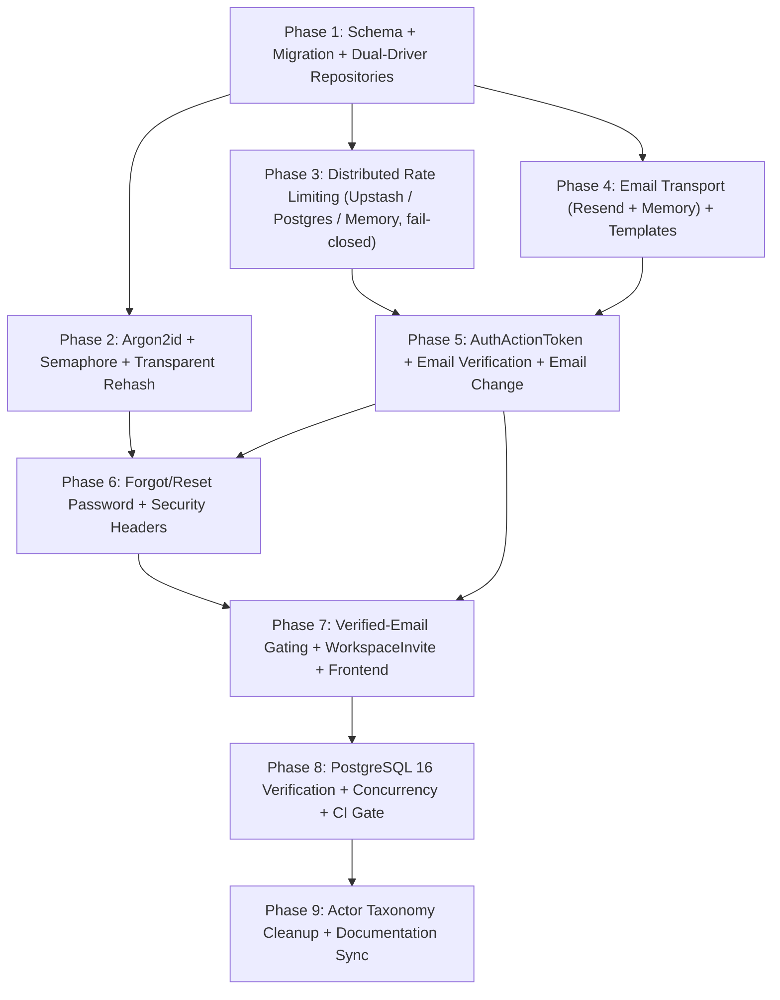

# Shotistry — Authentication Security Hardening Implementation Plan

- **Status:** `IMPLEMENTED & VERIFIED` (All 9 phases implemented; code and local PostgreSQL verified; live third-party cloud APIs gated by external credentials)
- **Reconciliation Date:** November 8, 2026
- **Branch:** `audit/production-readiness` · Working Tree: 43 modified files + 83 untracked files (all preserved in working tree) · HEAD `f7ce154a5cff8f5496f08bbb65a13b15b84bd4f0`
- **Design:** [auth-security-hardening-design.md](../architecture/auth-security-hardening-design.md) · ADRs [004](../architecture/architecture-decisions/ADR-004-argon2id-password-hashing-and-migration.md) · [005](../architecture/architecture-decisions/ADR-005-distributed-rate-limiting-and-fail-closed-policy.md) · [006](../architecture/architecture-decisions/ADR-006-transactional-email-adapter-and-action-tokens.md) · [007](../architecture/architecture-decisions/ADR-007-verified-email-gating-and-workspace-invites.md) · [008](../architecture/architecture-decisions/ADR-008-postgres-auth-repository-and-actor-taxonomy-cleanup.md)
- **Handoff:** [handoff-next-model.md](handoff-next-model.md)

> [!IMPORTANT]
> Methodology: Superpowers + `AGENTS.md`. **No production code without a failing test first** (RED → GREEN → REFACTOR).
> Current Status: All 9 phases implemented and verified. Unit/mocked test suite: **155 tests, 27 suites: 137 passing, 0 failing, 18 skipped**. PostgreSQL 16 CI Gate: **14/14 tests passing, 0 skipped**. Next.js production build: **40/40 routes compiled cleanly, 0 errors**.

---

## 1. Actual Verification State & Environment Summary (Reconciled 2026-11-08)

| Item | Actual Verified State |
|---|---|
| Node runtime | `v24.11.1` (native `crypto.argon2` active with `m=19456, t=2, p=1`, Semaphore concurrency limit = 4) |
| Test suite (`npm test`) | **155 tests across 27 describe suites in 24 test files: 137 PASSED, 0 FAILED, 18 SKIPPED** |
| Skipped tests (18) | **4 tests** in `tests/live-external-smoke.test.mjs` (BLOCKED on missing live API credentials: Gemini, Paymob, Upstash, Resend); **10 tests** in `tests/postgres-auth.test.mjs` and **4 tests** in `tests/postgres-ledger.test.mjs` (skipped during sandboxed `npm test` due to OS sandbox network socket restrictions). |
| PostgreSQL 16 CI Gate (`test:pg`) | **14/14 PASSED with 0 skips** executed with `POSTGRES_TEST_URL="postgresql://tasawk@localhost:5432/shotistry_audit_test?schema=public"` against `PostgreSQL 16.15 (Homebrew) on aarch64-apple-darwin25.6.0` on database `shotistry_audit_test`. |
| Production Build (`npm run build`) | **Compiled successfully in 3.0s: 40/40 routes static/dynamic, 0 errors**. |
| TypeScript check (`npx tsc --noEmit`) | **Clean (exit code 0, zero type errors)**. |
| Prisma validation (`npx prisma validate`) | **Valid (exit code 0, 21 models, 9 enums)**. |
| Documentation check (`scripts/check-docs.mjs`) | **Clean (exit code 0 across 62 markdown files)**. |
| Password hashing | Native Node 24 Argon2id (`$argon2id$v=19$m=19456,t=2,p=1$`) + async semaphore (`SHOTISTRY_MAX_CONCURRENT_HASHES=4`) + transparent legacy scrypt rehash on login. |
| Rate limiting algorithm | Distributed **Fixed Window Counter** with rolling reset / TTL on first increment. Backends: `UpstashRateLimitStore` (atomic Redis Lua via REST), `PostgresRateLimitStore` (`RateLimitBucket` row upsert lock), `MemoryRateLimitStore` (development/test only; throws in production). Fail-closed with 503 `RATE_LIMITER_UNAVAILABLE`. |
| DB driver architecture | Full dual-driver repository abstraction (`src/lib/db/repositories/*`), static architecture import guard passing. |
| Migrations | 3 complete migrations applied: `20261105000000_init`, `20261108000000_sessions_rbac`, `20261109000000_auth_security_hardening`. |

### Strip-Types Syntax Constraints (apply to every `src/**/*.ts` file)
`node --experimental-strip-types` only erases types. **Do not use** TypeScript `enum`, `namespace` with runtime code, constructor parameter properties (`constructor(private x)`), or `import x = require()`. Use `as const` objects + union types. Keep explicit `.ts` extensions in relative imports (existing convention).

---

## 2. Phase Dependency Graph



Phases 2, 3 and 4 may run in parallel after Phase 1. Phase 9 documentation edits for the taxonomy (§9.A) have no code dependency and may be done at any time.

---

## 3. Existing-Test Impact Matrix

| Test File:Line(s) | Current Behavior | Breaks In Phase | Required Change |
|---|---|---|---|
| `tests/auth-security.test.mjs:149` | asserts `hashA.startsWith('scrypt$')` | 2 | assert `$argon2id$v=19$m=19456,t=2,p=1$`; add legacy scrypt verify + rehash tests |
| `tests/auth-security.test.mjs:109` | stub `passwordHash: 'scrypt$stub$hash'` | 2 | keep (invalid hash must still verify `false`) |
| `tests/auth-security.test.mjs:165–175` | sync `consumeRateLimit(...)` | 3 | `await consumeRateLimit(...)` (memory store in tests) |
| `tests/auth-security.test.mjs:300` | sync `listActiveUserSessions(...)` | 1 | `await listActiveUserSessions(...)` |
| `tests/rbac-routes.test.mjs:41, 586` | `resetRateLimitsForTests()` | 3 | keep sync for memory store (must throw in production) |
| `tests/rbac-routes.test.mjs:234–250` | 12 bad logins, expects 429 for `i >= 10` | 3 | still passes with new IP+email limit 7; optionally tighten to `i >= 7` |
| `tests/rbac-routes.test.mjs:338` | `workspacesPost` right after registration | 7 | verify email first via test helper; add `403 EMAIL_VERIFICATION_REQUIRED` case |
| `tests/rbac-routes.test.mjs:402` | `membersPost` adds registered user instantly | 7 | expect `202 INVITED`; accept invite as invitee (verified) via MemoryEmailTransport token |
| `tests/rbac-routes.test.mjs:629` | `checkoutIntentPost` | 7 | verify owner email first (or assert 403 for the gating reason) |
| `tests/rbac-routes.test.mjs:766, 844, 885` | `membersPost` (add/promote/demote) | 7 | first add via invite+accept; later calls on existing members stay synchronous `200 UPDATED` |
| `tests/rbac-routes.test.mjs:857, 871` | admin/owner checkout | 7 | verify emails first; 857 stays `403` (role), 871 `200`/`201` |
| `tests/rbac-routes.test.mjs:1133` | `sandboxSimulateWebhook:true` in production → 403 | 7 | verify email first so 403 is proven to come from the sandbox rule, not gating |
| `tests/e2e-workflow.test.mjs:142` | `postCheckoutIntent` after register | 7 | verify email via helper first |
| `tests/paymob-webhook.test.mjs:313–328` | `checkoutIntentPost` | 7 | verify email via helper first |
| `tests/postgres-ledger.test.mjs:49–56` | migration skip on `Session` exists | 8 | ordered, `_prisma_migrations`-aware migration runner on isolated test DB |

**Test helper to add (Phase 5):** `tests/helpers/verify-email.mjs` exporting `markEmailVerifiedForTests(userId)` that goes through the real repository (`AuthRepository.markEmailVerified`) — never a route bypass. Prefer the real flow (resend → MemoryEmailTransport → confirm) in at least one end-to-end test.

---

## 4. Phase 1 — Schema, Migration & Dual-Driver Repository Parity

- **Execution Status:** `IMPLEMENTED & VERIFIED`
- **Verification Evidence:** `tests/repositories.test.mjs` (4/4 passing), static architecture import guard passing (zero direct `getDb` calls in app routes), `tests/postgres-auth.test.mjs` (10/10 passing on PG 16).
- **Artifacts:** `src/lib/db/driver.ts`, `src/lib/db/repositories/*.ts`, `prisma/migrations/20261109000000_auth_security_hardening/migration.sql`.

### 1. Objective
Add the three new tables and move every SQLite-coupled auth/app query behind async, driver-resolved repositories so `SHOTISTRY_DB_DRIVER=postgres` works end-to-end. No behavior change for users.

### 2. Exact Files to Create/Modify
- **Modify:** `prisma/schema.prisma`, `src/lib/db/prisma.ts` (SQLite DDL + `resolveDbDriver()` export), `src/lib/auth/session.ts`, `src/lib/auth/admin-bootstrap.ts`, `scripts/bootstrap-admin.mjs`, and routes `src/app/api/auth/{login,password,sessions}/route.ts`, `src/app/api/workspaces/[id]/members/route.ts`, `src/app/api/workspace/session/route.ts`, `src/app/api/photoshoots/generate/route.ts`, `src/app/api/jobs/[id]/route.ts`, `src/app/api/billing/checkout-intent/route.ts`, `src/app/api/webhooks/paymob/route.ts`, `src/app/api/admin/metrics/route.ts`, `src/app/api/admin/credits/adjust/route.ts`; tests `tests/auth-security.test.mjs:300`.
- **Create:** `prisma/migrations/20261109000000_auth_security_hardening/migration.sql`; `src/lib/db/driver.ts`; `src/lib/db/repositories/{auth,workspace,photoshoot,billing,webhook,admin}-repository.ts` (each exporting an interface + `Sqlite*` + `Postgres*` implementation + `get*Repository()` factory); `tests/repositories.test.mjs`.

### 3. Exact Behavioral & Interface Changes
- `resolveDbDriver(): 'postgres' | 'sqlite'` — `'postgres'` iff `SHOTISTRY_DB_DRIVER === 'postgres'` (same rule `CreditLedgerService` uses today; reuse it there).
- All exported functions in `session.ts` return `Promise`s; **`listActiveUserSessions` becomes `async`**.
- `AuthRepository`: `findUserByEmail`, `findUserById`, `createSession`, `findSessionByTokenHash`, `touchSession`, `revokeSession(s)`, `listActiveSessions`, `setActiveWorkspace`, `getWorkspacesForUser`, `updatePasswordHash(userId, hash, { bumpPasswordUpdatedAt, revokeOtherSessionsExcept? })`, `markEmailVerified`, `countAdmins`, `createPrivilegedUser`, `insertAuditLog`.
- `WebhookRepository` uses booleans in PG and `ON CONFLICT DO NOTHING` (replace `INSERT OR IGNORE`, `processed = 1`, `cancelAtPeriodEnd = 1`).
- `admin/metrics` response `infrastructure.database` = `'POSTGRESQL'` or `'SQLITE'` (replace hard-coded `'OPERATIONAL_ACID_SQL'`); field `rateLimiter` added in Phase 3.
- `scripts/bootstrap-admin.mjs` honors `SHOTISTRY_DB_DRIVER=postgres`.
- After this phase, `grep -rn "getDb\|withSerializableTransaction" src/app src/lib/auth` returns nothing.

### 4. Schema & Migration Changes
```prisma
enum AuthActionTokenType { EMAIL_VERIFY PASSWORD_RESET EMAIL_CHANGE }

model AuthActionToken {
  id          String              @id @default(uuid())
  userId      String
  type        AuthActionTokenType
  tokenHash   String              @unique
  targetEmail String?
  expiresAt   DateTime
  consumedAt  DateTime?
  revokedAt   DateTime?
  createdIp   String?
  createdAt   DateTime            @default(now())
  user        User                @relation(fields: [userId], references: [id], onDelete: Cascade)
  @@index([userId, type])
  @@index([expiresAt])
}

model RateLimitBucket {
  key         String   @id
  count       Int
  windowStart DateTime
  expiresAt   DateTime
  updatedAt   DateTime
  @@index([expiresAt])
}

model WorkspaceInvite {
  id               String        @id @default(uuid())
  workspaceId      String
  invitedEmail     String
  role             WorkspaceRole
  invitedByUserId  String
  tokenHash        String        @unique
  expiresAt        DateTime
  acceptedAt       DateTime?
  acceptedByUserId String?
  revokedAt        DateTime?
  createdAt        DateTime      @default(now())
  workspace        Workspace     @relation(fields: [workspaceId], references: [id], onDelete: Cascade)
  invitedBy        User          @relation("InviteSender", fields: [invitedByUserId], references: [id], onDelete: Cascade)
  acceptedBy       User?         @relation("InviteAccepter", fields: [acceptedByUserId], references: [id], onDelete: SetNull)
  @@index([workspaceId, invitedEmail])
  @@index([expiresAt])
}
```
Add back-relations on `User` (`actionTokens`, `sentInvites @relation("InviteSender")`, `acceptedInvites @relation("InviteAccepter")`) and `Workspace` (`invites`). Mirror in SQLite DDL (`TEXT` timestamps, `CREATE TABLE IF NOT EXISTS`). Generate SQL with `npx prisma migrate diff --from-migrations prisma/migrations --to-schema-datamodel prisma/schema.prisma --script` (requires a shadow DB URL) or hand-write it consistent with `20261108000000_sessions_rbac` style; never edit the two existing migrations.

### 5. Dependencies & Prerequisites
None (first phase). Full suite green before starting.

### 6. Tests to Write First (TDD)
- `tests/auth-security.test.mjs`: schema parity test asserting SQLite has `AuthActionToken`, `RateLimitBucket`, `WorkspaceInvite` with expected columns (RED).
- `tests/repositories.test.mjs`: SQLite repository contract tests (create/find/revoke session, list active sessions is a Promise, webhook dedup idempotent, metrics driver label).
- A static test that reads route files and fails if they import `getDb`/`withSerializableTransaction` (guards regression).
- Update line 300 to `await`.

### 7. Test Commands
```bash
npm test
npx prisma validate
npx prisma generate
npx tsc --noEmit
```

### 8. Acceptance Criteria
All existing tests green; new contract tests green; `prisma validate` passes; no route or auth module imports SQLite helpers directly; bootstrap script works in both drivers (PG proven in Phase 8).

### 9. Security Risks & Mitigations
- Risk: refactor drops an authorization check → keep route-level guards unchanged; only replace data access; existing RBAC tests are the safety net.
- Risk: PG `P2002` leaks as 500 → map to `CONFLICT:` errors like the ledger does.

### 10. Rollback Considerations
Migration is additive (new tables only) — rollback = revert code; tables can remain. Down script for emergencies: `DROP TABLE "WorkspaceInvite", "RateLimitBucket", "AuthActionToken"; DROP TYPE "AuthActionTokenType";`.

### 11. Definition of Done
Green suite + `tsc` + `prisma validate`; grep check clean; `docs/architecture/database-design.md` updated with the three models.

---

## 5. Phase 2 — Argon2id Password Hashing, Semaphore & Transparent Migration

- **Execution Status:** `IMPLEMENTED & VERIFIED`
- **Verification Evidence:** `tests/password-hashing.test.mjs` (10/10 passing), transparent scrypt migration verified, concurrency semaphore bounded verify tested, benchmark script executable.
- **Artifacts:** `src/lib/auth/password.ts`, `src/lib/auth/hash-semaphore.ts`, `src/types/node-argon2.d.ts`, `scripts/benchmark-password-hashing.mjs`.

### 1. Objective
Replace scrypt with OWASP-compliant native Argon2id, bound concurrent hashing memory, and upgrade legacy hashes on login.

### 2. Exact Files to Create/Modify
- **Modify:** `src/lib/auth/password.ts`, `src/app/api/auth/login/route.ts`, `package.json` (`"engines": { "node": "24.x" }` only — no new deps), `tests/auth-security.test.mjs:140–160`.
- **Create:** `src/types/node-argon2.d.ts` (module augmentation for `node:crypto` `argon2`/`argon2Sync`), `src/lib/auth/hash-semaphore.ts`, `tests/password-hashing.test.mjs`, `scripts/benchmark-password-hashing.mjs`.

### 3. Exact Behavioral & Interface Changes
- `hashPassword(password): Promise<string>` → `$argon2id$v=19$m=19456,t=2,p=1$<salt>$<hash>` (base64 without padding, 16-byte salt, 32-byte tag).
- `verifyPassword(password, stored): Promise<boolean>` → supports bounded Argon2id + bounded legacy scrypt; `> 128` chars → `false` without hashing.
- New `needsPasswordRehash(stored): boolean`.
- New `PasswordHasherBusyError`; semaphore `MAX = Number(process.env.SHOTISTRY_MAX_CONCURRENT_HASHES ?? 4)`, acquire timeout 2500 ms.
- Login: on valid match and `needsPasswordRehash` → `AuthRepository.updatePasswordHash(userId, newHash, { bumpPasswordUpdatedAt: false })`; rehash failure is logged and **does not** fail the login.
- Routes that hash (`login`, `register`, `password`, later `reset-password`) map `PasswordHasherBusyError` → `503 { code: 'SERVICE_BUSY' }` + `Retry-After: 2`.

### 4. Schema & Migration Changes
None (`passwordHash` is `String?`, length-agnostic).

### 5. Dependencies & Prerequisites
Phase 1 (`AuthRepository.updatePasswordHash`). Node ≥ 24.7.

### 6. Tests to Write First (TDD)
- Format/params test; round-trip verify; wrong password `false`; tampered/garbage/oversized params (`m=4194304`) `false`; 129-char password `false`.
- Legacy `scrypt$16384$8$1$...` (generate in test with `crypto.scryptSync`) verifies `true` and `needsPasswordRehash` is `true`.
- Login integration: seeded scrypt user logs in → stored hash now `$argon2id$`, `passwordUpdatedAt` unchanged, other sessions still active.
- Semaphore: with MAX=1 and a held permit, a second acquire times out → `PasswordHasherBusyError`.
- Timing parity smoke: unknown-email login path calls Argon2id dummy verify (spy/counter, not wall-clock assertions).

### 7. Test Commands
```bash
npm test
node --experimental-strip-types scripts/benchmark-password-hashing.mjs --concurrency 1,4,8,16,25 --iterations 50
npx tsc --noEmit
```

### 8. Acceptance Criteria
All hashing tests green; benchmark p50/p95/p99 and RSS delta per concurrency level recorded in `docs/qa/test-results.md` with machine/Node version; with default semaphore, peak RSS delta at c=25 stays < 256 MiB.

### 9. Security Risks & Mitigations
- DoS via crafted stored params → strict bounds. DoS via long passwords → 128 cap. Timing enumeration → Argon2id dummy verify. Memory exhaustion → semaphore + 503.

### 10. Rollback Considerations
Argon2id hashes cannot be verified by the old code. Rollback requires keeping the new `verifyPassword` (read both formats) while reverting `hashPassword` to scrypt — never deploy code that cannot read `$argon2id$`.

### 11. Definition of Done
Green suite, benchmark recorded, ADR-004 status updated to `IMPLEMENTED`, `docs/security/authentication-authorization.md` hashing section updated.

---

## 6. Phase 3 — Distributed Rate Limiting (Fail-Closed)

- **Execution Status:** `IMPLEMENTED & VERIFIED` (Code & PostgreSQL Store); `PARTIALLY VERIFIED` (Live Upstash Cloud `BLOCKED` on missing credentials)
- **Verification Evidence:** `tests/rate-limit-distributed.test.mjs` (9/9 passing), Postgres store concurrency verified in `tests/postgres-auth.test.mjs` (test 8: 50 concurrent increments exact count and window), fail-closed 503 verified. Live Upstash network verification is blocked on external credentials (`UPSTASH_REDIS_REST_URL`/`TOKEN` skipped in `tests/live-external-smoke.test.mjs`).
- **Algorithm Invariant:** Implemented as an atomic **Fixed Window Counter with rolling expiration** (atomic Lua script with `INCR` + conditional `PEXPIRE` on Upstash Redis; single atomic `INSERT ... ON CONFLICT DO UPDATE` with row-level locking on PostgreSQL). Under boundary conditions, permits up to 2x the limit across window boundaries. Store switching resets in-flight counters across backends.
- **Artifacts:** `src/lib/security/rate-limit.ts`, `src/lib/security/rate-limit/*.ts`, `tests/rate-limit-distributed.test.mjs`.

### 1. Objective
Fleet-wide atomic rate limits with Upstash (primary) or PostgreSQL (fallback), memory only outside production, and `503` when the backend is unavailable in production.

### 2. Exact Files to Create/Modify
- **Modify:** `src/lib/security/rate-limit.ts` (becomes facade), `src/app/api/auth/{login,register,password}/route.ts`, `src/app/api/admin/{credits/adjust,metrics}/route.ts`, `src/app/api/photoshoots/generate/route.ts`, `src/app/api/billing/checkout-intent/route.ts`, `tests/auth-security.test.mjs:165–175`, `.env.example` (documented keys only, placeholders).
- **Create:** `src/lib/security/rate-limit/{types,upstash-store,postgres-store,memory-store,policies,client-ip}.ts`, `tests/rate-limit-distributed.test.mjs`.

### 3. Exact Behavioral & Interface Changes
- `consumeRateLimit(key, limit, windowMs): Promise<RateLimitDecision>`; new `enforceRateLimitPolicies(request, policyName, identities): Promise<Response | null>` returning a ready `429`/`503` response or `null`.
- `RATE_LIMIT_POLICIES` constant (`as const`) exactly matching design §4.4.
- Store selection per ADR-005; `SHOTISTRY_RATE_LIMIT_BACKEND` optional override (`upstash|postgres|memory`; `memory` rejected in production).
- Upstash: `POST ${URL}/eval` body `[LUA, 1, key, String(windowMs)]`, header `Authorization: Bearer ${TOKEN}`, `AbortSignal.timeout(1500)`; `fetch` injectable via `createUpstashRateLimitStore({ fetchImpl })`.
- Postgres: single upsert from design §4.2 via `prisma.$queryRaw` (no interactive transaction); probabilistic cleanup (1%, LIMIT 200).
- Keys: `shotistry:rl:v1:<policy>:<sha256hex.slice(0,24)>`; `getClientIp` per design §4.3 with IPv6 `/64`.
- `429` headers: `Retry-After`, `Cache-Control: no-store`; `503` body `{ success:false, code:'RATE_LIMITER_UNAVAILABLE' }` + `Retry-After: 5`.
- `admin/metrics` adds `infrastructure.rateLimiter: 'upstash' | 'postgres' | 'memory' | 'unavailable'`.

### 4. Schema & Migration Changes
Uses `RateLimitBucket` from Phase 1. No new migration.

### 5. Dependencies & Prerequisites
Phase 1.

### 6. Tests to Write First (TDD)
- Memory store sliding window (existing test, now awaited).
- Upstash store with fake `fetch`: correct URL/body/headers; `[count, pttl]` parsing; 5xx/timeout/throw → `RateLimitBackendUnavailableError`.
- Store selection matrix: production + nothing configured → 503 from a real route (`POST /api/auth/login`); production + placeholder Upstash → 503; production + `SHOTISTRY_RATE_LIMIT_BACKEND=memory` → 503; dev → memory.
- `resetRateLimitsForTests` throws under `NODE_ENV=production`.
- Keys contain no raw email (assert key does not include `@`).
- IP extraction: Vercel header preferred when `VERCEL=1`; spoofed `x-forwarded-for` ignored when Vercel header present; IPv6 `/64` grouping.
- Postgres store contract runs in Phase 8 (PG-only, 50 concurrent increments → exact count).

### 7. Test Commands
```bash
npm test
npx tsc --noEmit
```

### 8. Acceptance Criteria
All routes in the policy matrix enforce limits; no route calls the old sync API; production never falls back to memory; tests green.

### 9. Security Risks & Mitigations
- Fail-open → explicit 503 path tested. Lockout abuse of a victim's email → per-email bucket is higher (20/h) and returns the same generic 429. Redis token leakage → server-only env, never logged.

### 10. Rollback Considerations
Revert to previous facade; no data migration. If Upstash outages cause 503s, set Postgres fallback by removing Upstash env (documented in runbook).

### 11. Definition of Done
Green suite; `docs/operations/environment-setup.md` lists `UPSTASH_REDIS_REST_URL`, `UPSTASH_REDIS_REST_TOKEN`, `SHOTISTRY_RATE_LIMIT_BACKEND`, `SHOTISTRY_TRUSTED_PROXY_COUNT`; live Upstash smoke test written and gated (`BLOCKED` until credentials).

---

## 7. Phase 4 — Transactional Email Adapter

- **Execution Status:** `IMPLEMENTED & VERIFIED` (Code & Memory Transport); `PARTIALLY VERIFIED` (Live Resend Delivery `BLOCKED` on missing credentials and domain DNS)
- **Verification Evidence:** `tests/email-transport.test.mjs` (8/8 passing), bilingual template rendering with `#token=` fragments, HTML sanitization and memory transport verified. Live Resend delivery blocked on external credentials (`RESEND_API_KEY`/`LIVE_EMAIL_TO` skipped in `tests/live-external-smoke.test.mjs`).
- **Artifacts:** `src/lib/email/*.ts`, `tests/email-transport.test.mjs`.

### 1. Objective
A provider-agnostic `EmailTransport` with a Resend implementation and an in-memory test transport, plus bilingual templates.

### 2. Exact Files to Create/Modify
- **Create:** `src/lib/email/{types,resend-transport,memory-transport,index,templates}.ts`, `tests/email-transport.test.mjs`, gated live test case appended to `tests/live-external-smoke.test.mjs`.
- **Modify:** `.env.example` (placeholders `RESEND_API_KEY`, `EMAIL_FROM`, `EMAIL_REPLY_TO`, `APP_BASE_URL`).

### 3. Exact Behavioral & Interface Changes
- `EmailTransport.send({ to, subject, html, text, idempotencyKey, tags }) → Promise<{ provider, messageId }>`.
- `getEmailTransport()` → Resend in production; Memory only when explicitly injected via `setEmailTransportForTests()` (throws in production).
- Resend: `POST https://api.resend.com/emails`, `Authorization: Bearer`, `Idempotency-Key` (≤ 256 chars), 5 s timeout, `429` → `EmailRateLimitedError` with retry-after; placeholder/missing config → `EmailTransportUnavailableError`.
- Templates (ar/en, RTL `dir="rtl"` for ar): `verifyEmail`, `passwordReset`, `passwordChangedNotice`, `emailChangeConfirm`, `emailChangeNotice`, `workspaceInvite`. Links built from `APP_BASE_URL` with `#token=`. All user-provided strings HTML-escaped.
- Never log `html`, `text`, or URLs.

### 4. Schema & Migration Changes
None.

### 5. Dependencies & Prerequisites
Phase 1 (only for consistency of env handling). No package installs — native `fetch`.

### 6. Tests to Write First (TDD)
Fake-`fetch` Resend tests (URL, headers incl. `Idempotency-Key`, JSON body, error mapping); placeholder key → unavailable; memory transport records messages; templates escape `<script>` in names, include `dir="rtl"` for ar, and put the token only after `#`.

### 7. Test Commands
```bash
npm test
# Live (BLOCKED until credentials). Existing convention in tests/live-external-smoke.test.mjs:
# each test calls t.skip('BLOCKED (External Credential Required): ...') when its credential env var is absent.
RESEND_API_KEY=... EMAIL_FROM=... LIVE_EMAIL_TO=... node --experimental-strip-types --test tests/live-external-smoke.test.mjs
```

### 8. Acceptance Criteria
Unit tests green. Live delivery **not** claimed until the gated test passes against Resend with a verified domain.

### 9. Security Risks & Mitigations
Header/HTML injection → escaping and fixed headers; token leakage in logs → no body logging; provider outage → explicit errors, no fake success.

### 10. Rollback Considerations
Pure addition; remove module.

### 11. Definition of Done
Green suite; env docs updated; ADR-006 transport section marked implemented; live status `BLOCKED` recorded.

---

## 8. Phase 5 — AuthActionToken Service, Email Verification & Email Change

- **Execution Status:** `IMPLEMENTED & VERIFIED`
- **Verification Evidence:** `tests/email-verification.test.mjs` (8/8 passing), atomic single-use token consumption verified under concurrency in `tests/postgres-auth.test.mjs` (test 9: concurrent action token consumption -> exactly 1 winner).
- **Artifacts:** `src/lib/auth/action-tokens.ts`, `src/lib/db/repositories/action-token-repository.ts`, `src/app/api/auth/verify-email/*`, `src/app/api/auth/email/*`, `tests/helpers/verify-email.mjs`, `tests/email-verification.test.mjs`.

### 1. Objective
Single-use hashed tokens and the verify-email + change-email flows.

### 2. Exact Files to Create/Modify
- **Create:** `src/lib/auth/action-tokens.ts`, `src/lib/db/repositories/action-token-repository.ts`, routes `src/app/api/auth/verify-email/resend/route.ts`, `src/app/api/auth/verify-email/confirm/route.ts`, `src/app/api/auth/email/change-request/route.ts`, `src/app/api/auth/email/change-confirm/route.ts`, `tests/helpers/verify-email.mjs`, `tests/email-verification.test.mjs`.
- **Modify:** `src/app/api/auth/register/route.ts` (dispatch verification after commit; `verificationEmailSent`), `src/app/api/auth/session/route.ts` + `src/lib/auth/session.ts` (`emailVerified` on principal), `src/lib/types/index.ts`.

### 3. Exact Behavioral & Interface Changes
- `issueActionToken({ userId, type, targetEmail?, ttlMs, ip }) → { rawToken, tokenId, expiresAt }` (revokes prior unconsumed same-type tokens in the same transaction).
- `consumeActionToken({ rawToken, type, now }) → token | null` via single conditional `UPDATE ... RETURNING`.
- `POST /verify-email/resend` (auth + CSRF; 60 s min interval; already verified → `200 { alreadyVerified: true }`; transport unavailable → `503 EMAIL_SERVICE_UNAVAILABLE`).
- `POST /verify-email/confirm` `{ token }` (no session required; rate-limited; invalid/expired/replayed → `400 INVALID_OR_EXPIRED_TOKEN`; checks `targetEmail === user.email`).
- `POST /email/change-request` `{ newEmail, currentPassword }` (auth + CSRF + verified; uniform `202`).
- `POST /email/change-confirm` `{ token }` (auth for same user + CSRF; `409 EMAIL_UNAVAILABLE` on collision; revokes other sessions).
- All responses `Cache-Control: no-store`; raw tokens never in responses.

### 4. Schema & Migration Changes
Uses `AuthActionToken` (Phase 1).

### 5. Dependencies & Prerequisites
Phases 1, 3, 4.

### 6. Tests to Write First (TDD)
Token stored hashed (DB value ≠ raw, equals SHA-256); single use (second consume `null`); expiry; re-issue revokes earlier token; concurrent double-confirm → exactly one success (`Promise.all`); verify flow end-to-end via MemoryEmailTransport; changing email invalidates a pending verify token for the old address; email-change uniform response for taken/free addresses; collision on confirm → 409; other sessions revoked after change.

### 7. Test Commands
```bash
npm test
npx tsc --noEmit
```

### 8. Acceptance Criteria
Flows pass offline; `GET /api/auth/session` exposes `emailVerified`; registration still returns 201 when transport throws.

### 9. Security Risks & Mitigations
Token brute force → 256-bit tokens + rate limits; replay → conditional update; enumeration via change-request → uniform 202; link scanners → POST-only consumption.

### 10. Rollback Considerations
Routes are additive; disabling = removing routes. Tokens table can stay.

### 11. Definition of Done
Green suite; API spec updated with the 4 routes; Existing-Test helper available for Phase 7.

---

## 9. Phase 6 — Account Recovery & Token-Leakage Headers

- **Execution Status:** `IMPLEMENTED & VERIFIED`
- **Verification Evidence:** `tests/account-recovery.test.mjs` (8/8 passing), uniform 202 response with floor timing, privileged account exclusion with audit logging, session revocation, CLI password rotation, and `next.config.ts` headers verified. Production build cleanly passed (`npm run build`).
- **Artifacts:** `src/app/api/auth/forgot-password/route.ts`, `src/app/api/auth/reset-password/route.ts`, `next.config.ts`, `scripts/bootstrap-admin.mjs`, `tests/account-recovery.test.mjs`.

### 1. Objective
Forgot/reset password with anti-enumeration, full session revocation, privileged-role exclusion, and security headers.

### 2. Exact Files to Create/Modify
- **Create:** `src/app/api/auth/forgot-password/route.ts`, `src/app/api/auth/reset-password/route.ts`, `next.config.ts`, `tests/account-recovery.test.mjs`.
- **Modify:** `scripts/bootstrap-admin.mjs` (`--rotate-password` mode), `src/lib/auth/admin-bootstrap.ts` (`rotateAdminPasswordViaCli`, `rotateSupportOperatorPassword`), `src/app/api/auth/password/route.ts` (send `passwordChangedNotice`).

### 3. Exact Behavioral & Interface Changes
- `POST /forgot-password` `{ email }` → always `202` uniform body for valid syntax; only `role='USER'` accounts get a token (15 min); `ADMIN`/`SUPPORT` → no token + `AdminAuditLog` `PRIVILEGED_RESET_ATTEMPT`; minimum response floor (~50 ms, padded with a dummy token hash) so timing does not reveal existence.
- `POST /reset-password` `{ token, newPassword }` → validate strength; Argon2id hash; update hash + `passwordUpdatedAt`; revoke **all** sessions (`PASSWORD_RESET`) and other reset/change tokens; clear session cookie in response; send notice email; `200`.
- `next.config.ts` `headers()`: global `X-Content-Type-Options: nosniff`, `X-Frame-Options: DENY`, `Referrer-Policy: strict-origin-when-cross-origin`; `Referrer-Policy: no-referrer` + `Cache-Control: no-store` on `/verify-email`, `/reset-password`, `/account/confirm-email`, `/invites/accept`, `/api/auth/:path*`.

### 4. Schema & Migration Changes
None.

### 5. Dependencies & Prerequisites
Phases 2 (hashing), 3 (limits), 4, 5.

### 6. Tests to Write First (TDD)
Unknown vs known email → identical status/body/headers; ADMIN/SUPPORT → no email recorded + audit row; reset revokes all sessions (old cookie → 401 on `/api/auth/session`); token single-use; weak password → 400 and token **not** consumed (validate before consume); CLI rotation requires secret and revokes admin sessions; `next.config.ts` headers asserted by importing the config and inspecting `headers()` output.

### 7. Test Commands
```bash
npm test
npm run build
```

### 8. Acceptance Criteria
Recovery works offline end-to-end; build succeeds with new `next.config.ts`; no raw token in any response or log.

### 9. Security Risks & Mitigations
Enumeration → uniform response + timing floor; mailbox takeover of privileged accounts → excluded; session fixation after reset → full revocation.

### 10. Rollback Considerations
Remove routes; `next.config.ts` revert is safe (headers only).

### 11. Definition of Done
Green suite + build; `authentication-authorization.md` recovery section and threat model updated.

---

## 10. Phase 7 — Verified-Email Gating, Workspace Invites & Frontend

- **Execution Status:** `IMPLEMENTED & VERIFIED`
- **Verification Evidence:** `tests/verified-email-gating.test.mjs` (3/3 passing), `tests/workspace-invites.test.mjs` (3/3 passing), impacted test suites in `tests/rbac-routes.test.mjs` and `tests/e2e-workflow.test.mjs` passing. Frontend pages compile cleanly in `npm run build` (40/40 routes).
- **Artifacts:** `src/lib/auth/email-verification-guard.ts`, `src/lib/db/repositories/invite-repository.ts`, `src/app/api/workspaces/invites/*`, `src/app/verify-email/page.tsx`, `src/app/forgot-password/page.tsx`, `src/app/reset-password/page.tsx`, `src/app/invites/accept/page.tsx`, `src/app/account/confirm-email/page.tsx`.

### 1. Objective
Enforce ADR-007 and replace instant member addition with identity-bound invites; ship UI pages.

### 2. Exact Files to Create/Modify
- **Create:** `src/lib/auth/email-verification-guard.ts` (`requireVerifiedEmail(principal): Response | null`), `src/lib/db/repositories/invite-repository.ts`, `src/app/api/workspaces/invites/accept/route.ts`, `src/app/api/workspaces/[id]/invites/[inviteId]/route.ts`, pages `src/app/verify-email/page.tsx`, `src/app/forgot-password/page.tsx`, `src/app/reset-password/page.tsx`, `src/app/invites/accept/page.tsx`, `src/app/account/confirm-email/page.tsx`, `tests/verified-email-gating.test.mjs`, `tests/workspace-invites.test.mjs`.
- **Modify:** `src/app/api/billing/checkout-intent/route.ts`, `src/app/api/workspaces/route.ts`, `src/app/api/workspaces/[id]/members/route.ts`, `src/context/AppContext.tsx`, `src/app/{account,pricing,login}/page.tsx`, `src/components/Navbar.tsx`, `src/lib/i18n/translations.ts`, and all tests in the Existing-Test Impact Matrix rows for Phase 7.

### 3. Exact Behavioral & Interface Changes
- Gated routes return `403 { success:false, code:'EMAIL_VERIFICATION_REQUIRED', error }` (gate runs after auth + CSRF, before business logic).
- `/members` POST: existing member → `200 { status:'UPDATED', member }`; otherwise → `202 { status:'INVITED', invite }` (sanitized).
- `/invites/accept` POST `{ token }`: identity mismatch → `403 INVITE_IDENTITY_MISMATCH` (invite not consumed); success → `200 { workspace, role }` and session active workspace switched.
- Pages read `#token=` then `history.replaceState`, POST token; bilingual strings; `/login` gets "Forgot password?" link; `/account` shows verification status + resend + change email; `/pricing` disables checkout with a verify prompt when unverified.

### 4. Schema & Migration Changes
Uses `WorkspaceInvite` (Phase 1).

### 5. Dependencies & Prerequisites
Phases 5, 6.

### 6. Tests to Write First (TDD)
Each gated route 403 when unverified and success when verified; studio upload/generate still allowed unverified; Paymob webhook settles for an unverified owner's previously created intent; invite → accept happy path; wrong account → 403 and invite still usable by the right account; expired/revoked/replayed invite → 400; ADMIN cannot invite ADMIN or revoke ADMIN invite; `GET /members` never returns `tokenHash`. Then update the existing tests listed in §3.

### 7. Test Commands
```bash
npm test
npx tsc --noEmit
npm run build
```

### 8. Acceptance Criteria
All gating & invite tests green; all previously passing tests green after documented updates; UI builds; ar/en strings complete.

### 9. Security Risks & Mitigations
Consent bypass → invites; account confusion → identity binding; token in browser history → fragment + `replaceState`; payment loss → webhook never gated.

### 10. Rollback Considerations
Gating can be reverted per route; invite rows harmless. Do not revert invites while keeping gating off for members (consent hole returns).

### 11. Definition of Done
Green suite + build; `system-actors.md`, `use-case-specification.md`, `rbac-matrix.md`, `api-specification.md` updated for gating & invites.

---

## 11. Phase 8 — PostgreSQL 16 Verification & CI Gate

- **Execution Status:** `IMPLEMENTED & VERIFIED (Host PostgreSQL 16 Environment); SKIPPED IN SANDBOXED RUNS`
- **Verification Evidence:** `POSTGRES_TEST_URL="postgresql://tasawk@localhost:5432/shotistry_audit_test?schema=public" npm run test:pg` executed with sandbox bypass on `PostgreSQL 16.15 (Homebrew) on aarch64-apple-darwin25.6.0`: **14/14 tests pass, 0 skips, 0 failures** across `tests/postgres-auth.test.mjs` (10 tests) and `tests/postgres-ledger.test.mjs` (4 tests). Note: Inside standard sandboxed runs without socket access, tests safely skip with informative OS sandbox messaging unless `REQUIRE_POSTGRES_TESTS=1` forces hard failure.
- **Safety Protections:** `tests/helpers/pg-migrate.mjs` hardened with production environment rejection (`NODE_ENV === 'production'`), protected database name checks (`postgres`, `production`, `shotistry`), database name suffix verification (`_test`), and advisory lock `84729103`.
- **Artifacts:** `tests/helpers/pg-migrate.mjs`, `tests/postgres-auth.test.mjs`, `tests/postgres-ledger.test.mjs`.

### 1. Objective
Prove the whole auth layer on real PostgreSQL with concurrency, and make skips impossible in CI.

### 2. Exact Files to Create/Modify
- **Modify:** `tests/postgres-ledger.test.mjs` (migration runner), `package.json` (`"test:pg"` script).
- **Create:** `tests/helpers/pg-migrate.mjs`, `tests/postgres-auth.test.mjs`.

### 3. Exact Behavioral & Interface Changes
- `pg-migrate.mjs`: refuses to run unless the DB name ends with `_test`; `DROP SCHEMA public CASCADE; CREATE SCHEMA public;` then applies every `prisma/migrations/*/migration.sql` in lexical order (or runs `npx prisma migrate deploy` with `DATABASE_URL` = test URL) and records rows in `_prisma_migrations`.
- `"test:pg": "REQUIRE_POSTGRES_TESTS=1 SHOTISTRY_DB_DRIVER=postgres node --experimental-strip-types --test tests/postgres-*.test.mjs"`.

### 4. Schema & Migration Changes
None new — verifies all three migrations apply cleanly in order on PG 16.

### 5. Dependencies & Prerequisites
Phases 1–7. Host access to `localhost:5432` (sandbox blocks the socket — run with explicit user approval) or a CI Postgres 16 service.

### 6. Tests to Write First (TDD)
`postgres-auth.test.mjs` (each fails hard when `REQUIRE_POSTGRES_TESTS=1` and PG unreachable):
1. Migrations applied: `Session`, `AuthActionToken`, `RateLimitBucket`, `WorkspaceInvite`, `_prisma_migrations` (3 rows).
2. Session create / resolve / revoke / revoke-all.
3. 10 concurrent registrations with the same email → exactly 1 success.
4. Atomic workspace provisioning (user + workspace + OWNER + subscription + trial in one tx; injected failure leaves nothing).
5. Trial credit idempotency (`trial:grant:user:<id>` once under concurrency).
6. 20 concurrent logins for the same user → 20 distinct sessions, no deadlock; concurrent revoke-all leaves 0 active.
7. RBAC persistence (role change visible on next request).
8. 50 concurrent `PostgresRateLimitStore.consume` → exact counts, limit respected.
9. Concurrent token consumption → one winner.
10. Admin bootstrap via script in PG mode.

### 7. Test Commands
```bash
psql postgresql://tasawk@localhost:5432/postgres -c "SELECT version();"
POSTGRES_TEST_URL="postgresql://tasawk@localhost:5432/shotistry_audit_test?schema=public" npm run test:pg
npm test
```

### 8. Acceptance Criteria
All PG tests pass with zero skips; exact `SELECT version()` output and test output pasted into `docs/qa/test-results.md`. **SQLite results are never cited as PG verification.**

### 9. Security Risks & Mitigations
Accidental wipe of a real DB → `_test` name guard; credentials in logs → print DB name only.

### 10. Rollback Considerations
Test-only changes.

### 11. Definition of Done
PG suite green with recorded version/output; CI doc describes the Postgres 16 service and `REQUIRE_POSTGRES_TESTS=1`.

---

## 12. Phase 9 — Actor Taxonomy Cleanup & Documentation Sync

- **Execution Status:** `IMPLEMENTED & VERIFIED`
- **Verification Evidence:** `node scripts/check-docs.mjs` passes cleanly across 61 markdown files. Standardized `CLI_OPERATOR`, introduced Signed-Capability Bearer category, classified `SYS_*` as internal subsystems, synchronized architecture, security, and operations documentation.
- **Artifacts:** `docs/product/system-actors.md`, `docs/security/rbac-matrix.md`, `docs/product/use-case-specification.md`, ADRs 004–008, `project-status.md`, `CHANGELOG.md`.

### 1. Objective
Correct actor classification and align every affected doc with what is actually implemented.

### 2. Exact Files to Create/Modify
**A (taxonomy):** `docs/product/system-actors.md` (lines 36, 56, 65, 66, 86, 235, 237, 263–268), `docs/product/use-case-specification.md` (lines 30, 60, 138, 236, 271), `docs/security/rbac-matrix.md` (lines 47, 129).
**B (sync):** `docs/security/{authentication-authorization,security-checklist,threat-model}.md`, `docs/architecture/{database-design,api-specification,system-architecture}.md`, `docs/operations/{environment-setup,deployment-guide}.md`, `docs/qa/{release-checklist,release-criteria,test-results}.md`, `docs/audit/production-readiness-audit.md`, `project-status.md`, `CHANGELOG.md`.

### 3. Exact Behavioral & Interface Changes
- `CLI_OPERATOR` standardized everywhere (node IDs and prose).
- New subgraph "Signed-Capability Bearer (Client Capability Proof)" containing `EXT_SIGNED_ASSET_BEARER`; external systems subgraph contains only Gemini, Paymob, Resend (email), object storage, Upstash.
- `SYS_*` (incl. new `SYS_RATE_LIMITER`, `SYS_EMAIL_DISPATCHER`, `SYS_ACTION_TOKEN_SERVICE`) only inside the Shotistry boundary and in sequence diagrams; remove them from "actor" catalog headings (rename §4.5 to "Internal Enforcement Subsystems (not actors)").
- Mark each capability implemented / blocked honestly.

### 4. Schema & Migration Changes
None.

### 5. Dependencies & Prerequisites
Part A: none. Part B: after Phases 1–8.

### 6. Tests to Write First (TDD)
Doc lint script (optional) `scripts/check-docs.mjs`: fails if legacy operator abbreviations appear in `docs/`, or if any Mermaid block fails to parse (if a Mermaid CLI is available; otherwise manual render check).

### 7. Test Commands
```bash
grep -rn "CLI_OPERATOR" docs/ && echo "OK"
npm test
```

### 8. Acceptance Criteria
All references use `CLI_OPERATOR`; diagrams render; status claims match tests and live verification results.

### 9. Security Risks & Mitigations
Overclaiming → every "implemented" claim links to a test; blocked items listed with missing credentials.

### 10. Rollback Considerations
Docs only.

### 11. Definition of Done
Docs consistent; `project-status.md` updated with actual test counts.

---

## 13. Production Readiness & Rollout Specifications

### 13.1 Environment Matrix

| Variable | Required In Prod | Rule |
|---|---|---|
| `SHOTISTRY_DB_DRIVER` | yes | `postgres` |
| `DATABASE_URL` | yes | pooled URL with `?pgbouncer=true` if using PgBouncer; direct URL for migrations (`DIRECT_URL` if adopted) |
| `UPSTASH_REDIS_REST_URL` / `UPSTASH_REDIS_REST_TOKEN` | recommended | `https://` URL; non-placeholder token. If absent, Postgres store is used |
| `SHOTISTRY_RATE_LIMIT_BACKEND` | optional | `upstash` \| `postgres` (never `memory` in prod) |
| `SHOTISTRY_TRUSTED_PROXY_COUNT` | optional | default `1` |
| `SHOTISTRY_MAX_CONCURRENT_HASHES` | optional | default `4` |
| `RESEND_API_KEY` / `EMAIL_FROM` / `EMAIL_REPLY_TO` | yes / yes / optional | verified domain sender |
| `APP_BASE_URL` | yes | `https://` origin used in email links |
| `SHOTISTRY_ADMIN_BOOTSTRAP_SECRET` | yes (bootstrap/rotation only) | ≥ 24 chars random; remove after use |
| `ASSET_SIGNING_SECRET` | yes | ≥ 32 random bytes |
| `GEMINI_API_KEY`, `PAYMOB_*` | yes | existing |

### 13.2 DNS
Resend domain (e.g. `mail.shotistry.com`): SPF TXT, DKIM records as shown in Resend dashboard, DMARC `v=DMARC1; p=quarantine; rua=mailto:dmarc@shotistry.com`. Verify in Resend before enabling gating in production.

### 13.3 Rollout Order
1. Staging: deploy Phases 1–8 with Postgres + Upstash + Resend; run `npm run test:pg` against staging-like DB and live smoke tests.
2. Back up production DB (`pg_dump`), run `prisma migrate deploy` (additive migration).
3. Deploy code. Verify `/api/admin/metrics` reports `database: POSTGRESQL` and `rateLimiter: upstash|postgres`.
4. Post-deploy smoke: register → verify email received → login → forgot/reset → invite/accept → checkout intent (sandbox) → limiter 429 → logout.

### 13.4 Monitoring & Alerting
Alert on: rate of `503 RATE_LIMITER_UNAVAILABLE`, `EMAIL_DISPATCH_FAILED`, `SERVICE_BUSY`, `PRIVILEGED_RESET_ATTEMPT` audit rows, spikes in 429s on login, Resend 4xx/5xx.

### 13.5 Rollback
Code rollback must keep Argon2id verification (see Phase 2 §10). Migration is additive; do not drop new tables during an incident. Rate-limiter outage → switch backend by env, never to memory.

### 13.6 Release Gate
All suites green including `npm run test:pg` with zero skips; live Resend + Upstash smoke tests passed; DNS verified; `project-status.md` updated with evidence.
