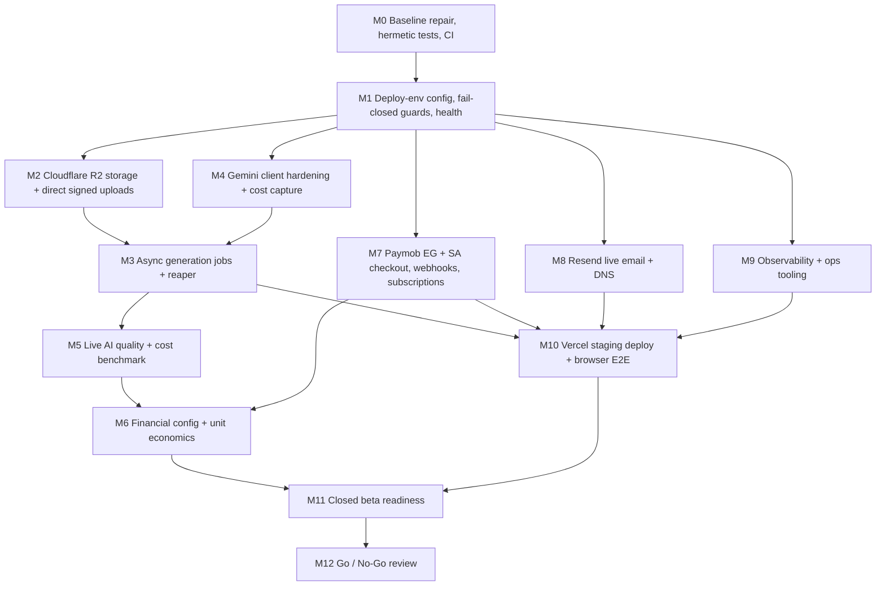

# Phase 10 Implementation Plan — Staging Deployment, Live Integration & Closed Beta Validation

> **For agentic workers:** Execute with the Superpowers workflow defined in `AGENTS.md` (brainstorm → plan → strict RED → GREEN → REFACTOR → verification before completion). Use checkbox (`- [ ]`) tracking per milestone. **Do not start implementation until the founder explicitly authorizes it after the model switch.**

| Field | Value |
|---|---|
| Plan status | **DRAFT — AWAITING FOUNDER APPROVAL** (planning phase only) |
| Prepared | 2026-11-09 |
| Branch | `audit/production-readiness` |
| HEAD at planning time | `24d9835135c5775e0187189e148ca344525c813b` (`feat(auth): complete Shotistry security hardening and SaaS foundation`) |
| Working tree at planning time | 1 modified tracked file: `package-lock.json` (+4/−4, pre-existing, not made by this plan). No untracked files apart from ignored `.env`, `.next/`, `node_modules/`. |
| Scope target | Production-like **STAGING** + controlled **CLOSED BETA**. **No public production launch.** |

### Evidence labels used in this document

- **VERIFIED** — confirmed during this planning session by reading code or executing a command (exact command given).
- **NOT VERIFIED** — claimed in docs or plausible, but not confirmed in this session.
- **ASSUMPTION** — planning assumption that must be confirmed during implementation.
- **BLOCKED** — cannot be verified without an external account, credential, DNS access, legal approval, or spending authorization.

---

## 1. Baseline Evidence (Planning Session)

| # | Check | Command | Result | Label |
|---|---|---|---|---|
| B1 | Branch / HEAD | `git branch --show-current; git rev-parse HEAD` | `audit/production-readiness` @ `24d9835` | VERIFIED |
| B2 | Working tree | `git status --short` | ` M package-lock.json` only | VERIFIED |
| B3 | Lockfile drift | `git show HEAD:package.json` vs `git show HEAD:package-lock.json` | HEAD `package.json` declares `"sharp": "^0.35.5"` and `engines.node: 24.x`, but the **HEAD lockfile does not list `sharp` as a root dependency nor the engines field**. The uncommitted working-tree lockfile fixes this. ⇒ **`npm ci` from the committed HEAD is expected to fail** (lock/package mismatch). | VERIFIED (mismatch) / NOT VERIFIED (`npm ci` not executed — would rewrite `node_modules`) |
| B4 | Node version | `node -v` | `v24.14.1` | VERIFIED |
| B5 | TypeScript | `npx tsc --noEmit` | exit 0 | VERIFIED |
| B6 | Unit/integration tests (as-is) | `npm test` | **155 tests: 104 pass, 33 FAIL, 18 skipped** (exit 1) | VERIFIED |
| B7 | Unit/integration tests with local `.env` values neutralized | all `.env` keys overridden to blank in the shell, `NODE_ENV=test`, then `npm test` | **136 pass, 1 fail, 18 skipped**; the single failure (`e2e-workflow` expects `SUCCEEDED_SANDBOX`) is an artifact of blanking `PAYMOB_HMAC_SECRET` in that experiment | VERIFIED |
| B8 | Root cause of B6 | — | The test suite is **not hermetic**: values from the git-ignored local `.env` (e.g. `SHOTISTRY_RATE_LIMIT_BACKEND="upstash"` with placeholder URL, `SHOTISTRY_TRUSTED_PROXY_COUNT="1"`) leak into tests. No explicit `dotenv`/`loadEnvFile` exists in `src/`, `tests/`, `scripts/`; the loader is most likely Prisma Client's automatic `.env` loading. | VERIFIED (symptom) / ASSUMPTION (exact loader) |
| B9 | Historical claim "137 pass / 0 fail" | `docs/implementation/handoff-next-model.md`, `project-status.md` | Only reproducible when no `.env` is present (macOS sandbox). Not reproducible on this Windows workstation as-is. | VERIFIED (discrepancy) |
| B10 | PostgreSQL gate | `npm run test:pg` | Not executed. Script uses POSIX inline env syntax (`REQUIRE_POSTGRES_TESTS=1 …`) which **does not work in PowerShell/cmd**; works on Linux CI. | VERIFIED (script syntax) / NOT VERIFIED (execution) |
| B11 | Lint | `npm run lint` (`next lint`) | Not executed. No `eslint`/`eslint-config-next` dev dependency and no ESLint config file in repo ⇒ expected to prompt/fail. | VERIFIED (missing config) / NOT VERIFIED (execution) |
| B12 | Production build | `npm run build` | Not re-executed in this session (historical claim: 40/40 routes). | NOT VERIFIED |
| B13 | CI | `Test-Path .github` | **No `.github/` directory — no CI workflows exist.** | VERIFIED |
| B14 | `@google/genai` SDK | `node_modules/@google/genai/package.json`, `dist/node/node.d.ts` | v2.32.0; declares `Interactions` client. Context7 docs confirm `ImageResponseFormat { type:'image', aspect_ratio, image_size:'512'|'1K'|'2K'|'4K', mime_type, delivery }`. | VERIFIED (types) / BLOCKED (live API, model ID availability) |
| B15 | Secrets hygiene | `git ls-files .env`, `.gitignore` | `.env` untracked and ignored; `.data/` ignored. | VERIFIED |

---

## 2. Discrepancy Register (Implemented vs Documented)

| Area | Documentation claims | Actual repository state | Classification | Label |
|---|---|---|---|---|
| Handoff working-tree warning | "DIRTY / UNCOMMITTED, 43 modified + 83 untracked, HEAD `f7ce154`" | Work was committed as `24d9835`; tree is clean except lockfile. | Stale doc | VERIFIED |
| Test results | "137 passed, 0 failed" | 33 failures when a local `.env` exists (B6–B8). | Partial (non-hermetic suite) | VERIFIED |
| **Cloudflare R2 storage** | "PARTIALLY VERIFIED — remote R2 bucket untested, blocked on credentials" | **No R2/S3 code exists at all.** `src/lib/storage/asset-storage.ts` writes to `process.cwd()/.data/assets` on local disk. No S3 SDK dependency. `.env.example` uses `STORAGE_*` names while handoff uses `R2_*` names — neither is read by code. | **Not implemented** (planned only) | VERIFIED |
| Product upload path | Signed upload capability | Studio sends the full image as base64 JSON in `POST /api/photoshoots/generate` (`rawImageBase64`, up to 20 MB). `/api/assets/upload` exists but the studio does not use it. On Vercel, request bodies above ~4.5 MB will be rejected. | Partial / staging-incompatible | VERIFIED (code) / ASSUMPTION (Vercel limit value — confirm in M1) |
| Generated image persistence | Stored assets with signed URLs | Generated image is persisted as a **`data:` URL string inside `GeneratedImage.imageUrl`** (Postgres `TEXT`), and returned inline in JSON. 2K/4K PNGs will bloat DB rows and responses. | Partial / not production-viable | VERIFIED |
| **Background generation jobs** | ADR-003: async pipeline via QStash/internal worker | Generation runs **synchronously inside the HTTP request** (`src/app/api/photoshoots/generate/route.ts`). No queue, no worker, no `maxDuration`, no stuck-job reaper, no timeout, no retry. A function timeout mid-generation leaves a `PENDING` reservation that is never released. | Not implemented | VERIFIED |
| Gemini live integration | "Mock tested; live smoke skipped" | Real `@google/genai` Interactions call exists. However: (a) **silent fallback** to `LOCAL_COMPOSITE_SANDBOX` whenever `GEMINI_API_KEY` is missing — including in production; (b) no timeout/abort, no retry/backoff, no 429 handling; (c) `synthIdDetected: true` is asserted, not detected; (d) a binary mask is sent as a second input image (effect on quality/cost unvalidated); (e) usage metadata is returned but **not persisted** for cost accounting. | Partial | VERIFIED (code) / BLOCKED (live) |
| **Paymob checkout** | "Live checkout blocked on `PAYMOB_SECRET_KEY`" | **No Paymob API client exists.** `checkout-intent` only inserts a local `PENDING` `PaymentTransaction` with a locally generated `ord-…` id; no Intention/Unified Checkout call, no redirect, no client secret. The only "success" path is the non-production `sandboxSimulateWebhook` self-signed simulation. | **Not implemented** | VERIFIED |
| **Paymob subscriptions / recurring** | Subscription lifecycle documented | No subscription plan creation, no card tokenization, no renewal scheduling. Webhook handler accepts subscription events but trusts `subscription_data.workspace_id` and `plan_tier` from the payload. Subscription HMAC covers only `trigger_type + "for" + id`. | Not implemented (handler skeleton only) | VERIFIED |
| Paymob webhook credit trust | "Fail-closed, idempotent" | HMAC/idempotency implemented, but credits are derived from **unsigned payload fields** (`credits`, `plan_tier`, `workspace_id` are not part of the transaction HMAC field list), then by **price matching with `Math.round`**, with a **fallback grant of 50 credits** for unknown amounts. No check that `amount_cents`/`currency` equal the server-side pending intent. Refunds/voids do not reverse credits. Single global `PAYMOB_HMAC_SECRET` although EG and SA are separate merchant accounts. | Partial — **critical integrity defect** | VERIFIED |
| Sandbox simulation gating | "Disabled in production" | Gated on `NODE_ENV !== 'production'`. Pricing page sends `sandboxSimulateWebhook: true` whenever its build has `NODE_ENV !== 'production'`. Any non-production deployment lets any verified owner self-grant credits. | Partial — must use explicit deploy-env flag | VERIFIED |
| Resend email | "Memory transport tested; live delivery blocked" | Real `fetch('https://api.resend.com/emails')` transport exists; production fails closed when unconfigured. Failures are `console.error`-logged with raw error objects. | Implemented, live BLOCKED | VERIFIED (code) / BLOCKED (live) |
| PostgreSQL | "PG 16 verified 14/14" | Prisma schema targets PostgreSQL; 3 migrations present. No `directUrl` in `datasource` (needed for pooled managed Postgres + `migrate deploy`). Historical PG run was on macOS Homebrew; not re-run here. | Implemented, staging NOT VERIFIED | VERIFIED (schema) / NOT VERIFIED (run) |
| Rate limiting | Upstash + Postgres, fail-closed | Code present; Postgres store tested historically. Live Upstash BLOCKED. | Implemented | NOT VERIFIED (this session) |
| Observability | `docs/operations/monitoring-guide.md` | Only ad-hoc `console.error` calls in 7 routes. No structured logger, no redaction, no request IDs, no error monitoring, no alerting, no health endpoint. | Not implemented | VERIFIED |
| CI/CD | Release checklist | No GitHub Actions; no `vercel.json`. | Not implemented | VERIFIED |
| Brands / products UX | Journeys list "Create brand" | No `/api/brands` or product CRUD routes; studio takes free-text brand fields. | Not implemented | VERIFIED |
| Unit economics | "EG/SA margins verified" | Pricing catalog in `src/lib/pricing/model-costs.ts` is hard-coded (FX 50 EGP/USD, Paymob fee formulas, token counts). Not re-validated against current official pricing or real usage metadata. | Partial | NOT VERIFIED |

---

## 3. Critical Findings That Gate Staging

1. **C1 — No real object storage** (Vercel filesystem is ephemeral/read-only outside `/tmp`) ⇒ uploads and outputs would be lost. Blocks staging.
2. **C2 — Upload transport incompatible with Vercel body limits** (base64 JSON up to 20 MB). Blocks staging on real phone photos.
3. **C3 — Synchronous generation with no timeout/reaper** ⇒ stuck reservations and lost credits on function timeouts (Pro 4K is the most exposed). Blocks beta.
4. **C4 — Paymob checkout not implemented** ⇒ no real (sandbox) payment can happen. Blocks payment validation.
5. **C5 — Webhook credit grant trusts unsigned fields and has a 50-credit fallback; no amount/currency reconciliation; no refund reversal** ⇒ ledger integrity risk. Blocks any payment processing.
6. **C6 — Silent mock fallback for Gemini in production-like envs** ⇒ customers could be charged credits for a local composite. Blocks beta.
7. **C7 — Non-hermetic test suite and lockfile drift** ⇒ CI cannot be trusted yet. Blocks every other milestone's verification.
8. **C8 — Unit economics risk (ASSUMPTION-based arithmetic using the repo's own catalog and FX=50):** Egypt AGENCY worst-case gross margin ≈ **3.6%**, Egypt `pack_500` top-up ≈ **−21% (loss)** at full utilization of Flash 1K/Pro 1K. Must be re-validated with live costs before beta pricing is offered (see §8).

---

## 4. Milestone Overview & Dependencies



| Milestone | Local work possible without credentials | Live part BLOCKED on |
|---|---|---|
| M0 | 100% | GitHub repo admin to enable Actions/branch protection (for enforcement only) |
| M1 | 100% | — |
| M2 | ~85% (adapter, flows, tests vs fake S3 / optional MinIO) | Cloudflare account, R2 bucket, API token, CORS |
| M3 | 100% | Live run requires M2 + M4 live |
| M4 | ~80% | `GEMINI_API_KEY` on paid tier with billing |
| M5 | Dataset spec, scripts, rubric | Gemini key + budget + real product photos |
| M6 | Config, formulas, tests, scenario tables | Live usage metadata from M5; current FX; Paymob contracted fees |
| M7 | ~60% (client, webhook hardening, contract tests from docs) | Paymob EG sandbox merchant + Paymob KSA sandbox merchant (separately) |
| M8 | ~70% | Resend account, sending domain DNS |
| M9 | ~80% | Error-monitoring account (if approved), alert destinations |
| M10 | E2E specs runnable locally | Vercel project, Neon/Postgres, all of the above |
| M11 | Feedback, gating, metrics, docs | Real merchants, legal pages approval |
| M12 | — | All evidence above |

---

## 5. Milestones in Detail

Conventions for every milestone:
- Each task: write failing test → run and confirm the expected failure message → minimal implementation → re-run → refactor → run full gate (`npm run verify`, introduced in M0).
- Server/lib imports used by `node --test` keep explicit `.ts` extensions; client components keep extensionless imports (existing project convention).
- SQLite (`node:sqlite`, local/dev) and PostgreSQL parity must be preserved for every schema change.
- Every new migration is additive and backwards compatible (expand → migrate → contract) so a staging rollback to the previous deployment remains possible.

### M0 — Reproducible Baseline & CI (no credentials)

**Goal:** a deterministic, cross-platform, CI-enforced gate.

Files:
- Modify: `package.json` (scripts only: `test`, `test:pg`, new `verify`, `lint`, `typecheck`), `package-lock.json` (commit the pending sync — **requires approval**, see §11)
- Create: `tests/.env.test` (safe, non-secret values), `tests/helpers/env-guard.mjs` (asserts no real secrets/hosts in test env)
- Create: `scripts/run-pg-tests.mjs` (cross-platform runner setting `REQUIRE_POSTGRES_TESTS=1`, `SHOTISTRY_DB_DRIVER=postgres`)
- Create: `eslint.config.mjs`; add dev deps `eslint`, `eslint-config-next` (**dependency change — approval**)
- Create: `.github/workflows/ci.yml` (jobs: `install` → `typecheck` → `lint` → `unit` → `postgres` (service `postgres:16`) → `build` → `security`)
- Create: `.github/dependabot.yml` (optional)
- Update: `docs/qa/test-results.md` with real outputs

TDD / acceptance:
- RED: add `tests/test-env-hermetic.test.mjs` asserting `process.env.SHOTISTRY_RATE_LIMIT_BACKEND` and `SHOTISTRY_TRUSTED_PROXY_COUNT` equal the values from `tests/.env.test`, not `.env`. Fails today with local `.env` present.
- GREEN: `test` script becomes `node --env-file=tests/.env.test --experimental-strip-types --test tests/*.test.mjs` (Node `--env-file` loads before Prisma; Prisma's loader does not override existing vars — ASSUMPTION to confirm by the RED test turning GREEN).
- PG gate: `postgres-*.test.mjs` must **fail (not skip)** when `REQUIRE_POSTGRES_TESTS=1` and DB is unreachable — add an explicit test for that behaviour.
- Acceptance: on this Windows machine **with** the local `.env` present, `npm test` → 0 failures; CI green on Ubuntu with Node 24; `npm ci` succeeds from committed lockfile; `npm run build` exit 0; `npm audit --omit=dev --audit-level=high` reviewed (findings documented, not silently ignored); secret scan (e.g. gitleaks action) passes.

Commands:
```bash
npm ci
npx prisma validate && npx prisma generate
npm run typecheck && npm run lint
npm test
POSTGRES_TEST_URL=postgresql://…/shotistry_ci_test npm run test:pg   # CI service container
npm run build
npm audit --omit=dev --audit-level=high
```

### M1 — Deployment Environment Model, Fail-Closed Guards, Health

**Goal:** staging behaves like production (`NODE_ENV=production`) while being explicitly identified as staging; no silent mocks.

Files:
- Create: `src/lib/config/env.ts` — zod schema; `SHOTISTRY_DEPLOY_ENV = local | test | staging | production`; per-env required variables; `assertRuntimeConfig()` called lazily by integrations; never logs values.
- Modify: `src/lib/ai/gemini-client.ts` (no `LOCAL_COMPOSITE_SANDBOX` unless deploy env is `local|test`), `src/app/api/billing/checkout-intent/route.ts` and `src/app/pricing/page.tsx` (simulation allowed only when `SHOTISTRY_DEPLOY_ENV ∈ {local,test}` **and** `SHOTISTRY_ALLOW_PAYMENT_SIMULATION=1`; never via client flag alone), `src/lib/storage/asset-storage.ts` (local FS only in local/test).
- Modify: `prisma/schema.prisma` — add `directUrl = env("DIRECT_URL")` (pooled `DATABASE_URL` for runtime, direct for migrations).
- Create: `src/app/api/health/route.ts` — DB ping, storage HEAD on a canary key, config completeness booleans; no secrets; `Cache-Control: no-store`.
- Create: `vercel.json` — region (`fra1`, ASSUMPTION: closest low-latency region to EG/SA with Neon `eu-central-1`), function `maxDuration` for generation worker route, cron entries (M3 reaper, M2 cleanup).
- Create: `docs/operations/staging-environment.md` (env-var inventory, §7 of this plan expanded).

TDD / acceptance:
- RED tests: staging/production config with missing `GEMINI_API_KEY` → generation returns 503 `AI_PROVIDER_UNAVAILABLE` and **no credits reserved**; `sandboxSimulateWebhook:true` in staging → 403; `env.ts` rejects placeholder values; health endpoint returns 200 with booleans only and never includes secret substrings.
- Acceptance: all existing tests still pass; no code path in staging/production can produce `executionMode: LOCAL_COMPOSITE_SANDBOX`.

### M2 — Cloudflare R2 Storage (S3-compatible)

**Goal:** private bucket, short-lived signed capabilities, workspace isolation, direct browser uploads.

Design (owner decision, to be recorded as `ADR-009-object-storage-r2.md`):
- Interface `ObjectStorage { presignPut, presignGet, head, getRange, put, delete, list }` with `R2ObjectStorage` (`@aws-sdk/client-s3` + `@aws-sdk/s3-request-presigner`, endpoint `https://<ACCOUNT_ID>.r2.cloudflarestorage.com`, region `auto`) and `LocalFsObjectStorage` (local/test only). **New dependencies — approval.**
- Keys: `ws/{workspaceId}/uploads/{uuid}.{ext}` and `ws/{workspaceId}/outputs/{jobId}/{uuid}.{ext}`; never derived from user input other than validated workspace id; DB stores keys, never URLs.
- Upload flow: `POST /api/assets/upload-intent` (auth + CSRF + RBAC `asset:upload` + rate limit; declares content-type ∈ {jpeg,png,webp} and size ≤ 15 MB) → presigned PUT (TTL ≤ 5 min, `Content-Type` and `Content-Length` bound in signature) → browser PUTs directly to R2 → `POST /api/assets/{id}/finalize` performs `HEAD` (size/type), ranged GET + Sharp decode (magic-byte + dimensions sanity), marks `ProductAsset.status=READY`; otherwise deletes object and marks `REJECTED`.
- Download: `GET /api/assets/{id}/url` and `GET /api/images/{id}/url` check session + workspace membership, then return presigned GET (TTL 10 min, `response-content-disposition`). Remove reliance on long-lived HMAC bearer URLs for R2 objects (keep current signer only for local driver).
- Cleanup: Vercel Cron `/api/cron/storage-cleanup` deletes `PENDING` uploads older than 24 h and REJECTED objects; retention for customer images per approved policy (§11).
- Bucket config documented: private, no public dev URL, CORS limited to staging origin with `PUT`/`GET`, object lifecycle rule for `uploads/` abandoned objects.

Files: `src/lib/storage/object-storage.ts`, `src/lib/storage/r2-object-storage.ts`, `src/lib/storage/local-object-storage.ts`, `src/lib/storage/keys.ts`, refactor `src/lib/storage/asset-storage.ts`, routes `src/app/api/assets/upload-intent/route.ts`, `src/app/api/assets/[id]/finalize/route.ts`, `src/app/api/assets/[id]/url/route.ts`, `src/app/api/images/[id]/url/route.ts`, `src/app/api/cron/storage-cleanup/route.ts`, `src/app/studio/page.tsx`, `prisma/schema.prisma` + new migration (`ProductAsset.storageKey/status/bytes/width/height/sha256`, `GeneratedImage.storageKey/mimeType/bytes/width/height`, keep `imageUrl` nullable for backward compatibility), SQLite parity in `src/lib/db/prisma.ts`, repositories.

Tests (RED first): `tests/object-storage.test.mjs` (key generation rejects traversal/foreign workspace; presign includes content-type/length constraints; TTL bounds), `tests/asset-upload-flow.test.mjs` (finalize rejects wrong mime, oversize, undecodable bytes; cross-workspace `url` request → 404 not 403 to avoid enumeration; expired presign rejected by fake S3), `tests/storage-cleanup.test.mjs`, optional `tests/live-r2.test.mjs` (gated by `R2_*` creds: put → head → presigned GET fetch → delete → head 404; cross-workspace denial against real bucket).

Acceptance: local fake-S3 tests green; live R2 test **BLOCKED** until credentials, then must pass against isolated staging bucket.

### M3 — Asynchronous, Recoverable Generation Jobs

**Goal:** no lost credits, no duplicate charges, bounded latency, observable state.

Design (record as `ADR-010-generation-jobs-on-vercel.md`, supersedes the unimplemented parts of ADR-003):
- `POST /api/photoshoots/generate` validates, requires `productAssetId` (READY, same workspace) instead of base64, requires `Idempotency-Key` header (unique per workspace), creates job + reservation atomically, returns **202** `{ jobId }`.
- Work is executed via Next.js `after()` in a route configured with an adequate `maxDuration` (Fluid compute). ASSUMPTION: Vercel Pro plan limits suffice for Pro 4K latency — verify in M4/M5.
- State machine `QUEUED → RUNNING → SUCCEEDED | FAILED`; `attempts`, `lastErrorCode`, `startedAt`, `heartbeatAt`, `interactionId`, usage tokens, `costUsdMicros`.
- Exactly-once ledger effect: settle on success, release on terminal failure, both guarded by reservation status transition in one DB transaction.
- Reaper cron (`/api/cron/generation-reaper`, every 5 min, `CRON_SECRET` bearer): RUNNING with stale heartbeat > 10 min → retry once if retryable, else FAILED + release.
- Per-workspace concurrency cap (e.g. 3 RUNNING) and global cap to protect Gemini quota.
- Studio UI polls `GET /api/jobs/{id}` (workspace-scoped) and renders presigned output URL.

Files: generate route, `src/app/api/jobs/[id]/route.ts`, `src/lib/jobs/generation-worker.ts`, `src/lib/jobs/job-state.ts`, `src/app/api/cron/generation-reaper/route.ts`, ledger services (both drivers), photoshoot repository, schema + migration, studio page, translations.

Tests (RED first): duplicate `Idempotency-Key` → same jobId and single reservation; concurrent identical requests (PG test) → one reservation; worker failure → reservation RELEASED and balance restored; reaper releases stale job exactly once even if run concurrently (PG test); job polling cross-workspace → 404; settlement never happens twice under concurrent worker+reaper race.

Acceptance: `npm test` + `npm run test:pg` green; no path leaves a reservation `PENDING` beyond reaper window.

### M4 — Gemini Client Hardening & Cost Capture

Files: `src/lib/ai/gemini-client.ts`, `src/lib/ai/gemini-errors.ts`, `src/lib/types/index.ts`, `src/lib/pricing/model-costs.ts` (cost from actual usage), `scripts/gemini-model-probe.mjs`, `tests/gemini-client.test.mjs`, `tests/live-external-smoke.test.mjs`.

Tasks:
- AbortController timeout per model/size (configurable), bounded retries (429/5xx/`UNAVAILABLE`, exponential backoff + jitter, max 2), non-retryable classification (safety block, invalid argument, no image output).
- Persist usage (`input/output/thought tokens`) and compute cost from **actual usage** × catalog price; store per job.
- Replace `synthIdDetected: true` with an honest field (e.g. `aiGenerated: true`; SynthID is applied by Google but not detected by us).
- Feature flag `GEMINI_SEND_MASK` (default decided by M5 A/B).
- Output validation: decode returned bytes with Sharp, record real width/height, reject non-image.
- Model probe script: for each of `gemini-3.1-flash-lite-image`, `gemini-3.1-flash-image`, `gemini-3-pro-image` × supported sizes × aspect ratios {1:1, 4:5, 9:16, 16:9} → records availability, latency, dimensions, usage — **BLOCKED** on key.

Tests (RED first, injected fake client): timeout → retryable error and no partial persistence; 429 then success → 2 calls; safety block → FAILED non-retryable with user-safe message (no raw provider text containing prompt); missing key in staging → typed error (from M1).

### M5 — Live Image-Quality Benchmark & Live Cost Benchmark (BLOCKED on key, budget, photos)

Files: `docs/ai/real-world-image-quality-benchmark.md`, `docs/ai/benchmark/manifest.json` (dataset definition: category, product id, source photo, consent/ownership), `docs/ai/benchmark/rubric.md`, `scripts/benchmark/run-image-benchmark.mjs`, `scripts/benchmark/summarize.mjs`, `docs/audit/live-ai-cost-benchmark.md`. Benchmark images stored in the staging R2 bucket under `benchmark/` (not committed).

Dataset: 8 categories (perfume, cosmetics/skincare, fashion, jewelry/accessories, food/beverage, glass/transparent, reflective, packaged) × ≥3 real products × 3 presets × models permitted by plan (Flash 1K for all; Lite 1K; Pro 1K/4K on a subset) × mask on/off subset.

Rubric (1–5, two independent human reviewers, plus automated): product identity, label text accuracy, typography, colour fidelity (ΔE on masked product region), shape/proportions (IoU of product silhouettes), background realism, lighting, shadow integration, composition, commercial usability; hard-fail flags: wrong/hallucinated text, altered logo, changed product geometry.

Acceptance criteria (proposed, founder-visible): per advertised category, **≥ 80% of final delivered images** score ≥ 4 on identity and label accuracy with **0 hard-fail logo alterations** in the accepted set; categories failing are labelled "beta / limited" in UI copy; marketing may not claim "100% fidelity" unless `lockProductForeground` is on **and** the delivered-image fidelity check passes for that image.

Cost benchmark: actual usage tokens per model/size, failure and retry rate, latency p50/p95, cost per **successful delivered** image. Estimated spend: ~250–350 generations ≈ US$25–45 at catalog prices (ASSUMPTION) — budget cap request US$75 (§11).

### M6 — Centralized Financial Configuration & Unit Economics

Files: `src/lib/pricing/financial-config.ts` (FX rates with source+date, Paymob fee schedule per country from merchant contract, VAT treatment flag, retry/failure rate from M5, storage/bandwidth assumptions, pricing-source date), refactor `model-costs.ts` and `plans.ts` to consume it, `tests/unit-economics.test.mjs`, `docs/business/staging-unit-economics.md`.

Scenario model: conservative (40% utilization), expected (65%), high (100%) × model/size mix per plan × retry-adjusted × payment fees × infra fixed costs (Vercel, Neon, R2, Resend, monitoring) → per plan and per top-up pack: COGS, gross margin, break-even utilization.

Preliminary arithmetic from the **existing in-repo catalog** (ASSUMPTION, not live-verified; FX 50 EGP/USD, 3.75 SAR/USD; worst case = all credits on the costliest per-credit option ≈ US$0.071/credit for Flash 1K or Pro 1K/2K):

| Offer | Price | Revenue per credit | Worst-case gross margin |
|---|---|---|---|
| EG STARTER (80 cr) | 349 EGP | 4.36 EGP | ≈ 15% |
| EG PRO (200 cr) | 899 EGP | 4.50 EGP | ≈ 18% |
| EG AGENCY (500 cr) | 1,899 EGP | 3.80 EGP | **≈ 3.6%** |
| EG pack_150 | 599 EGP | 3.99 EGP | ≈ 8% |
| EG pack_500 | 1,499 EGP | 3.00 EGP | **≈ −21% (loss)** |
| SA STARTER / PRO / AGENCY | 79 / 189 / 399 SAR | 0.99 / 0.95 / 0.80 SAR | ≈ 69% / 69% / 64% |

Guardrail tests: once the founder approves a minimum worst-case margin (proposal: ≥ 25% at 100% utilization, ≥ 50% at expected utilization), add a test that fails if any plan/pack violates it. **No price or credit change without founder approval** (§11).

### M7 — Paymob Sandbox: Egypt and Saudi Arabia (independently)

Design (record as `ADR-011-paymob-unified-checkout-and-subscriptions.md` after reading current docs at https://developers.paymob.com/ via Context7/web — endpoint names below are **NOT VERIFIED**):
- `src/lib/paymob/paymob-config.ts` — per-region config (`EG`, `SA`): base URL, secret key, public key, HMAC secret, integration ids per method (card, wallet, Mada, Apple Pay), currency.
- `src/lib/paymob/paymob-client.ts` — create payment intention (amount in subunits, currency, `special_reference` = our `PaymentTransaction.id`, billing data, notification/redirection URLs), retrieve transaction for reconciliation, refund (staging only via dashboard initially).
- Checkout UI: pricing page → server creates intention → redirect to Paymob Unified Checkout → `/billing/return` page polls our transaction status (never trusts query string).
- Webhook hardening (fixes C5):
  - Resolve the pending transaction **only** by our server-side reference/order id; derive `kind`, `planTier`, `packId`, `credits`, `workspaceId` from the **stored intent**; ignore payload `credits`, `plan_tier`, `workspace_id`.
  - Reject (and alert) when `amount_cents`/`currency`/region do not equal the stored intent.
  - Remove the 50-credit fallback; unknown → record as `UNMATCHED`, no grant, alert.
  - Region-specific HMAC secret selection.
  - Refund/void webhooks → compensating ledger entry (`REFUND_REVERSAL`), allowing negative available balance to be blocked from further generations.
  - Subscription webhooks: workspace from `Subscription.paymobSubscriptionId` mapping only; state transitions (active, renewed, failed, cancelled) idempotent per billing cycle.
- Schema migration: `PaymentTransaction.kind/planTier/packId/credits/region/intentionId/specialReference/status enum`, `Subscription.region/paymobPlanId/lastRenewalAt/failedAttempts`.

Tests (RED first): tampered unsigned fields cannot change credits; amount mismatch → no grant; duplicate webhook → single grant; invalid HMAC → 401; EG secret cannot validate SA payload; refund reverses exactly once; failed renewal moves to `PAST_DUE` without grant; cancellation sets `cancelAtPeriodEnd`; subunit conversion for 349 EGP → 34,900 and 79 SAR → 7,900; recorded-fixture contract tests for intention response parsing.

Live validation matrix (each row **BLOCKED** until the respective sandbox merchant exists; EG and SA reported separately): checkout creation, successful payment, failed payment, duplicate webhook, invalid HMAC, subscription creation, renewal, failed renewal, cancellation, refund, subunits, credit allocation. Payment methods marked VERIFIED only if actually activated on the merchant account (card, wallets/Meeza for EG; Mada, Apple Pay for SA — Apple Pay additionally needs domain verification).

### M8 — Transactional Email (Resend)

Files: `src/lib/email/*` (failure classification, retry for 429/5xx, no raw token in logs), `src/lib/observability/logger.ts` usage, `tests/email-transport.test.mjs`, `tests/no-secret-logging.test.mjs`, `docs/operations/staging-environment.md`.

Tasks: verified sending subdomain (proposal `mail.staging.shotistry.com` or `mail.shotistry.com`), SPF/DKIM via Resend-provided records, DMARC `p=none` during beta monitoring → `quarantine` before launch; `APP_BASE_URL` must be the stable staging alias (not per-deployment preview URLs); live smoke for verification, reset, email change, invite, password-changed notice in **ar and en** to a founder-controlled inbox; record Resend message ids. Test: capture logger output during each auth email flow and assert no 64-hex token / `#token=` substring appears.

### M9 — Observability & Operational Readiness

Files: `src/lib/observability/logger.ts` (JSON lines, levels, request id, redaction of `authorization`, `cookie`, `token`, `password`, `secret`, `hmac`, presigned query strings `X-Amz-*`, emails hashed), `src/lib/observability/request-context.ts`, replace `console.error` in 7 routes, admin ops endpoints/pages (job success/failure rates, stuck jobs, AI cost per day/model, payment events & unmatched webhooks, storage usage, rate-limit 429/503 counts, DB health), optional error monitoring (Sentry — **vendor/dependency approval**), alert rules (job failure rate > 10%/15 min, any `UNMATCHED` payment, reaper releases > N/h, health failing), `docs/operations/incident-response.md`, backup/restore drill on Neon (PITR restore into a branch, run smoke, document RTO/RPO).

Tests: redaction unit tests; admin ops endpoints RBAC (`ADMIN`/`SUPPORT` only) and real SQL aggregates.

### M10 — Vercel Staging Deployment & Full Browser E2E

Steps:
1. Create Vercel project linked to the GitHub repo; staging = Preview deployments of `audit/production-readiness` with a stable alias (`staging.shotistry.com` if DNS approved; otherwise the Vercel-assigned branch URL). Node 24.x. Production deployments **disabled/not promoted**.
2. Provision staging Postgres 16 (proposal: Neon, `eu-central-1`, dedicated project — never shared with production); set `DATABASE_URL` (pooled) + `DIRECT_URL`.
3. `npx prisma migrate deploy` against staging; bootstrap admin via `scripts/bootstrap-admin.mjs`, then remove `SHOTISTRY_ADMIN_BOOTSTRAP_SECRET`.
4. Configure all env vars (§7) scoped to Preview only.
5. Deploy; verify `/api/health`; record deployment URL and commit SHA in `docs/audit/staging-validation-report.md`.
6. Run Playwright E2E (`tests/e2e/*.spec.ts`, new dev dep `@playwright/test` — **approval**) against staging: the 20-step customer journey + security journeys (cross-workspace image/data access, expired presigned URL, expired session, duplicate webhook, concurrent & duplicate generation, failed storage upload, failed Gemini generation → credit release), in **ar/RTL and en/LTR**, desktop and mobile viewports. Results → `docs/qa/staging-e2e-results.md` with screenshots stored as artifacts.
7. `docs/operations/staging-deployment-guide.md`: deploy, rollback (Vercel "Instant Rollback" to previous preview + additive migrations only), secret rotation.

### M11 — Closed Beta Readiness

Files/tasks: invite-only registration (`SHOTISTRY_BETA_INVITE_REQUIRED=1` + invite codes table or email allowlist), per-image feedback (thumbs up/down + reason + comment → `ImageFeedback` table), funnel metrics in admin (registration → verified → first upload → first successful image → paid), beta Terms/Privacy pages and consent text covering image processing by Google Gemini (paid tier) and storage in Cloudflare — **legal approval**, support channel (email/WhatsApp) and SLA, `docs/qa/closed-beta-plan.md` (10–20 brands, category mix, EG/SA split, success metrics: activation, time-to-first-image, acceptance rate, failure rate, cost per delivered image, trial→paid intent, support load, retention at 2/4 weeks).

Beta payments remain **sandbox only** unless the founder separately authorizes live processing.

### M12 — Go / No-Go Review & Documentation Truth Sync

Update `project-status.md`, the main blueprint (`docs/architecture/system-architecture.md`), `docs/audit/staging-validation-report.md`, handoff, and CHANGELOG with a capability matrix of **implemented / live-verified / blocked / planned**, exact command outputs, deployment URL, and residual risks.

---

## 6. Required Deliverables Map

| Deliverable | Milestone |
|---|---|
| `docs/operations/staging-environment.md` | M1 (+M2, M8 updates) |
| `docs/operations/staging-deployment-guide.md` | M10 |
| `docs/audit/staging-validation-report.md` | M10 → M12 |
| `docs/audit/live-ai-cost-benchmark.md` | M5 |
| `docs/business/staging-unit-economics.md` | M6 |
| `docs/ai/real-world-image-quality-benchmark.md` | M5 |
| `docs/qa/staging-e2e-results.md` | M10 |
| `docs/qa/closed-beta-plan.md` | M11 |
| `docs/operations/incident-response.md` | M9 |
| `project-status.md` + blueprint update | M12 (incremental per milestone) |
| ADR-009 (R2), ADR-010 (jobs), ADR-011 (Paymob) | M2, M3, M7 |

---

## 7. External Prerequisites & Environment-Variable Inventory

### Accounts / infrastructure (all **BLOCKED** until provided)

| Item | Needed for | Owner action |
|---|---|---|
| Vercel team (Pro plan — ASSUMPTION: required for commercial use, cron frequency and longer function duration) | M1, M3, M10 | Create/approve plan; invite engineer; link GitHub repo |
| Managed PostgreSQL 16 for staging (proposal: Neon via Vercel Marketplace) | M10 | Create project or approve marketplace install |
| Cloudflare account + R2 bucket `shotistry-staging` + bucket-scoped API token | M2, M5, M10 | Create bucket/token; share `R2_ACCOUNT_ID`, `R2_ACCESS_KEY_ID`, `R2_SECRET_ACCESS_KEY`, `R2_BUCKET` |
| Google AI Studio / Cloud project on **paid tier** with billing + budget alert | M4, M5 | Create key restricted to Generative Language API; set budget cap |
| Paymob **Egypt** sandbox merchant (EGP) | M7 | Provide secret key, public key, HMAC secret, integration ids (card, wallet) |
| Paymob **KSA** sandbox merchant (SAR) | M7 | Provide secret key, public key, HMAC secret, integration ids (card, Mada, Apple Pay if available) |
| Resend account + sending domain | M8 | Create; add DNS records |
| DNS access for `shotistry.com` | M8, M10 | Add: `staging` CNAME → Vercel; Resend SPF TXT, DKIM CNAME/TXT records, return-path MX/TXT as provided; `_dmarc` TXT `v=DMARC1; p=none; rua=mailto:…` |
| Optional: Upstash Redis | M1 (rate limit) | Not required for staging — Postgres rate-limit backend will be used (owner decision) |
| Optional: Sentry (or equivalent) | M9 | Approve vendor; provide DSN |
| Real product photos (8 categories, rights cleared) | M5 | Provide or approve sourcing |
| Founder-controlled test inboxes (Gmail + Outlook) | M8 | Provide addresses |

### Environment variables (staging, Preview scope only)

| Variable | Source | Notes |
|---|---|---|
| `NODE_ENV=production`, `SHOTISTRY_DEPLOY_ENV=staging` | config | Staging must run production code paths |
| `APP_BASE_URL` | stable staging alias | Used for email links |
| `DATABASE_URL`, `DIRECT_URL`, `SHOTISTRY_DB_DRIVER=postgres` | Neon | Pooled vs direct |
| `ASSET_SIGNING_SECRET` | generate 32 random bytes | Local driver / legacy URLs |
| `CRON_SECRET` | generate | Protects cron routes |
| `SHOTISTRY_RATE_LIMIT_BACKEND=postgres`, `SHOTISTRY_TRUSTED_PROXY_COUNT` | config | Confirm Vercel proxy hop count in M1 |
| `SHOTISTRY_MAX_CONCURRENT_HASHES` | config | default 4 |
| `GEMINI_API_KEY`, `GEMINI_SEND_MASK`, `GEMINI_TIMEOUT_MS_*` | Google | |
| `R2_ACCOUNT_ID`, `R2_ACCESS_KEY_ID`, `R2_SECRET_ACCESS_KEY`, `R2_BUCKET` | Cloudflare | Replace unused `STORAGE_*` names in `.env.example` |
| `PAYMOB_EG_SECRET_KEY`, `PAYMOB_EG_PUBLIC_KEY`, `PAYMOB_EG_HMAC_SECRET`, `PAYMOB_EG_INTEGRATION_IDS` | Paymob EG | Replaces single global vars |
| `PAYMOB_SA_SECRET_KEY`, `PAYMOB_SA_PUBLIC_KEY`, `PAYMOB_SA_HMAC_SECRET`, `PAYMOB_SA_INTEGRATION_IDS` | Paymob KSA | |
| `RESEND_API_KEY`, `EMAIL_FROM`, `EMAIL_REPLY_TO` | Resend | |
| `SHOTISTRY_BETA_INVITE_REQUIRED=1` | config | M11 |
| `SENTRY_DSN` (optional) | Sentry | M9 |
| `SHOTISTRY_ADMIN_BOOTSTRAP_SECRET` | generate | Set only during bootstrap, then delete |

Stale variables to remove from `.env.example`: `NEXTAUTH_SECRET`, `NEXTAUTH_URL` (not used — VERIFIED by absence of NextAuth dependency), `STORAGE_*`, `PAYMOB_API_KEY` (to be confirmed against current Paymob docs).

---

## 8. Risk Register

| ID | Risk | Category | Mitigation | Milestone |
|---|---|---|---|---|
| R1 | Credits granted from unsigned webhook fields / fallback grant | Payment integrity | Server-side intent resolution, amount/currency reconciliation, no fallback | M7 |
| R2 | Reservation stuck/lost on timeouts | Data integrity | Async jobs, heartbeat, reaper, exactly-once transitions | M3 |
| R3 | Customers charged for mock output | Trust / legal | Fail-closed provider config | M1 |
| R4 | Cross-tenant image access | Security / privacy | Workspace-scoped keys, membership check before presign, short TTL, 404 on foreign ids, E2E tests | M2, M10 |
| R5 | Secret/token leakage in logs | Security | Redacting logger + tests; no presigned URLs in logs | M8, M9 |
| R6 | Negative or thin margins in Egypt (Agency, pack_500) and FX moves | Business | Live cost benchmark, centralized config, margin guardrail tests, founder pricing decision | M5, M6 |
| R7 | Gemini model IDs / Interactions image output differ from assumptions; preview models change | Technical | Probe script, model allowlist in config, graceful 503 | M4 |
| R8 | Image quality insufficient for transparent/reflective categories | Product | Benchmark, category labelling, no "100% fidelity" claims | M5 |
| R9 | Paymob method availability differs per merchant (Mada, Apple Pay, wallets) | Payment | Verify per merchant; hide unavailable methods | M7 |
| R10 | Staging accidentally processing live money | Financial | Sandbox keys only; env check refusing live-key prefixes in staging (ASSUMPTION: Paymob test/live keys distinguishable — verify) | M1, M7 |
| R11 | Staging DB shared with production | Data | Separate Neon project; `pg-migrate` guard; env inventory review | M10 |
| R12 | Migration incompatible with rollback | Operations | Additive migrations only; rollback = redeploy previous preview; tested restore | M2–M7, M9 |
| R13 | Personal data / image processing compliance (Egypt PDPL 151/2020, Saudi PDPL), image retention | Legal | Privacy policy, consent, retention policy — founder/legal approval | M11 |
| R14 | Abuse of free trial (Gemini cost burn) | Financial | Invite-only beta, verified email for generation in staging (decision §11), rate limits, global daily cost cap | M1, M11 |
| R15 | Vendor quotas (Gemini RPM, Resend, R2 egress) | Operations | Concurrency caps, alerts, budget caps | M3, M9 |
| R16 | Unverified Vercel limits (body size, duration, cron) | Technical | Validate in M1 with a deployed probe before relying on them | M1 |

**Rollback strategy:** every staging change is a Vercel preview deployment pinned to a commit; rollback = promote previous deployment alias. Database changes follow expand/contract; destructive "contract" steps are deferred until after beta. Ledger corrections are only via compensating entries (never UPDATE/DELETE of ledger rows). Neon PITR provides data-level recovery.

---

## 9. What Can Be Done Locally vs What Remains BLOCKED

**Completable locally without credentials:** M0 entirely; M1 entirely; M2 adapter, flows, migrations and tests against a fake S3 (optional local MinIO container for S3-protocol realism); M3 entirely; M4 except live calls; M5 dataset spec, rubric, scripts; M6 configuration, formulas, scenario model, tests (with placeholder live inputs clearly labelled ASSUMPTION); M7 client, webhook hardening, schema, contract tests from documented payloads; M8 code hardening and log tests; M9 logger, admin ops views, incident doc; M10 Playwright specs runnable against `next start` locally with local drivers; M11 feedback, gating, metrics, beta plan draft.

**Remains BLOCKED until real integrations exist:** live R2 upload/download/delete and cross-workspace verification on a real bucket; live Gemini generation, model availability, real dimensions, latency, usage-based costs and the quality benchmark; Paymob EG and Paymob SA sandbox flows (each independently); Resend inbox delivery and DNS authentication; staging Postgres connectivity/backup/restore; Vercel deployment, limits and cron execution; full browser E2E on the deployed URL; real-merchant beta metrics.

---

## 10. Go / No-Go Criteria (Staging Release → Closed Beta)

All must be **VERIFIED with evidence** (command output, deployment URL, ids, screenshots) — any BLOCKED item is an automatic **No-Go** for that capability:

1. CI green on the release commit: `npm ci`, typecheck, lint, unit, **PostgreSQL gate with zero skips**, build, dependency audit (no unresolved high/critical in prod deps), secret scan.
2. Real Gemini generation succeeds for each offered model/size; no mock path reachable in staging.
3. Real R2: upload, finalize, presigned download, deletion, expiry, and cross-workspace denial verified on the staging bucket.
4. Staging PostgreSQL: migrations applied via `migrate deploy`; backup + restore drill completed and documented.
5. Paymob sandbox: all 12 scenarios pass for **EG**, and separately for **SA**; markets not passing are not offered in beta.
6. Email: verification, reset, email change, invite, password-change notice delivered to real inboxes in ar and en; SPF/DKIM pass, DMARC aligned.
7. Full customer journey and all security journeys pass in ar/RTL and en/LTR, desktop and mobile.
8. Zero open critical/high security findings; zero cross-tenant access paths.
9. Ledger reconciliation: for every test workspace, `sum(ledger) == balance`, every reservation terminal, every payment matched to exactly one grant (or explicitly unmatched + alerted), every refund reversed once.
10. Unit economics recomputed from live usage and current official pricing; founder has approved prices/credit weights against the approved margin guardrail.
11. Image-quality benchmark meets the approved acceptance criteria (§5 M5) for each category offered to beta merchants.
12. Monitoring, alerts and incident runbook exercised once (synthetic failure triggers alert; on-call follows runbook).

Public production launch requires a **separate explicit founder release decision** and is out of scope.

---

## 11. Decisions Requiring Founder Approval

1. **Git:** authorize committing the pending `package-lock.json` sync (fixes `npm ci` drift) and per-milestone commits on `audit/production-readiness` (no merge to `main`, no push unless authorized). Also: may implementation push the branch to GitHub so CI can run?
2. **New dependencies:** `@aws-sdk/client-s3`, `@aws-sdk/s3-request-presigner` (R2); `eslint`, `eslint-config-next` (lint); `@playwright/test` (E2E); optional `@sentry/nextjs`.
3. **Vendors & spend:** Vercel Pro, Neon (staging Postgres), Cloudflare R2, Gemini paid tier with a benchmark budget cap (proposal US$75), Resend, optional Sentry.
4. **Pricing:** Egypt AGENCY and Egypt `pack_500` appear unprofitable/thin under in-repo assumptions; approve a target margin guardrail (proposal ≥ 25% worst-case, ≥ 50% expected) — actual price/credit changes will be proposed with evidence after M5/M6, never applied silently.
5. **Tax:** are displayed prices VAT-inclusive (EG 14%, KSA 15%)? Affects revenue math and checkout amounts.
6. **Customer image retention policy** (proposal: abandoned uploads 24 h; source uploads 30 days; generated outputs while account active + 90 days; deletion on request).
7. **Staging domain:** use `staging.shotistry.com` (requires DNS changes) vs Vercel-assigned URL.
8. **Free-trial generation before email verification** (currently allowed by ADR-007): proposal to require verified email in staging/beta to limit Gemini cost abuse.
9. **Legal:** beta Terms, Privacy Policy and consent wording for processing customer images through Google Gemini and Cloudflare.

Ordinary engineering choices (R2 SDK, `after()` + Vercel Cron job model, Postgres rate-limit backend for staging, Neon region, logger design) are owner-engineering decisions and will be recorded as ADRs rather than escalated.

