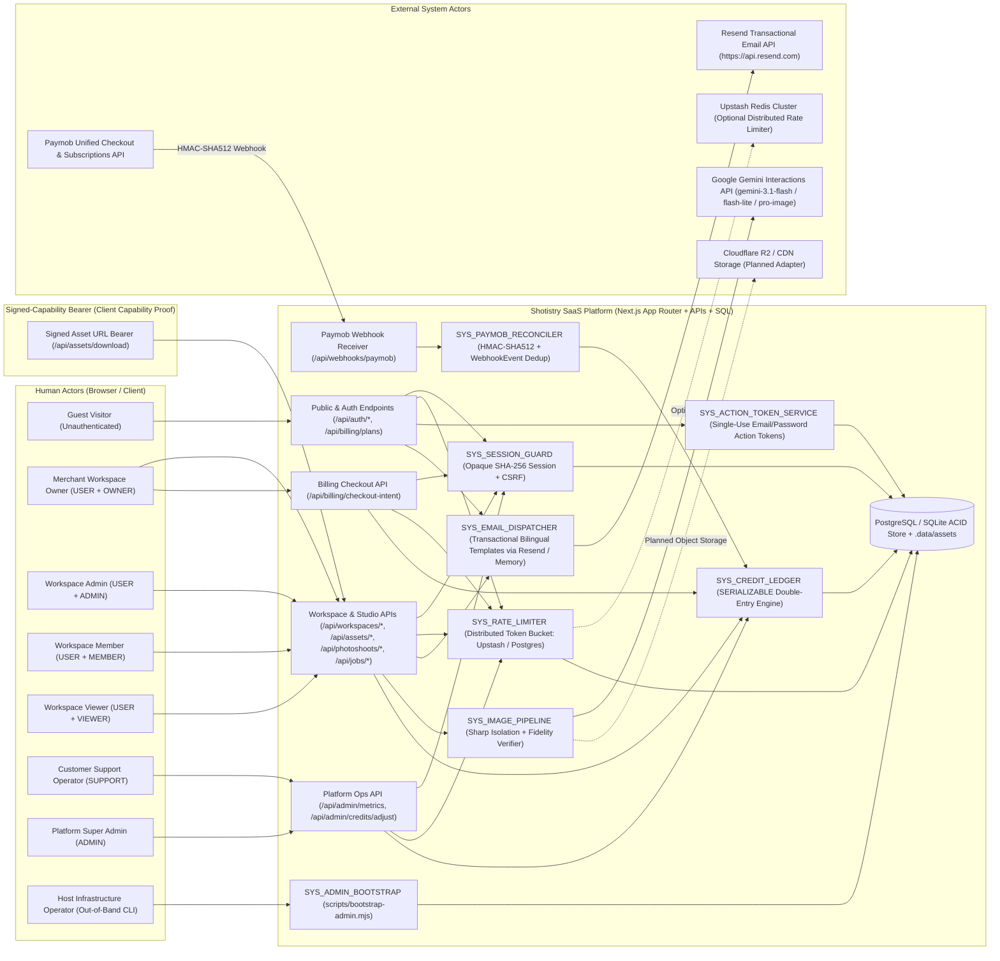

# Shotistry — System Actors & Trust Boundary Specification

- **Status:** Official Architecture Baseline (Validated Against Code)
- **Branch:** `audit/production-readiness`
- **Last Verified Against Code:** November 8, 2026

---

## 1. Purpose & Actor Classification Methodology

This document defines the official **System Actor Model** for **Shotistry**, an AI-powered commercial product photography SaaS platform serving e-commerce brands, social-commerce merchants, and agencies in **Egypt (`EGP`)** and **Saudi Arabia (`SAR`)**.

To maintain strict security and architectural clarity, this specification separates:
1. **System Actors** — external human users, external machine systems, or autonomous internal enforcement engines that initiate interactions or enforce invariants across trust boundaries.
2. **Database Entities** — passive persisted records (`User`, `Workspace`, `WorkspaceMember`, `Session`, `Brand`, `Product`, `ProductAsset`, `Photoshoot`, `GenerationJob`, `GeneratedImage`, `Subscription`, `CreditLedger`, `CreditReservation`, `PaymentTransaction`, `WebhookEvent`, `AdminAuditLog`). **Entities are never actors.**
3. **Roles & Permissions** — authorization attribute sets (`PlatformRole`, `WorkspaceRole`, `PlatformPermission`, `WorkspacePermission`) bound to authenticated identities.
4. **Provisioning Paths** — workflows that initialize entities (`POST /api/auth/register`, `POST /api/workspaces`, `POST /api/workspaces/[id]/members`, `scripts/bootstrap-admin.mjs`). A provisioning path is **not** a separate actor.

> [!NOTE]
> Every capability, route, and status in this document reflects direct verification against [src/](file:///Users/tasawk/StudioProjects/shotistry/src) and [prisma/schema.prisma](file:///Users/tasawk/StudioProjects/shotistry/prisma/schema.prisma). Features marked **Planned** do not yet have live routes or adapters in the repository.

---

## 2. System Context Diagram

---

## 3. Distinction Between Actors, Entities, Roles & Provisioning Paths

| Classification | Examples in Shotistry | Why They Are Distinct |
|---|---|---|
| **Human Actors** | Guest Visitor, Workspace Owner, Workspace Admin, Workspace Member, Workspace Viewer, Customer Support Operator, Platform Super Admin, Host Infrastructure Operator (`CLI_OPERATOR`) | Initiate interactive sessions, make decisions, hold credentials, and operate browser or CLI workflows. |
| **Signed-Capability Bearer** | `EXT_SIGNED_ASSET_BEARER` (Client holding time-limited HMAC-SHA256 signature) | Client software (browser ``/`<a>` or mobile webview) presenting a cryptographic capability token granting read-only access to a specific asset, without user credentials. |
| **External System Actors** | Google Gemini Interactions API, Paymob Payment Gateway, Resend Transactional Email API, Upstash Redis Cluster, *(Planned)* Cloudflare R2 Storage | Autonomous third-party systems crossing Shotistry's perimeter via server credentials or cryptographically verified webhooks. |
| **Internal Enforcement Subsystems (not actors)** | `SYS_SESSION_GUARD`, `SYS_RATE_LIMITER`, `SYS_ACTION_TOKEN_SERVICE`, `SYS_EMAIL_DISPATCHER`, `SYS_CREDIT_LEDGER`, `SYS_IMAGE_PIPELINE`, `SYS_PAYMOB_RECONCILER`, `SYS_ADMIN_BOOTSTRAP` | Trusted internal software modules executing invariant enforcement, accounting, image transformation, or out-of-band administrative bootstrap. |
| **Database Entities (NOT Actors)** | `User`, `Workspace`, `WorkspaceMember`, `Session`, `AuthActionToken`, `RateLimitBucket`, `WorkspaceInvite`, `Brand`, `Product`, `ProductAsset`, `Photoshoot`, `GenerationJob`, `GeneratedImage`, `Subscription`, `CreditLedger`, `CreditReservation`, `PaymentTransaction`, `WebhookEvent`, `AdminAuditLog` | Passive records persisted in PostgreSQL/SQLite; mutated strictly by authorized workflows. |
| **Roles (NOT Actors)** | `Role` (`USER`, `SUPPORT`, `ADMIN`), `WorkspaceRole` (`OWNER`, `ADMIN`, `MEMBER`, `VIEWER`) | Authorization attribute enums stored on `User` and `WorkspaceMember`. A single `User` may act as `OWNER` in Workspace A and `VIEWER` in Workspace B simultaneously. |
| **Provisioning Paths (NOT Actors)** | `POST /api/auth/register`, `POST /api/workspaces`, `POST /api/workspaces/[id]/members`, `bootstrapPlatformAdmin`, `createSupportOperatorByAdmin` | Processes executed by an actor (`Guest Visitor`, `Workspace Owner/Admin`, `CLI_OPERATOR`, `Platform Admin`) to create or link records. |

---

## 4. Complete Actor Catalog & Responsibilities

### 4.1 Anonymous / Guest Actor

#### A-01: Guest Visitor (`ANON_GUEST`)
- **Category:** Anonymous Human Actor
- **Identity Proof:** None (unauthenticated HTTP client; any spoofed headers `x-user-id`, `x-user-role`, `x-workspace-id` or unsigned legacy cookies are ignored).
- **Business Purpose:** Evaluates Shotistry's value proposition, localized `SAR`/`EGP` pricing plans, and commercial capabilities before registering or signing in.
- **Primary Objectives:** Browse bilingual landing page, switch locale (`ar`/`en`) and display currency (`SAR`/`EGP`), inspect plans/top-ups, register a new merchant account, or authenticate into an existing account.
- **Permissions:** Public read-only storefront + unauthenticated auth endpoints only; zero `PlatformPermission` and zero `WorkspacePermission`.
- **Accessible Features:**
  - Marketing landing page (`/`)
  - Public pricing catalog (`/pricing` read view, `GET /api/billing/plans`)
  - Registration (`/register`, `POST /api/auth/register`) and Login (`/login`, `POST /api/auth/login`)
  - Session probe (`GET /api/auth/session` returning `{ authenticated: false, user: null }`)
  - *(Gated views `/studio`, `/account`, `/admin` render sign-in prompts instead of private data)*
- **Allowed Operations:**
  - Read localized plan definitions (`GET /api/billing/plans?country=SA|EG`).
  - Probe session status (`GET /api/auth/session`).
  - Submit same-origin `application/json` registration (creates `User` with hardcoded `role='USER'`, initial `Workspace`, `OWNER` membership, `FREE` plan, and 5 `TRIAL_GRANT` credits).
  - Submit same-origin `application/json` login credentials.
- **Restricted Operations:**
  - Accessing any protected workspace, generation, job, billing checkout, or admin endpoint (`401 Unauthorized`).
  - Supplying `role` or `platformRole` in `/api/auth/register` (`403 Forbidden`).
  - Auto-provisioning a default workspace or trial credits by visiting `/`, `/studio`, `/api/workspace/session`, or `/api/webhooks/paymob` (all legacy defaults removed).
  - Triggering admin bootstrap via HTTP (no HTTP endpoint exists).
- **Data Visibility:** Public marketing copy, public pricing tiers (`FREE`, `STARTER`, `PRO`, `AGENCY`), and public top-up packs (`pack_50`, `pack_150`, `pack_500`). Zero visibility into any `User`, `Workspace`, `Job`, `CreditLedger`, or platform KPI.
- **Interactions with Other Actors:** Transitions to `OWNER` upon registration or to their DB-assigned role upon login via `SYS_SESSION_GUARD`.

---

### 4.2 Merchant Workspace Human Participants (`User.role = 'USER'`)

All four workspace actors hold platform role `USER` and receive contextual tenant permissions determined live from `"WorkspaceMember"` for `Session.activeWorkspaceId`. A single merchant `User` can hold different `WorkspaceRole` values across multiple workspaces and switches active context via [`switchSessionActiveWorkspace`](file:///Users/tasawk/StudioProjects/shotistry/src/lib/auth/session.ts#L520-L542).

#### A-02: Workspace Owner (`WS_OWNER` — `USER` + `WorkspaceMember.role = 'OWNER'`)
- **Category:** Merchant Workspace Participant
- **Business Purpose:** Accountable business principal (e-commerce founder, brand owner, agency owner) who owns the workspace tenant, team access, and commercial billing relationship.
- **Primary Objectives:** Transform raw phone product photos into studio renders, govern workspace seats/roles, manage multiple brand workspaces, and purchase subscriptions or credit top-ups in `EGP`/`SAR`.
- **Permissions:** All 11 `WorkspacePermission` capabilities (`workspace:read`, `workspace:switch`, `workspace:create`, `workspace:members:read`, `workspace:members:manage`, `brand:manage`, `product:manage`, `asset:upload`, `photoshoot:generate`, `job:read`, `billing:checkout`), plus full personal session management. Zero `PlatformPermission` capabilities.
- **Accessible Features:**
  - Full AI Studio (`/studio`), Pricing & Checkout (`/pricing`), Account/Workspaces/Members/Device Sessions (`/account`), Navbar workspace switcher & live credit badge.
- **Allowed Operations:**
  - Upload raw PNG/JPEG/WebP assets (`POST /api/assets/upload`) and generate studio photoshoots (`POST /api/photoshoots/generate`).
  - Inspect jobs and fidelity metrics (`GET /api/workspace/session`, `GET /api/jobs/[id]`) and download renders.
  - Initiate subscription & top-up checkout intents (`POST /api/billing/checkout-intent`).
  - Create additional workspaces (`POST /api/workspaces` — starts with `0` credits) and switch active workspace (`POST /api/workspace/switch`).
  - View workspace members and invite/assign `ADMIN`, `MEMBER`, or `VIEWER` roles (`GET`/`POST /api/workspaces/[id]/members`).
  - List/revoke device sessions, revoke all sessions, change password, log out (`/api/auth/*`).
- **Restricted Operations:**
  - Accessing `/admin`, `GET /api/admin/metrics`, or `POST /api/admin/credits/adjust` (`403 Forbidden`). Workspace ownership never grants platform administration rights.
  - Accessing or mutating workspaces where not a `WorkspaceMember`, or overriding `workspaceId` in request bodies (`403 Forbidden`).
  - Modifying the workspace owner's own `OWNER` role via `/members` (`403 Forbidden`), or provisioning `SUPPORT`/`ADMIN` accounts.
  - Triggering `sandboxSimulateWebhook: true` when `NODE_ENV === 'production'` (`403 Forbidden`).
  - Accessing paid-only models (`gemini-3-pro-image`) or `2K`/`4K` resolutions on `FREE` or `STARTER` plans (`403 Forbidden`).
- **Data Visibility:** Active workspace balance, plan tier, recent photoshoot jobs, generated images, masks/isolated assets, member emails/roles in managed workspaces, and own active device sessions (`tokenHash`/`csrfToken` excluded from list APIs). Cannot view other tenants' jobs or platform MRR/KPIs.
- **Interactions with Other Actors:** Invites/manages `WS_ADMIN`, `WS_MEMBER`, `WS_VIEWER`; initiates payments completed asynchronously by `EXT_PAYMOB`; submits renders executed by `SYS_IMAGE_PIPELINE` and `EXT_GEMINI_API`; may receive ledger adjustments from `PLATFORM_SUPPORT` or `PLATFORM_ADMIN`.

#### A-03: Workspace Admin (`WS_ADMIN` — `USER` + `WorkspaceMember.role = 'ADMIN'`)
- **Category:** Merchant Workspace Participant
- **Business Purpose:** Delegated operations or studio manager overseeing creative production teams within an assigned workspace without financial checkout authority.
- **Primary Objectives:** Manage studio contributors (`MEMBER`/`VIEWER`), coordinate product uploads and commercial renders, and monitor workspace generation output.
- **Permissions:** 10 of 11 `WorkspacePermission` capabilities (all except `billing:checkout`). Can assign `MEMBER` and `VIEWER` via [`canManageWorkspaceMemberRole`](file:///Users/tasawk/StudioProjects/shotistry/src/lib/auth/rbac.ts#L128-L139), but **cannot** assign `ADMIN` or `OWNER` and cannot demote an existing `ADMIN` or `OWNER`.
- **Accessible Features:** `/studio`, `/account` (workspaces, device sessions, password change, member management scoped to `MEMBER`/`VIEWER`), `/pricing` (view-only for checkout).
- **Allowed Operations:** All asset upload, AI photoshoot generation, job inspection, workspace creation/switching, session management, and `MEMBER`/`VIEWER` seat management.
- **Restricted Operations:**
  - Initiating billing checkout (`POST /api/billing/checkout-intent` -> `403 Forbidden`).
  - Assigning `ADMIN` or modifying an `OWNER` or fellow `ADMIN` in `/api/workspaces/[id]/members` (`403 Forbidden`).
  - Platform support/admin operations (`/api/admin/*` -> `403 Forbidden`).
- **Data Visibility:** Same workspace operational data and member list as `WS_OWNER`; no access to other workspaces or platform-wide metrics.
- **Interactions with Other Actors:** Delegated authority from `WS_OWNER`; oversees `WS_MEMBER` and `WS_VIEWER`; interacts with `SYS_SESSION_GUARD` and `SYS_IMAGE_PIPELINE`.

#### A-04: Workspace Member (`WS_MEMBER` — `USER` + `WorkspaceMember.role = 'MEMBER'`)
- **Category:** Merchant Workspace Participant
- **Business Purpose:** Brand marketer, designer, or e-commerce merchandiser producing commercial product photography within an assigned workspace.
- **Primary Objectives:** Upload product photos, select Gulf/Egyptian/Minimalist scene presets, configure aspect ratios and foreground-locking options, generate renders, and download results.
- **Permissions:** `workspace:read`, `workspace:switch`, `workspace:create`, `brand:manage`, `product:manage`, `asset:upload`, `photoshoot:generate`, `job:read`.
- **Accessible Features:** `/studio` (full generation workflow), `/account` (own device sessions, password, personal workspaces), `/pricing` (read-only).
- **Allowed Operations:** Upload assets, generate shoots, read workspace session/jobs, download signed assets, manage personal sessions, switch or create own workspaces.
- **Restricted Operations:**
  - Viewing or modifying workspace members (`GET`/`POST /api/workspaces/[id]/members` -> `403 Forbidden`).
  - Initiating subscription or credit top-up checkouts (`POST /api/billing/checkout-intent` -> `403 Forbidden`).
  - Platform `/api/admin/*` routes (`403 Forbidden`).
- **Data Visibility:** Active workspace credit balance, jobs, and generated images; own account sessions. Cannot list teammate emails in `/workspaces/[id]/members`.
- **Interactions with Other Actors:** Reports to `WS_OWNER`/`WS_ADMIN`; triggers `SYS_IMAGE_PIPELINE`, `EXT_GEMINI_API`, and `SYS_CREDIT_LEDGER` consumption.

#### A-05: Workspace Viewer (`WS_VIEWER` — `USER` + `WorkspaceMember.role = 'VIEWER'`)
- **Category:** Merchant Workspace Participant
- **Business Purpose:** Client stakeholder, QA reviewer, or merchandiser auditing finished commercial photography outputs without ability to spend credits or mutate team state.
- **Primary Objectives:** Review recent studio renders, inspect fidelity scores and SynthID indicators, inspect specific jobs, and download approved assets.
- **Permissions:** `workspace:read`, `workspace:switch`, `workspace:create`, `job:read` (plus personal `/api/auth/*` lifecycle).
- **Accessible Features:** `/studio` (read-only gallery & warning banner `t.viewerReadOnlyNotice`; generate button disabled), `/account` (sessions, password, own workspaces), `/pricing` (view-only).
- **Allowed Operations:** `GET /api/workspace/session`, `GET /api/jobs/[id]`, download signed render URLs, switch/create own workspace, manage own sessions/password.
- **Restricted Operations:**
  - Uploading assets (`POST /api/assets/upload` -> `403 Forbidden`).
  - Generating photoshoots or spending credits (`POST /api/photoshoots/generate` -> `403 Forbidden`).
  - Listing or editing workspace members (`GET`/`POST /api/workspaces/[id]/members` -> `403 Forbidden`).
  - Initiating billing checkout (`POST /api/billing/checkout-intent` -> `403 Forbidden`).
  - Platform `/api/admin/*` routes (`403 Forbidden`).
- **Data Visibility:** Active workspace balance, job status, prompts, and output images; own sessions. Hidden: workspace member directory, other workspaces, billing actions, admin metrics.
- **Interactions with Other Actors:** Granted read access by `WS_OWNER` or `WS_ADMIN`; subject to immediate mid-session privilege revocation/demotion checked on every request.

---

### 4.3 Human Platform Operational Actors (`User.role` = `SUPPORT` | `ADMIN`)

Platform roles exist strictly on `"User"."role"`. Neither `SUPPORT` nor `ADMIN` receives automatic membership in merchant workspaces.

#### A-06: Customer Support Operator (`PLATFORM_SUPPORT` — `User.role = 'SUPPORT'`)
- **Category:** Human Platform Operational Actor
- **Business Purpose:** Resolves merchant tickets, investigates failed generation/payment issues, and issues bounded goodwill credit compensations.
- **Primary Objectives:** Monitor platform health/job telemetry, verify recent audit logs, and grant goodwill credits (`+1` to `+200`) to existing workspaces with mandatory ticket justification.
- **Permissions (`PlatformPermission`):** `platform:metrics:read`, `platform:audit:read`, `platform:credits:adjust:bounded`. Zero tenant `WorkspacePermission` unless explicitly invited to a workspace as a member.
- **Accessible Features:** `/admin` (live KPI metrics, job telemetry table, bounded adjustment form `1..200`, infrastructure status), `/account` (own sessions & password; zero merchant workspace list unless created separately).
- **Allowed Operations:**
  - `GET /api/admin/metrics` (aggregated subscriber count, MRR, AI expenses, success rate, last 20 jobs, last 10 `AdminAuditLog` entries).
  - `POST /api/admin/credits/adjust` with positive integer `1 <= amount <= 200` and mandatory `reason.length >= 3` against an **existing** workspace/owner email, writing immutable `AdminAuditLog`.
- **Restricted Operations:**
  - Negative credit deductions (`amount < 0` -> `403 Forbidden`).
  - High-value credit adjustments (`amount > 200` -> `403 Forbidden`).
  - Creating `ADMIN` or `SUPPORT` accounts (`platform:users:manage` denied).
  - Viewing or generating inside arbitrary merchant workspaces without explicit `WorkspaceMember` membership (`403 Forbidden` on `/api/jobs/[id]`, `/api/workspace/session`, `/api/photoshoots/generate`).
  - Auto-creating missing workspaces during credit adjustments (`404 Not Found`).
- **Data Visibility:** Platform-wide aggregated metrics, recent 20 job summaries (ID, product title, preset, model, status, cost, owner email), last 10 `AdminAuditLog` rows, infrastructure readiness flags. Cannot view raw user passwords, raw session tokens, or unshared tenant job details via `/api/jobs/[id]`.
- **Interactions with Other Actors:** Provisioned exclusively by `PLATFORM_ADMIN` via [`createSupportOperatorByAdmin`](file:///Users/tasawk/StudioProjects/shotistry/src/lib/auth/admin-bootstrap.ts#L121-L172); serves `WS_OWNER`/`WS_MEMBER` tickets; audited under `AdminAuditLog`.

#### A-07: Platform Super Administrator (`PLATFORM_ADMIN` — `User.role = 'ADMIN'`)
- **Category:** Human Platform Operational Actor
- **Business Purpose:** Executive platform operator responsible for Shotistry's global operations, unit economics health, chargeback/fraud ledger reversals, and support staff governance.
- **Primary Objectives:** Audit platform MRR and Gemini COGS margins, execute positive or negative credit corrections (`|amount| <= 10,000`), onboard `SUPPORT` operators, and respond to security or billing incidents.
- **Permissions (`PlatformPermission`):** `platform:metrics:read`, `platform:audit:read`, `platform:credits:adjust`, `platform:credits:adjust:bounded`, `platform:users:manage`. Zero implicit `WorkspacePermission` bypass.
- **Accessible Features:** `/admin` (unbounded positive/negative ledger adjustment UI `-10000..+10000`, live unit-economics KPIs, telemetry & audit logs), `/account` (own sessions & password >= 12 chars), server-side `createSupportOperatorByAdmin()`.
- **Allowed Operations:**
  - All `PLATFORM_SUPPORT` read operations.
  - Positive and negative `CreditLedger` (`ADMIN_ADJUSTMENT`) mutations via `POST /api/admin/credits/adjust` (`-10,000 <= amount <= +10,000`, `amount !== 0`, prevents negative settled balance).
  - Provisioning `SUPPORT` operators via verified `ADMIN` identity in [`createSupportOperatorByAdmin`](file:///Users/tasawk/StudioProjects/shotistry/src/lib/auth/admin-bootstrap.ts#L121-L172) *(note: server-side function implemented & tested; dedicated HTTP route for user management is not yet exposed)*.
- **Restricted Operations:**
  - Implicit cross-tenant workspace bypass on merchant APIs (`/api/jobs/[id]`, `/api/workspace/session`, `/api/photoshoots/generate`, `/api/billing/checkout-intent` -> `403 Forbidden` unless actually a member of that workspace).
  - Self-bootstrapping or creating additional `ADMIN` accounts via HTTP registration or repeated bootstrap runs (`ADMIN_ALREADY_BOOTSTRAPPED` fail-closed error).
  - Bypassing CSRF, cookie session verification, or password complexity (`>= 12` chars).
- **Data Visibility:** Platform KPIs, aggregate MRR (`SAR`/`EGP`/`USD`), Gemini AI COGS, recent jobs, `AdminAuditLog`, infrastructure config status.
- **Interactions with Other Actors:** Created once by `CLI_OPERATOR` via `SYS_ADMIN_BOOTSTRAP`; provisions `PLATFORM_SUPPORT`; oversees `SYS_CREDIT_LEDGER` adjustments triggered by `EXT_PAYMOB` chargebacks or escalations.

#### A-08: Host Infrastructure Operator (`CLI_OPERATOR`)
- **Category:** Out-of-Band Human Operator (Non-Web)
- **Business Purpose:** DevOps / Security Lead with shell and environment secret access (`SHOTISTRY_ADMIN_BOOTSTRAP_SECRET`) who initializes the first `PLATFORM_ADMIN` during deployment setup and performs password rotations via CLI.
- **Primary Objectives:** Run [scripts/bootstrap-admin.mjs](file:///Users/tasawk/StudioProjects/shotistry/scripts/bootstrap-admin.mjs) cleanly on databases without exposing privileged web setup endpoints.
- **Allowed / Restricted Operations:** Can invoke `SYS_ADMIN_BOOTSTRAP` with a valid >=24-char bootstrap secret and >=12-char admin password; rejected automatically if any `ADMIN` already exists in `"User"` during bootstrap, or if placeholder/weak secrets are supplied. Can rotate admin passwords via `--rotate-password`.

---

### 4.3 Signed-Capability Bearer

#### B-01: Signed Asset URL Bearer (`EXT_SIGNED_ASSET_BEARER`)
- **Category:** Client Capability Proof (Browser `` / `<a>` Download Client)
- **Authentication / Trust Boundary:** Stateless HMAC-SHA256 query signature (`key`, `expires`, `sig`) generated by [`signAssetUrl`](file:///Users/tasawk/StudioProjects/shotistry/src/lib/storage/asset-storage.ts#L40-L50) (default `3600s` = 1h TTL) using `ASSET_SIGNING_SECRET` (fails closed in `production` if missing/<16 chars; ephemeral per-process 32-byte CSPRNG key in non-production).
- **Business Purpose:** Enables direct browser rendering and download of uploaded workspace assets via `GET /api/assets/download` without exposing raw filesystem paths or requiring custom auth headers on `` tags.
- **Allowed Operations:** Reading `image/png`, `image/jpeg`, or `image/webp` bytes from `.data/assets/<workspace>/<uuid>.<ext>` while HMAC & timestamp remain valid.
- **Restricted Operations:** Reading expired URLs, tampered signatures (`403 Forbidden`), or path traversal attempts (`..`, null bytes -> rejected by `baseDir + path.sep` guard and returns `null`/`404`).

---

### 4.4 External System Actors

#### E-01: Google Gemini Interactions API (`EXT_GEMINI_API`)
- **Category:** External AI SaaS Service
- **Authentication / Trust Boundary:** Outbound TLS using server-only `process.env.GEMINI_API_KEY` via `@google/genai` `ai.interactions.create` inside [`GeminiClient`](file:///Users/tasawk/StudioProjects/shotistry/src/lib/ai/gemini-client.ts#L109-L342). Never exposed to browser bundles.
- **Business Purpose:** Generates photorealistic commercial studio environments conditioned on customer product reference pixels and binary alpha masks.
- **Allowed Operations / Protocol:** Receives synthesized prompt + negative prompt + isolated reference image + binary mask + `response_format: { type: 'image', mime_type, aspect_ratio, image_size }` targeting `gemini-3.1-flash-image`, `gemini-3.1-flash-lite-image`, or `gemini-3-pro-image`; returns `interaction.output_image.data` (or `steps[].content[]`) and token `usage`.
- **Restricted Operations / Safeguards:** Cannot write directly to Shotistry SQL or bypass plan model/resolution entitlements; failures throw errors causing `SYS_CREDIT_LEDGER` to release reserved credits (`0` loss to merchant). When `GEMINI_API_KEY` is unconfigured/placeholder, `GeminiClient` falls back to `LOCAL_COMPOSITE_SANDBOX` (`synthIdDetected: false`).

#### E-02: Paymob Unified Checkout & Subscriptions API (`EXT_PAYMOB`)
- **Category:** External Financial Payment Processor
- **Authentication / Trust Boundary:**
  - **Inbound Webhooks (`POST /api/webhooks/paymob`):** Cryptographically verified via HMAC-SHA512 using `PAYMOB_HMAC_SECRET` (`crypto.timingSafeEqual`). Fails closed (`503` unconfigured/placeholder, `401` invalid signature) in **all** environments.
  - **Outbound Paymob Intention API:** Planned live network adapter (checkout intent currently persists pending `PaymentTransaction` records and accepts signed webhooks; `tests/live-external-smoke.test.mjs` gates live `PAYMOB_SECRET_KEY`/`PAYMOB_API_KEY` calls).
- **Business Purpose:** Processes localized `SAR` (Mada, Apple Pay, Visa/Mastercard) and `EGP` (Meeza, Cards, Mobile Wallets) payments and delivers verified billing lifecycle callbacks.
- **Allowed Operations:** Triggering idempotent `SUBSCRIPTION_GRANT` or `TOP_UP_PURCHASE` credit grants and updating existing `Subscription` (`ACTIVE`, `PAST_DUE`, `SUSPENDED`, `CANCELED`) and `PaymentTransaction` statuses for verified existing `workspaceId`s.
- **Restricted Operations:** Auto-creating missing workspaces (`400`/`404` fail-closed), double-crediting duplicate events (`WebhookEvent.eventId` + `CreditLedger.idempotencyKey`), or accepting unsigned/tampered payloads.

#### E-03: Resend Transactional Email Provider (`EXT_EMAIL_PROVIDER`)
- **Category:** External Communications API
- **Authentication / Trust Boundary:** Outbound HTTPS requests to `https://api.resend.com/emails` with `Authorization: Bearer RESEND_API_KEY`. In test environments or when `RESEND_API_KEY` is absent, falls back safely to in-memory `MemoryEmailTransport`.
- **Business Purpose:** Delivers bilingual email verification links, password reset tokens, security notifications, and workspace invitations with `#token=` URL fragments.
- **Allowed Operations:** Sending transactional notifications formatted with strict HTML escaping and bilingual RTL/LTR templates.

#### E-04: Upstash Redis Cluster (`EXT_UPSTASH_REDIS` — Optional)
- **Category:** External Distributed Key-Value Store
- **Authentication / Trust Boundary:** Outbound HTTPS calls to `UPSTASH_REDIS_REST_URL` via bearer token `UPSTASH_REDIS_REST_TOKEN`.
- **Business Purpose:** Provides distributed sliding-window token-bucket rate limiting for edge and serverless environments. When absent, falls back to `PostgresRateLimitStore` (`RateLimitBucket` table).

#### E-05: Cloudflare R2 / S3 Object Storage (`EXT_OBJECT_STORAGE` — Planned)
- **Category:** External Object Storage
- **Status:** Planned adapter for direct presigned uploads and CDN delivery.

---

### 4.5 Internal Enforcement Subsystems (not actors)

#### I-01: Session Expiration & Security Guard (`SYS_SESSION_GUARD`)
- **Implementation:** [src/lib/auth/session.ts](file:///Users/tasawk/StudioProjects/shotistry/src/lib/auth/session.ts), [src/lib/security/csrf.ts](file:///Users/tasawk/StudioProjects/shotistry/src/lib/security/csrf.ts)
- **Responsibilities:** Enforces SHA-256 opaque cookie resolution (`__Host-shotistry_session` in prod), lazy revocation of idle (`7d`) & absolute (`30d`) expired sessions, login/register session rotation, sliding-window `lastActivityAt`/`idleExpiresAt` updates, and multi-layer CSRF (`Sec-Fetch-Site` + `Origin`/`Referer` + session-bound `x-csrf-token`).

#### I-02: Distributed Rate Limiter (`SYS_RATE_LIMITER`)
- **Implementation:** [src/lib/security/rate-limit/](file:///Users/tasawk/StudioProjects/shotistry/src/lib/security/rate-limit/)
- **Responsibilities:** Enforces tiered sliding-window rate limits across IP and user dimensions with fail-closed behavior in production (`UpstashRateLimitStore` or `PostgresRateLimitStore`), client IP extraction honoring trusted proxies (`SHOTISTRY_TRUSTED_PROXY_COUNT`), and IPv6 subnet grouping (`/64`).

#### I-03: Action Token Lifecycle Service (`SYS_ACTION_TOKEN_SERVICE`)
- **Implementation:** [src/lib/auth/action-tokens.ts](file:///Users/tasawk/StudioProjects/shotistry/src/lib/auth/action-tokens.ts), [src/lib/db/repositories/action-token-repository.ts](file:///Users/tasawk/StudioProjects/shotistry/src/lib/db/repositories/action-token-repository.ts)
- **Responsibilities:** Manages issuance, SHA-256 hashing, single-use atomic consumption, and revocation of single-use tokens for email verification (`24h`), password reset (`15m`), and email change (`1h`).

#### I-04: Transactional Email Dispatcher (`SYS_EMAIL_DISPATCHER`)
- **Implementation:** [src/lib/email/](file:///Users/tasawk/StudioProjects/shotistry/src/lib/email/)
- **Responsibilities:** Renders verified bilingual (`ar`/`en`) templates with sanitized inputs, passes `#token=` fragments to prevent token leakage in HTTP referrers, and dispatches messages through `ResendEmailTransport` or `MemoryEmailTransport`.

#### I-05: Double-Entry Credit Reservation & Settlement Engine (`SYS_CREDIT_LEDGER`)
- **Implementation:** [`CreditLedgerService`](file:///Users/tasawk/StudioProjects/shotistry/src/lib/ledger/credit-ledger-service.ts#L73-L906) and [`PostgresCreditLedgerService`](file:///Users/tasawk/StudioProjects/shotistry/src/lib/ledger/postgres-ledger-service.ts)
- **Responsibilities:** Guarantees atomic user+workspace+trial registration (`trial:grant:user:<userId>`), blocks duplicate trial grants on additional workspaces, executes `SERIALIZABLE` + row-locked credit reservations (`PENDING` -> `SETTLED` / `RELEASED`), rejects negative balances and insufficient funds (`402`), and prevents double-spend under concurrent generation bursts.

#### I-06: Foreground Isolation & Fidelity Verifier (`SYS_IMAGE_PIPELINE`)
- **Implementation:** [src/lib/ai/image-processor.ts](file:///Users/tasawk/StudioProjects/shotistry/src/lib/ai/image-processor.ts) and [src/lib/ai/prompt-synthesizer.ts](file:///Users/tasawk/StudioProjects/shotistry/src/lib/ai/prompt-synthesizer.ts)
- **Responsibilities:** Validates PNG/JPEG/WebP binary headers via `sharp`, normalizes EXIF orientation, isolates foreground pixels via adaptive thresholding + exterior border BFS flood-fill, optionally composites original foreground pixels over generated scenes (`lockProductForeground`), and computes quantitative fidelity (`verifyDeliveredImageFidelity`) strictly on the final delivered asset.

#### I-07: Paymob Webhook Reconciler (`SYS_PAYMOB_RECONCILER`)
- **Implementation:** [src/app/api/webhooks/paymob/route.ts](file:///Users/tasawk/StudioProjects/shotistry/src/app/api/webhooks/paymob/route.ts) and [`PaymobSecurity`](file:///Users/tasawk/StudioProjects/shotistry/src/lib/paymob/paymob-hmac.ts)
- **Responsibilities:** Enforces fail-closed HMAC-SHA512 verification, logs deduplicated events in `WebhookEvent`, validates target workspace existence, updates `Subscription` & `PaymentTransaction` records, and invokes `SYS_CREDIT_LEDGER.grantCredits` idempotently.

#### I-08: Out-of-Band CLI Admin Bootstrapper (`SYS_ADMIN_BOOTSTRAP`)
- **Implementation:** [scripts/bootstrap-admin.mjs](file:///Users/tasawk/StudioProjects/shotistry/scripts/bootstrap-admin.mjs) and [`bootstrapPlatformAdmin`](file:///Users/tasawk/StudioProjects/shotistry/src/lib/auth/admin-bootstrap.ts#L22-L115)
- **Responsibilities:** Executes outside HTTP request pipelines with timing-safe verification of `SHOTISTRY_ADMIN_BOOTSTRAP_SECRET` (>=24 chars) and >=12-char password policy to seed exactly one initial `ADMIN` row and record `PLATFORM_ADMIN_BOOTSTRAP` in `AdminAuditLog`.
