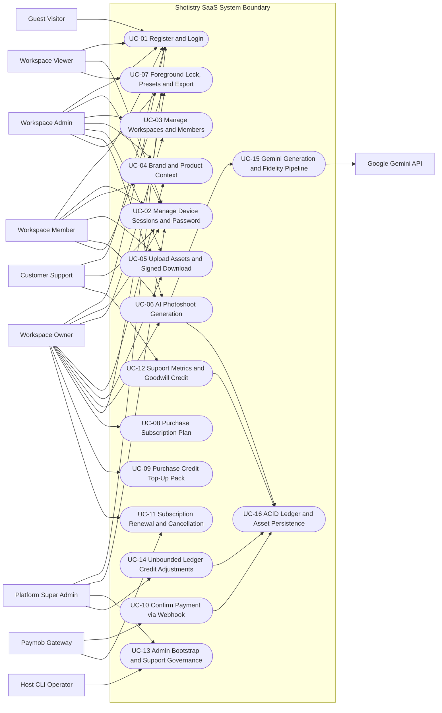

# Shotistry — System Use Case Specification

- **Status:** Official Functional & Security Use Case Baseline (Validated Against Code)
- **Branch:** `audit/production-readiness`
- **Coverage Scope:** All 14 required operational domains (`UC-01` through `UC-16`) mapped strictly to verified code and planned roadmap gaps.

---

## 1. Status Classification Key

| Badge | Meaning |
|---|---|
| **Implemented & Verified** | End-to-end backend route, database persistence, RBAC/CSRF controls, and automated tests exist and pass on `audit/production-readiness`. |
| **Partially Implemented** | Core DB models or partial pipeline hooks exist, but dedicated management CRUD routes, live external adapter keys, or background workers remain incomplete. |
| **Planned Roadmap** | Architectural design only; not yet exposed in HTTP handlers or UI. |

---

## 2. System Use Case Diagram

---

## 3. Detailed Use Case Specifications

### UC-01: Account Registration & Authentication (`Register`, `Login`, `Logout`)
- **Domain:** Account registration and login
- **Implementation Status:** **Implemented & Verified** ([`POST /api/auth/register`](file:///Users/tasawk/StudioProjects/shotistry/src/app/api/auth/register/route.ts), [`POST /api/auth/login`](file:///Users/tasawk/StudioProjects/shotistry/src/app/api/auth/login/route.ts), [`POST /api/auth/logout`](file:///Users/tasawk/StudioProjects/shotistry/src/app/api/auth/logout/route.ts), [`GET /api/auth/session`](file:///Users/tasawk/StudioProjects/shotistry/src/app/api/auth/session/route.ts))
- **Primary Actors:** `Guest Visitor` (registration/login); any authenticated `User` (logout)
- **Preconditions:** Same-origin HTTPS/HTTP browser request with `Content-Type: application/json` (for register/login) and valid IP within sliding rate limit (`10` attempts / `15m`).
- **Main Flow (Registration):**
  1. Guest submits `email`, `password` (>=8 chars, >=1 letter & digit), optional `name`/`phone`/`workspaceName`, `country` (`SA|EG`), `locale` (`ar|en`).
  2. Server rejects any client-supplied `role` or `platformRole` (`403`).
  3. [`registerMerchantWithInitialWorkspace`](file:///Users/tasawk/StudioProjects/shotistry/src/lib/ledger/credit-ledger-service.ts#L114-L213) hashes password via `scrypt` and atomically creates `User` (`role='USER'`), initial `Workspace`, `WorkspaceMember` (`OWNER`), `Subscription` (`FREE`, `ACTIVE`), and single `TRIAL_GRANT` (`+5` credits, `idempotencyKey='trial:grant:user:<userId>'`).
  4. [`createSession`](file:///Users/tasawk/StudioProjects/shotistry/src/lib/auth/session.ts#L162-L237) rotates any existing token, generates a 32-byte opaque CSPRNG token + CSRF token, persists SHA-256 `tokenHash`, and returns `201` with `HttpOnly` cookie (`__Host-shotistry_session` in production).
- **Main Flow (Login & Logout):**
  1. Login normalizes email, enforces IP + account rate limits, verifies password via `scrypt` + `timingSafeEqual` (running `constantTimeDummyVerify` on unknown email), rotates prior cookie (`ROTATED_ON_AUTH`), and returns `200`.
  2. Logout verifies authenticated session + `x-csrf-token`, marks session revoked (`LOGOUT`), and sends `Max-Age=0` clear cookie (`200`).
- **Alternate / Exception Flows:**
  - Duplicate email -> `409 Conflict` generic error; zero extra credits granted.
  - Wrong password OR non-existent email -> identical `401` `{ error: "Invalid email or password" }`.
  - Non-JSON form CSRF -> `415`; cross-origin -> `403`; exceeded rate limit -> `429` + `Retry-After`.
- **Postconditions:** Opaque session hash persisted in `"Session"`; client holds `HttpOnly` session cookie + `csrfToken` in React memory.

---

### UC-02: Multi-Device Session Lifecycle, Password Change & Account Recovery Evaluation
- **Domain:** Account security & session lifecycle
- **Implementation Status:**
  - Multi-device list, single-device revoke, bulk revoke, and password change invalidation: **Implemented & Verified** ([`sessions/route.ts`](file:///Users/tasawk/StudioProjects/shotistry/src/app/api/auth/sessions/route.ts), [`sessions/[id]/route.ts`](file:///Users/tasawk/StudioProjects/shotistry/src/app/api/auth/sessions/%5Bid%5D/route.ts), [`revoke-all/route.ts`](file:///Users/tasawk/StudioProjects/shotistry/src/app/api/auth/sessions/revoke-all/route.ts), [`password/route.ts`](file:///Users/tasawk/StudioProjects/shotistry/src/app/api/auth/password/route.ts), [`/account`](file:///Users/tasawk/StudioProjects/shotistry/src/app/account/page.tsx))
  - Email verification & self-service forgot-password delivery: **Planned Roadmap** (`User.emailVerifiedAt` column & UI status exist; outbound email adapter and `AuthActionToken` table are not yet wired).
- **Primary Actors:** Any authenticated `User`
- **Main Flow:**
  1. Actor opens `/account` -> `GET /api/auth/sessions` lists active devices (`id`, `userAgent`, `ipAddress`, `lastActivityAt`, `isCurrent`) excluding secrets.
  2. Revoking single device calls `DELETE /api/auth/sessions/[id]` with CSRF -> marks session `SINGLE_DEVICE_REVOKED`; clears cookie only if `revokedCurrentSession === true`.
  3. Revoking all calls `POST /api/auth/sessions/revoke-all` -> terminates every session for `userId` (`USER_REVOKE_ALL`).
  4. Changing password calls `POST /api/auth/password` (rate-limited `5/15m`) -> verifies current password, updates `passwordHash` & `passwordUpdatedAt`, revokes **all** sessions (`PASSWORD_CHANGED`), and issues a new session cookie for the current device.

---

### UC-03: Workspace Creation, Multi-Workspace Switching & Membership Governance
- **Domain:** Workspace creation and membership
- **Implementation Status:** **Implemented & Verified** ([`/api/workspaces`](file:///Users/tasawk/StudioProjects/shotistry/src/app/api/workspaces/route.ts), [`/api/workspace/switch`](file:///Users/tasawk/StudioProjects/shotistry/src/app/api/workspace/switch/route.ts), [`/api/workspaces/[id]/members`](file:///Users/tasawk/StudioProjects/shotistry/src/app/api/workspaces/%5Bid%5D/members/route.ts))
- **Primary Actors:** Authenticated `User` (`workspace:create`/`switch`); `WS_OWNER` and `WS_ADMIN` (`workspace:members:read`/`manage`)
- **Preconditions:** Authenticated session; CSRF token for all POST mutations.
- **Main Flow:**
  1. **Create Workspace:** `POST /api/workspaces` validates `{ name, country }` -> calls `createAdditionalWorkspaceForUser()` -> creates `Workspace` + `WorkspaceMember` (`OWNER`) + `FREE` subscription with **`0` trial credits**.
  2. **Switch Workspace:** `POST /api/workspace/switch` validates target membership in `WorkspaceMember` -> updates `Session.activeWorkspaceId` -> returns refreshed workspace summary & role.
  3. **Manage Members:** `WS_OWNER` or `WS_ADMIN` views teammates via `GET /api/workspaces/[id]/members`, then submits `POST` with `{ email, role }` (`ADMIN|MEMBER|VIEWER`). Target `User` must already exist (`404` otherwise). `WS_OWNER` can assign `ADMIN|MEMBER|VIEWER` (never alter owner); `WS_ADMIN` can assign only `MEMBER|VIEWER`.
- **Exception Flows:** Non-member workspace switch -> `403`; `MEMBER`/`VIEWER` listing or adding members -> `403`; `WS_ADMIN` attempting to promote/demote `ADMIN` -> `403`.
- **Postconditions:** Updated `Session.activeWorkspaceId` or `WorkspaceMember` row enforced immediately on next request.

---

### UC-04: Brand & Product Context Management
- **Domain:** Brand management & product catalog metadata
- **Implementation Status:**
  - Inline brand/product persistence during generation + prompt customization (`brandName`, `brandAesthetic`, `productName`, `category`): **Implemented & Verified** ([`createPhotoshootJob`](file:///Users/tasawk/StudioProjects/shotistry/src/lib/ledger/credit-ledger-service.ts#L453-L545), [`PromptSynthesizer`](file:///Users/tasawk/StudioProjects/shotistry/src/lib/ai/prompt-synthesizer.ts))
  - Dedicated Brand Profile & Product Catalog CRUD UI/API (`/api/brands`, `/api/products`): **Planned Roadmap**
- **Primary Actors:** `WS_OWNER`, `WS_ADMIN`, `WS_MEMBER`
- **Main Flow (Current System):**
  1. Inside `/studio`, creator enters product title (`productTitle`) and category (`productCategory`) with uploaded product image.
  2. When generating, `CreditLedgerService.createPhotoshootJob` atomically ensures a default workspace `Brand` row (`brand-${workspaceId}`, `'Default Brand'`) and inserts normalized `Product`, `Photoshoot`, and `GenerationJob` rows in SQL.
- **Exception / Gap Note:** Plan quotas (`maxBrands: 1/3/unlimited`) are defined in [`SUBSCRIPTION_PLANS`](file:///Users/tasawk/StudioProjects/shotistry/src/lib/pricing/plans.ts#L3-L133), awaiting future `/api/brands` endpoints to create multiple named brand profiles per workspace.

---

### UC-05: Product Upload & Signed Asset Retrieval
- **Domain:** Product upload
- **Implementation Status:**
  - Server upload validation (`PNG|JPEG|WEBP`, max `20MB`), local `.data/assets/<ws>/<uuid>.<ext>` persistence, and HMAC-SHA256 signed download URLs (`3600s` TTL): **Implemented & Verified** ([`/api/assets/upload`](file:///Users/tasawk/StudioProjects/shotistry/src/app/api/assets/upload/route.ts), [`/api/assets/download`](file:///Users/tasawk/StudioProjects/shotistry/src/app/api/assets/download/route.ts), [`asset-storage.ts`](file:///Users/tasawk/StudioProjects/shotistry/src/lib/storage/asset-storage.ts))
  - Direct Cloudflare R2 presigned PUT URLs (`R2_*`): **Planned Roadmap**
- **Primary Actors:** `WS_OWNER`, `WS_ADMIN`, `WS_MEMBER` (upload); `EXT_SIGNED_ASSET_BEARER` (download)
- **Main Flow:**
  1. Client encodes selected product image (`image/png`, `image/jpeg`, `image/webp`) cleanly under 20MB and sends `POST /api/assets/upload` with cookie + `x-csrf-token`.
  2. Route enforces `asset:upload` RBAC, rejects cross-workspace `body.workspaceId` (`403`), decodes binary header via `sharp` (`parseImageInput`), writes binary under `.data/assets/<ws>/`, and returns HMAC-SHA256 `signedUrl`.
  3. Asset retrieval calls `GET /api/assets/download?key=...&expires=...&sig=...` -> timing-safe HMAC + expiration + `baseDir + path.sep` path traversal check -> returns binary stream.
- **Exception Flows:** `VIEWER` upload -> `403`; >20MB payload -> `413`; unsupported MIME/corrupt file -> `400`; expired/tampered download URL -> `403`; traversal path -> `404`.

---

### UC-06: AI Photoshoot Generation & Atomic Credit Reservation
- **Domain:** AI photoshoot generation
- **Implementation Status:**
  - Synchronous end-to-end generation (`PromptSynthesizer` + Sharp `isolateProductForeground` + `GeminiClient` + `SERIALIZABLE` reservation/settlement/release): **Implemented & Verified** ([`/api/photoshoots/generate`](file:///Users/tasawk/StudioProjects/shotistry/src/app/api/photoshoots/generate/route.ts))
  - Asynchronous `BullMQ` worker queue & SSE `/api/jobs/[id]/stream` progress stream: **Planned Roadmap**
- **Primary Actors:** `WS_OWNER`, `WS_ADMIN`, `WS_MEMBER`; system collaborators `SYS_IMAGE_PIPELINE`, `EXT_GEMINI_API`, `SYS_CREDIT_LEDGER`
- **Main Flow:**
  1. Actor configures product photo, title, category, regional preset, aspect ratio (`1:1|4:5|9:16|16:9`), optional custom directives, and `lockProductForeground` toggle, then triggers `POST /api/photoshoots/generate`.
  2. Server verifies session, CSRF, `photoshoot:generate` RBAC, active workspace binding, mandatory `rawImageBase64`, and plan model/resolution entitlement (`403` on Free `4K` or `gemini-3-pro-image`).
  3. `CreditLedgerService.createPhotoshootJob` persists `Brand`/`Product`/`Photoshoot`/`GenerationJob`; `reserveCredits()` creates a `PENDING` `CreditReservation` inside a `SERIALIZABLE` transaction (`402` if insufficient available credits).
  4. `GeminiClient.generateProductPhoto` runs Sharp isolation + `ai.interactions.create` (when `GEMINI_API_KEY` is live) or `LOCAL_COMPOSITE_SANDBOX` compositing, then executes `verifyDeliveredImageFidelity` on the final delivered `imageUrl`.
  5. On success, `settleReservation` debits credits in `CreditLedger`, saves `GeneratedImage`, and transitions `GenerationJob` to `COMPLETED`. On failure, `releaseReservation` transitions reservation to `RELEASED` and job to `FAILED` (`0` credits lost).
- **Exception Flows:** Insufficient credits -> `402`; disallowed plan model/resolution -> `403`; corrupt/unsupported image -> `422` + automatic reservation release; `VIEWER` -> `403`.

---

### UC-07: Image Editing, Foreground Locking, Job Inspection & Downloads
- **Domain:** Image editing and downloads
- **Implementation Status:**
  - Non-destructive scene/directive regeneration, `lockProductForeground` exact-pixel scene compositing, alpha mask + isolated RGBA preview, `GET /api/jobs/[id]` workspace inspection, and Studio PNG download links: **Implemented & Verified** ([`/studio`](file:///Users/tasawk/StudioProjects/shotistry/src/app/studio/page.tsx), [`/api/jobs/[id]`](file:///Users/tasawk/StudioProjects/shotistry/src/app/api/jobs/%5Bid%5D/route.ts), [`image-processor.ts`](file:///Users/tasawk/StudioProjects/shotistry/src/lib/ai/image-processor.ts))
  - Interactive canvas brush mask editor / localized inpainting & true multi-resolution `4K` file conversion on download: **Planned Roadmap** *(currently both "Download HD" and "Download 4K" buttons link to `activeResult.imageUrl`)*
- **Primary Actors:** `WS_OWNER`, `WS_ADMIN`, `WS_MEMBER`, `WS_VIEWER` (inspection + download only)
- **Main Flow:**
  1. Actor inspects active result's fidelity percentage badge, SynthID/Sandbox indicator, isolated RGBA thumbnail, and binary alpha mask thumbnail.
  2. Creator (`OWNER|ADMIN|MEMBER`) toggles `lockProductForeground`, refines `customDirectives`, preset, or aspect ratio, and triggers regeneration; `VIEWER` inspects results and downloads files (`download="shotistry-render-*.png"`).
  3. Authorized workspace members query `GET /api/jobs/[id]` -> strictly enforces `job.workspaceId === session.activeWorkspaceId` (`403` cross-workspace even for Platform `ADMIN`).

---

### UC-08: Subscription Plan Purchase (`SAR` / `EGP`)
- **Domain:** Subscription purchase
- **Implementation Status:**
  - Server checkout intent persistence (`PaymentTransaction` `'PENDING'`) + `OWNER`-only RBAC + non-prod webhook simulation (`sandboxSimulateWebhook`, blocked `403` in production): **Implemented & Verified** ([`/pricing`](file:///Users/tasawk/StudioProjects/shotistry/src/app/pricing/page.tsx), [`/api/billing/plans`](file:///Users/tasawk/StudioProjects/shotistry/src/app/api/billing/plans/route.ts), [`/api/billing/checkout-intent`](file:///Users/tasawk/StudioProjects/shotistry/src/app/api/billing/checkout-intent/route.ts))
  - Live outbound Paymob Intention API network session token creation: **Planned Roadmap / External Credential Blocked** (`PAYMOB_SECRET_KEY`/`PAYMOB_API_KEY`)
- **Primary Actors:** `WS_OWNER` (only role holding `billing:checkout`)
- **Main Flow:**
  1. Owner selects currency (`SA` -> `SAR`, `EG` -> `EGP`) and clicks Subscribe on `STARTER`, `PRO`, or `AGENCY`.
  2. Client sends `POST /api/billing/checkout-intent` with cookie + `x-csrf-token`.
  3. Server verifies `billing:checkout` (`OWNER` only), rejects cross-workspace `workspaceId`, rejects `FREE` tier, persists `PENDING` `PaymentTransaction` with generated `paymobOrderId`, and returns checkout intent metadata.

---

### UC-09: Non-Expiring Credit Top-Up Purchase
- **Domain:** Credit top-ups
- **Implementation Status:** **Implemented & Verified** for server intent & webhook settlement ([`/pricing`](file:///Users/tasawk/StudioProjects/shotistry/src/app/pricing/page.tsx), [`TOP_UP_PACKS`](file:///Users/tasawk/StudioProjects/shotistry/src/lib/pricing/plans.ts#L135-L160)); live Paymob network session **External Credential Blocked**.
- **Primary Actors:** `WS_OWNER`
- **Main Flow:** Same owner-only flow as `UC-08` with `kind: 'TOP_UP'` and `packId` (`pack_50`, `pack_150`, `pack_500`); verified webhook appends immutable `TOP_UP_PURCHASE` ledger entry without mutating `Subscription.planTier`.

---

### UC-10: Paymob Payment Confirmation Webhook
- **Domain:** Payment confirmation
- **Implementation Status:** **Implemented & Verified** ([`POST /api/webhooks/paymob`](file:///Users/tasawk/StudioProjects/shotistry/src/app/api/webhooks/paymob/route.ts), [`PaymobSecurity`](file:///Users/tasawk/StudioProjects/shotistry/src/lib/paymob/paymob-hmac.ts))
- **Primary Actors:** `EXT_PAYMOB`, `SYS_PAYMOB_RECONCILER`
- **Main Flow:**
  1. Paymob sends POST transaction callback with 20-field payload and `paymob-hmac` HMAC-SHA512 digest.
  2. Reconciler checks `PAYMOB_HMAC_SECRET` is configured (`503` fail-closed otherwise) and validates HMAC via `crypto.timingSafeEqual` (`401` otherwise).
  3. Resolves existing `workspaceId` from payload or existing `PaymentTransaction.paymobOrderId` (`400` if missing; `404` if workspace does not exist — **never auto-provisions**).
  4. Atomically deduplicates `WebhookEvent.eventId` inside `SERIALIZABLE` tx, updates `PaymentTransaction` (`SUCCEEDED` or `FAILED`), and if `success === true && !is_voided && !is_refunded && !error_occured`, grants credits idempotently (`idempotencyKey='paymob:txn:<paymobTxnId>'`) and activates subscription if plan purchase.

---

### UC-11: Subscription Renewal, Past-Due & Cancellation Lifecycle
- **Domain:** Subscription renewal and cancellation
- **Implementation Status:**
  - Inbound Paymob subscription lifecycle webhook processing (`Created` / `Renew` / `payment_success` / `Activated` -> `ACTIVE` + monthly grant; `fail` / `past_due` -> `PAST_DUE`; `suspend` -> `SUSPENDED`; `cancel` -> `CANCELED` + `cancelAtPeriodEnd=1`): **Implemented & Verified** ([`webhooks/paymob/route.ts`](file:///Users/tasawk/StudioProjects/shotistry/src/app/api/webhooks/paymob/route.ts#L88-L258))
  - Self-service merchant "Cancel Subscription" UI/API (`POST /api/billing/cancel`): **Planned Roadmap**
- **Primary Actors:** `EXT_PAYMOB`, `SYS_PAYMOB_RECONCILER`; future `WS_OWNER` self-service cancellation
- **Main Flow:** Paymob subscription webhook (`trigger_type` + `subscription_data`) passes fail-closed HMAC-SHA512 verification, resolves existing workspace (`400`/`404`), deduplicates event, transitions `Subscription.status` & billing window, and grants recurring monthly credits only on positive billing triggers (`created`, `renew`, `payment_success`, `activated`).

---

### UC-12: Customer Support Telemetry Inspection & Bounded Compensation
- **Domain:** Customer support
- **Implementation Status:** **Implemented & Verified** ([`GET /api/admin/metrics`](file:///Users/tasawk/StudioProjects/shotistry/src/app/api/admin/metrics/route.ts), [`POST /api/admin/credits/adjust`](file:///Users/tasawk/StudioProjects/shotistry/src/app/api/admin/credits/adjust/route.ts), [`/admin`](file:///Users/tasawk/StudioProjects/shotistry/src/app/admin/page.tsx))
- **Primary Actors:** `PLATFORM_SUPPORT` (`User.role = 'SUPPORT'`)
- **Main Flow:**
  1. Authenticated Support operator opens `/admin` -> `GET /api/admin/metrics` verifies `platform:metrics:read` and returns SQL MRR, Gemini COGS, recent 20 job summaries, last 10 `AdminAuditLog` entries, and infra status.
  2. Support investigates ticket, enters target owner email or `workspaceId`, amount (`1..200`), and mandatory reason (`>= 3` chars).
  3. Server enforces `platform:credits:adjust:bounded`, rejects negative or `> 200` amounts (`403`), resolves **existing** target workspace (`404` if missing), credits `CreditLedger`, and records immutable `AdminAuditLog`.
- **Exception Flows:** Negative debit -> `403`; over-cap `>200` -> `403`; accessing merchant `/api/jobs/[id]` directly -> `403`.

---

### UC-13: Platform Super Admin Governance & Secure One-Time Bootstrap
- **Domain:** Admin operations
- **Implementation Status:**
  - Out-of-band CLI one-time `ADMIN` bootstrap + Support creation helper + Platform metrics/audit oversight: **Implemented & Verified** ([`scripts/bootstrap-admin.mjs`](file:///Users/tasawk/StudioProjects/shotistry/scripts/bootstrap-admin.mjs), [`src/lib/auth/admin-bootstrap.ts`](file:///Users/tasawk/StudioProjects/shotistry/src/lib/auth/admin-bootstrap.ts), [`/admin`](file:///Users/tasawk/StudioProjects/shotistry/src/app/admin/page.tsx))
  - HTTP UI/endpoint for managing `SUPPORT` user roster or suspending users: **Planned Roadmap** *(currently `createSupportOperatorByAdmin()` is server-side TypeScript library only)*
- **Primary Actors:** `CLI_OPERATOR` (`SYS_ADMIN_BOOTSTRAP`), `PLATFORM_ADMIN` (`User.role = 'ADMIN'`)
- **Main Flow:**
  1. Infrastructure operator sets `SHOTISTRY_ADMIN_BOOTSTRAP_SECRET` (>=24 chars, non-placeholder), `ADMIN_EMAIL`, and `ADMIN_PASSWORD` (>=12 chars) and runs `node --experimental-strip-types scripts/bootstrap-admin.mjs`.
  2. `bootstrapPlatformAdmin` verifies secret timing-safely, verifies zero existing `ADMIN` accounts (`ADMIN_ALREADY_BOOTSTRAPPED` if repeated), inserts `User` (`role='ADMIN'`), and writes `PLATFORM_ADMIN_BOOTSTRAP` audit log.
  3. Authenticated `ADMIN` logs in at `/login` -> accesses `/admin` telemetry & unrestricted ledger tools. Never auto-created via HTTP and never bypasses workspace membership rules.

---

### UC-14: Administrative & Support Financial Credit Adjustments
- **Domain:** Credit adjustments
- **Implementation Status:** **Implemented & Verified** ([`POST /api/admin/credits/adjust`](file:///Users/tasawk/StudioProjects/shotistry/src/app/api/admin/credits/adjust/route.ts))
- **Primary Actors:** `PLATFORM_ADMIN`, `PLATFORM_SUPPORT`
- **Main Flow:**
  1. Verified staff submits `{ targetEmail | workspaceId, amount, reason }` with CSRF token.
  2. `ADMIN` permitted `[-10,000 .. +10,000]` non-zero integer; `SUPPORT` restricted to `[+1 .. +200]`.
  3. Target workspace must already exist (`404` otherwise; zero auto-creation).
  4. `CreditLedgerService.grantCredits` verifies non-negative resulting settled balance (`400` if debit exceeds settled credits) and writes `ADMIN_ADJUSTMENT` ledger row + `AdminAuditLog` recording `operatorRole`, `ipAddress`, `amount`, `reason`, `ledgerEntryId`, `balanceAfter`.

---

### UC-15: System Integration — Gemini Interactions API & Image Fidelity Pipeline
- **Domain:** System integrations (AI & computer vision)
- **Implementation Status:**
  - `PromptSynthesizer`, `sharp` decoding, adaptive border BFS foreground isolation, `GeminiClient` Interactions API contract, `lockProductForeground` compositing, `verifyDeliveredImageFidelity`, and `LOCAL_COMPOSITE_SANDBOX`: **Implemented & Verified** ([`gemini-client.ts`](file:///Users/tasawk/StudioProjects/shotistry/src/lib/ai/gemini-client.ts), [`image-processor.ts`](file:///Users/tasawk/StudioProjects/shotistry/src/lib/ai/image-processor.ts), [`prompt-synthesizer.ts`](file:///Users/tasawk/StudioProjects/shotistry/src/lib/ai/prompt-synthesizer.ts))
  - Live remote Gemini API execution: **Implemented / External Credential Blocked** (`GEMINI_API_KEY` not provisioned in workspace test environment)
- **Primary Actors:** `SYS_IMAGE_PIPELINE`, `EXT_GEMINI_API`
- **Summary Flow:** Isolates reference foreground & binary alpha mask -> sends text prompt + negative prompt + reference PNG/JPEG/WebP + mask PNG to `ai.interactions.create` using `response_format` (`512|1K|2K|4K` clamped per model) -> extracts output image -> optionally locks original foreground pixels -> measures exact fidelity metrics on final delivered imageUrl -> never claims `synthIdDetected: true` in sandbox composite mode.

---

### UC-16: System Integration — ACID SQL Persistence & Asset Storage Delivery
- **Domain:** System integrations (Database, Ledger & Storage)
- **Implementation Status:**
  - Dual SQL driver (`node:sqlite` default local + `PostgresCreditLedgerService` using `@prisma/client` `Serializable` + `SELECT ... FOR UPDATE`), 18-table / 8-enum Prisma schema, signed `.data/assets` local storage: **Implemented & Verified** ([`prisma.ts`](file:///Users/tasawk/StudioProjects/shotistry/src/lib/db/prisma.ts), [`postgres-ledger-service.ts`](file:///Users/tasawk/StudioProjects/shotistry/src/lib/ledger/postgres-ledger-service.ts), [`asset-storage.ts`](file:///Users/tasawk/StudioProjects/shotistry/src/lib/storage/asset-storage.ts))
  - Cloudflare R2 S3-compatible bucket upload/CDN driver (`R2_*` / `STORAGE_*`): **Planned Roadmap**
- **Primary Actors:** `SYS_CREDIT_LEDGER`, `EXT_SIGNED_ASSET_BEARER`
- **Summary Flow:** Every financial mutation (`register`, `reserve`, `settle`, `release`, `grant`) runs inside `SERIALIZABLE` / row-locked SQL transactions with `idempotencyKey` uniqueness guarantees; binary uploads validate headers and serve via short-lived HMAC-SHA256 URLs bounded strictly inside the workspace asset directory.
