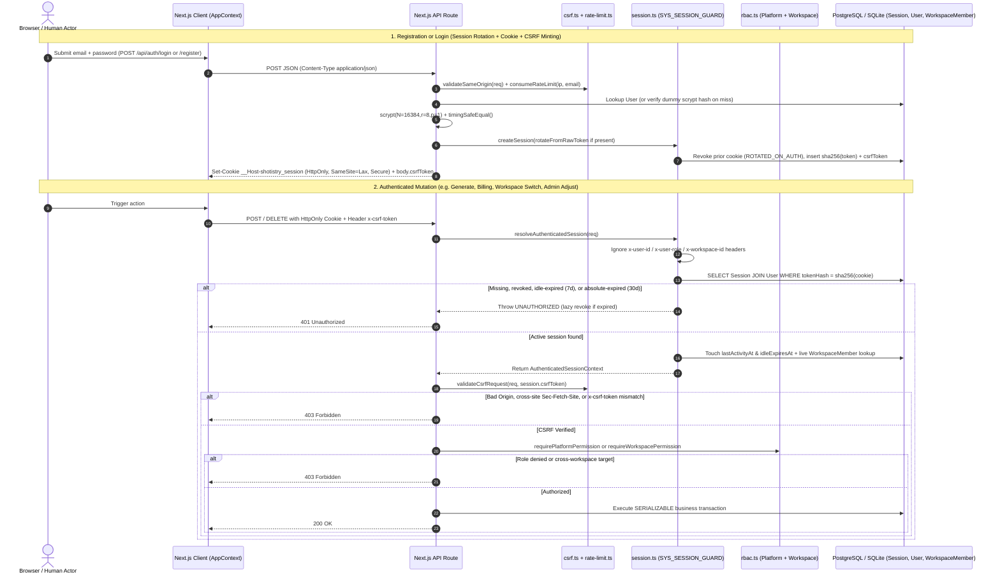

# Shotistry — Authentication, Session Security & Authorization Architecture

- **Status:** Implemented & Verified (**Option A — Database-Backed Opaque Session Architecture**)
- **Branch:** `audit/production-readiness`
- **Core Modules:** [`src/lib/auth/session.ts`](file:///Users/tasawk/StudioProjects/shotistry/src/lib/auth/session.ts), [`src/lib/auth/password.ts`](file:///Users/tasawk/StudioProjects/shotistry/src/lib/auth/password.ts), [`src/lib/auth/rbac.ts`](file:///Users/tasawk/StudioProjects/shotistry/src/lib/auth/rbac.ts), [`src/lib/auth/admin-bootstrap.ts`](file:///Users/tasawk/StudioProjects/shotistry/src/lib/auth/admin-bootstrap.ts), [`src/lib/security/csrf.ts`](file:///Users/tasawk/StudioProjects/shotistry/src/lib/security/csrf.ts), [`src/lib/security/rate-limit.ts`](file:///Users/tasawk/StudioProjects/shotistry/src/lib/security/rate-limit.ts)

---

## 1. Executive Security Summary

Shotistry authenticates human users via **database-backed high-entropy opaque session tokens** (`Option A`) rather than stateless JWTs or unsigned client cookies. Every protected API request resolves the principal **exclusively** from the SHA-256 hash of an `HttpOnly` cookie joined live against `"Session"`, `"User"`, and `"WorkspaceMember"` in PostgreSQL/SQLite.

### Remediated Baseline Vulnerabilities
Prior to this remediation on `audit/production-readiness`, the baseline codebase (`95fb12a`) exhibited critical authentication bypasses that have all been **completely eliminated and regression-tested**:
1. Forged identity header trust (`x-user-id`, `x-user-role`, `x-workspace-id`, `x-country`) and unsigned legacy cookies (`shotistry_user_id`, `shotistry_role`, `shotistry_workspace_id`).
2. Defaulting unauthenticated callers on `/api/admin/metrics` and `/api/admin/credits/adjust` to `'ADMIN'` / `'admin-system'` with automatic database insertion of `'ADMIN'` users from HTTP requests.
3. Silent auto-provisioning of default `'user-default-merchant'` / `'ws-default-studio'` workspaces + 5 trial credits for anonymous visitors or missing webhook targets.
4. Platform `ADMIN` implicit bypass of workspace membership checks on tenant APIs (`/api/jobs/[id]`).
5. Static hardcoded fallback `ASSET_SIGNING_SECRET` and missing `path.sep` directory traversal boundary check.

---

## 2. Authentication & Authorization Flow Diagram

---

## 3. Session Token Architecture (Option A)

| Property | Implemented Specification (`src/lib/auth/session.ts`) |
|---|---|
| **Token Entropy** | `crypto.randomBytes(32).toString('base64url')` (256 bits cryptographic randomness) |
| **Database Storage** | Strict 64-char hex **SHA-256 digest** (`tokenHash`) in `"Session"`; raw token is **never** stored in SQL or logged |
| **Cookie Name (Production)** | `__Host-shotistry_session` (`NODE_ENV === 'production'`); extractor **refuses** unprefixed `shotistry_session` in production to prevent subdomain cookie-tossing |
| **Cookie Name (Dev / Test)** | `shotistry_session` |
| **Cookie Flags** | `HttpOnly`; `SameSite=Lax`; `Path=/`; **No `Domain` attribute**; `Secure` enforced when `NODE_ENV === 'production'`; explicit `Max-Age` & `Expires` synchronized with `expiresAt` |
| **Idle Expiration** | **7 days** (`DEFAULT_IDLE_TTL_SECONDS = 604800`, overridable via `SESSION_IDLE_TTL_SECONDS`) sliding window updated on activity, clamped cleanly at `expiresAt` |
| **Absolute Expiration** | **30 days** (`DEFAULT_ABSOLUTE_TTL_SECONDS = 2592000`, overridable via `SESSION_ABSOLUTE_TTL_SECONDS`) |
| **Immediate Server Revocation** | Checked synchronously via `Session.revokedAt IS NULL` on every request; expired sessions are stamped `IDLE_EXPIRED` or `ABSOLUTE_EXPIRED` |

---

## 4. Full Session & Credential Lifecycle

1. **Login / Registration Rotation (`ROTATED_ON_AUTH`):** Submitting credentials while carrying an older cookie immediately revokes the prior token hash inside the same transaction before issuing the new token (`POST /api/auth/login`, `POST /api/auth/register`).
2. **Session Inspection (`GET /api/auth/session`):** Safe public probe returning `{ authenticated: false, user: null }` to guests without auto-provisioning any database row.
3. **Logout (`POST /api/auth/logout`):** Validates session + `x-csrf-token`, stamps `revokedAt` (`LOGOUT`), and returns `Set-Cookie` clearing cookie (`Max-Age=0`, `Expires=Thu, 01 Jan 1970 00:00:00 GMT`).
4. **Multi-Device Listing & Single-Device Revocation (`GET /api/auth/sessions`, `DELETE /api/auth/sessions/[id]`):** Lists non-revoked, unexpired sessions for `session.userId` (omitting `tokenHash` & `csrfToken`). `DELETE` scopes query strictly to `WHERE id = ? AND userId = ?` (`SINGLE_DEVICE_REVOKED`) and returns `revokedCurrentSession: boolean` (+ clear cookie when self-revoking).
5. **Bulk Revocation (`POST /api/auth/sessions/revoke-all`):** Revokes all active sessions for `session.userId` (`USER_REVOKE_ALL`, supporting optional `keepCurrent: true`).
6. **Active Workspace Switching (`POST /api/workspace/switch`):** Verifies target `WorkspaceMember` membership for `session.userId`, updates `Session.activeWorkspaceId`, and recomputes balance & `workspaceRole`.
7. **Password Rotation Cascade (`POST /api/auth/password`):** Verifies `currentPassword`, validates strength (min 8 chars user / 12 chars admin), updates `User.passwordHash` + `passwordUpdatedAt`, revokes **every** active session (`PASSWORD_CHANGED`), and issues a fresh rotated session for the calling browser.

---

## 5. Password Hashing, Anti-Enumeration & Rate Limiting

### 5.1 Cryptographic Password Hashing (`src/lib/auth/password.ts`)
- **Primary Algorithm (OWASP Recommended):** Native Node.js 24 (`v24.7.0+`) `crypto.argon2('argon2id')` with parameters:
  - Memory cost (`m`): `19456 KiB` (`19 MiB`)
  - Time cost (`t` / passes): `2`
  - Parallelism (`p` / threads): `1`
  - Tag length: `32` bytes (`256-bit`)
  - Salt: `16` random bytes (CSPRNG)
- **Storage Format (Standard PHC String):**
  `$argon2id$v=19$m=19456,t=2,p=1$<base64_nopad_salt>$<base64_nopad_tag>`.
- **Serverless Concurrency Limiter (`src/lib/auth/hash-semaphore.ts`):**
  - Caps concurrent hashing operations via an asynchronous semaphore (`SHOTISTRY_MAX_CONCURRENT_HASHES`, default `4`).
  - Acquire timeout: `2500ms` (configurable via `SHOTISTRY_HASH_SEMAPHORE_TIMEOUT_MS`).
  - Queue wait exhaustion maps to HTTP `503 SERVICE_BUSY` with `Retry-After: 2` to protect serverless instances from out-of-memory crashes under burst traffic.
- **Strict Parameter Bounds (Anti-DoS Defense):**
  - Passwords exceeding 128 characters are rejected defensively before hashing.
  - Stored Argon2id bounds: `8192 <= m <= 65536` (`m >= 8 * p`), `1 <= t <= 10`, `1 <= p <= 4`, `16 <= salt.length <= 32`, `tag.length === 32`.
  - Stored scrypt bounds: `16384 <= N <= 131072` (power of 2), `1 <= r <= 16`, `1 <= p <= 4`.
- **Transparent Legacy Hash Migration:**
  - `verifyPassword` supports both bounded Argon2id and legacy `scrypt$16384$8$1$...` hashes in constant time via `crypto.timingSafeEqual`.
  - When a user with a legacy scrypt or sub-standard hash logs in successfully, `POST /api/auth/login` transparently upgrades their stored hash to `$argon2id$v=19$m=19456,t=2,p=1$...` without bumping `passwordUpdatedAt` and without revoking any active sessions.
- **Anti-Enumeration Controls:**
  - Unknown emails and null-password accounts trigger `constantTimeDummyVerify` with an Argon2id hash so response latency matches an actual credential check.
  - Wrong password and nonexistent email both return `401 Unauthorized` with the identical JSON body `{ success: false, error: "Invalid email or password" }`.
  - Duplicate signup returns `409 Conflict` with generic `{ success: false, error: "An account could not be created with the provided email address." }`.

### 5.2 Distributed Sliding-Window Rate Limiting (`src/lib/security/rate-limit/`)

Shotistry implements **fail-closed distributed sliding-window rate limiting** across IP and user dimensions with multi-backend failover:
- **Upstash Redis REST Store (`UpstashRateLimitStore`):** Uses atomic server-side Lua scripts over HTTPS to increment sliding windows atomically.
- **Postgres ACID Store (`PostgresRateLimitStore`):** Uses `RateLimitBucket` table with atomic `INSERT ... ON CONFLICT ("key") DO UPDATE` with sliding window tracking and probabilistic cleanup.
- **Client IP Extraction:** Respects `SHOTISTRY_TRUSTED_PROXY_COUNT` (default `1`) and Vercel edge headers (`x-vercel-forwarded-for`), drops private IP hops from untrusted proxies, and aggregates IPv6 addresses into `/64` CIDR blocks to prevent token-bucket exhaustion via address cycling.
- **Fail-Closed Production Posture:** If the configured rate-limiting backend is unreachable in production, requests return HTTP `503 RATE_LIMITER_UNAVAILABLE` with a `Retry-After: 60` header.

| Policy Key | Scope | Limit | Window | Response on Exhaustion |
|---|---|---|---|---|
| `auth:register:ip` | IP Address | `10` requests | `15 minutes` | `429` + `Retry-After` header |
| `auth:login:ip` | IP Address | `10` requests | `15 minutes` | `429` + `Retry-After` header |
| `auth:login:email` | Normalized Email (SHA-256) | `5` requests | `15 minutes` | `429` + `Retry-After` header |
| `auth:forgot_password:ip` | IP Address | `5` requests | `15 minutes` | `429` + `Retry-After` header |
| `auth:forgot_password:email` | Normalized Email (SHA-256) | `3` requests | `15 minutes` | `429` + `Retry-After` header |
| `auth:reset_password:ip` | IP Address | `5` requests | `15 minutes` | `429` + `Retry-After` header |
| `auth:verify_email:resend:user` | User ID | `3` requests | `15 minutes` | `429` + `Retry-After` header |
| `auth:email_change:request:user` | User ID | `3` requests | `15 minutes` | `429` + `Retry-After` header |
| `auth:password:change:user` | User ID | `5` requests | `15 minutes` | `429` + `Retry-After` header |
| `workspaces:invites:create:ip` | IP Address | `20` requests | `1 hour` | `429` + `Retry-After` header |
| `workspaces:invites:accept:ip` | IP Address | `10` requests | `15 minutes` | `429` + `Retry-After` header |

---

## 6. Multi-Layer CSRF Defense (`src/lib/security/csrf.ts`)

State-changing browser requests face **four coordinated protections**:
1. **Cookie Isolation:** `HttpOnly` + `SameSite=Lax` + `__Host-` prefix in production prevents JavaScript reads and third-party POST cookie transmission in modern browsers.
2. **Pre-Auth JSON Content-Type Enforcement:** `/api/auth/register` and `/api/auth/login` reject non-JSON payloads (`415 Unsupported Media Type`), blocking HTML `<form>` CSRF posts.
3. **Fetch Metadata & Same-Origin Verification ([`validateSameOrigin`](file:///Users/tasawk/StudioProjects/shotistry/src/lib/security/csrf.ts#L34-L77)):**
   - Rejects `Sec-Fetch-Site` values other than `same-origin` or `none` (`403`).
   - Validates `Origin` (rejecting `"null"` and foreign origins) or fallback `Referer` origin against request origin, forwarded host, `APP_URL`, and `NEXT_PUBLIC_APP_URL`.
4. **Synchronizer CSRF Token (`x-csrf-token`):** Every authenticated mutation route (`/api/auth/logout`, `/api/auth/sessions/[id]`, `/api/auth/sessions/revoke-all`, `/api/auth/password`, `/api/workspaces`, `/api/workspace/switch`, `/api/workspaces/[id]/members`, `/api/assets/upload`, `/api/photoshoots/generate`, `/api/billing/checkout-intent`, `/api/admin/credits/adjust`) calls [`validateCsrfRequest`](file:///Users/tasawk/StudioProjects/shotistry/src/lib/security/csrf.ts#L79-L107) comparing SHA-256 hashes of `x-csrf-token` vs `session.csrfToken` via `crypto.timingSafeEqual`. `AppContext.authorizedFetch()` keeps this synchronizer token strictly in React state (never readable from `document.cookie`).

---

## 7. Anti-Trial-Farming & Secure Admin Bootstrap

- **Single Free Trial Guarantee:** `registerMerchantWithInitialWorkspace` grants 5 credits exactly once per `User` (`trialGrantedAt = now`, `idempotencyKey = 'trial:grant:user:<userId>'`). Duplicate email attempts fail `409`, anonymous browsing creates zero rows, and `POST /api/workspaces` creates secondary workspaces with `0` initial credits.
- **Out-of-Band Admin Bootstrap ([`scripts/bootstrap-admin.mjs`](file:///Users/tasawk/StudioProjects/shotistry/scripts/bootstrap-admin.mjs), [`src/lib/auth/admin-bootstrap.ts`](file:///Users/tasawk/StudioProjects/shotistry/src/lib/auth/admin-bootstrap.ts)):**
  - Unreachable via HTTP.
  - Requires `SHOTISTRY_ADMIN_BOOTSTRAP_SECRET` (`>= 24` chars, non-placeholder) verified via SHA-256 `timingSafeEqual`.
  - Enforces minimum 12-character password strength.
  - Fails closed (`ADMIN_ALREADY_BOOTSTRAPPED`) if any `User` with `role = 'ADMIN'` already exists.
  - Emits immutable `PLATFORM_ADMIN_BOOTSTRAP` entry into `AdminAuditLog`.
- **Signed Asset Access (`src/lib/storage/asset-storage.ts`):** Requires `ASSET_SIGNING_SECRET` (>= 16 chars, non-placeholder) in `NODE_ENV === 'production'` and blocks directory traversal via `fullPath.startsWith(baseDir + path.sep)`.

---

## 8. Email Verification, Account Recovery & Workspace Invites (Implemented)

Shotistry's production authentication hardening includes a full single-use action token lifecycle, verified-email gating (ADR-007), transactional email delivery, and identity-bound workspace invitations:

### 8.1 Action Token Architecture (`src/lib/auth/action-tokens.ts`)
- **Storage:** Dedicated `AuthActionToken` table in both PostgreSQL and SQLite.
- **Token Format:** 256 bits entropy (`crypto.randomBytes(32).toString('base64url')`), stored strictly as SHA-256 hash (`tokenHash`). Raw tokens are never logged or persisted.
- **Token Lifecycles & TTLs:**
  - `EMAIL_VERIFY`: **24-hour** TTL. Consumed atomically via single-row update.
  - `PASSWORD_RESET`: **15-minute** TTL. Revokes all active sessions upon consumption.
  - `EMAIL_CHANGE`: **1-hour** TTL. Updates user email to pending target and re-verifies.
- **Atomic Single-Use Guarantee:** Consumed via `UPDATE ... WHERE tokenHash = $1 AND consumedAt IS NULL AND revokedAt IS NULL AND expiresAt > now RETURNING *`. Concurrent attempts return `null` and fail closed.

### 8.2 Account Recovery & Anti-Enumeration
- `POST /api/auth/forgot-password`: Returns uniform `202 Accepted` response with constant-time floor padding (~50 ms) to prevent timing-based user enumeration.
- **Privileged Account Exclusion:** Only standard merchant users (`role = 'USER'`) receive reset emails. Calls targeting `ADMIN` or `SUPPORT` accounts generate zero tokens, send zero emails, and emit an immutable `PRIVILEGED_RESET_ATTEMPT` audit log into `AdminAuditLog`.
- `POST /api/auth/reset-password`: Validates password strength and hashes via Argon2id **before** token consumption to prevent burning tokens on validation errors. Atomically consumes token, revokes **all** active sessions with `PASSWORD_RESET`, invalidates all outstanding tokens, clears session cookies, and sends a `passwordChangedNotice` alert email.

### 8.3 Verified-Email Gating (ADR-007)
- **Protected Actions:** Commercial checkout (`POST /api/billing/checkout-intent`), workspace creation (`POST /api/workspaces`), adding workspace members, and accepting workspace invites strictly require verified email (`emailVerifiedAt IS NOT NULL`). Unverified users receive HTTP `403 { code: 'EMAIL_VERIFICATION_REQUIRED' }`.
- **Permitted Actions for Unverified Users:** Trial photo generation (`POST /api/photoshoots/generate`), viewing assets, inspecting account status, and resending verification emails.
- **Payment Safety:** Paymob webhooks never gate on verification; payments for previously created checkout intents always settle cleanly.

### 8.4 Identity-Bound Workspace Invites
- Replacing instant member addition, `POST /api/workspaces/[id]/members` creates a sanitized `WorkspaceInvite` record and dispatches an invitation email with a `#token=` link.
- `POST /api/workspaces/invites/accept` requires authenticated session, CSRF verification, verified email, and strictly matches `session.email === invite.invitedEmail`. Mismatches return `403 INVITE_IDENTITY_MISMATCH` without consuming the invite.

### 8.5 Token Leakage Protections
- All email links carry single-use tokens inside URL fragments (e.g., `/reset-password#token=...`), ensuring tokens are never transmitted to server access logs or HTTP `Referer` headers.
- Next.js frontend pages read `#token=` from `window.location.hash`, immediately scrub it via `window.history.replaceState`, and transmit the token securely in the POST JSON body.
- `next.config.ts` enforces `Referrer-Policy: no-referrer` and `Cache-Control: no-store` on all token-bearing routes (`/verify-email`, `/reset-password`, `/account/confirm-email`, `/invites/accept`, `/api/auth/:path*`).
