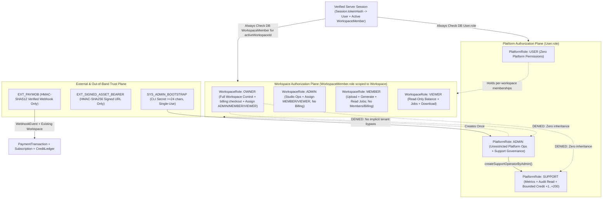

# Shotistry — Multi-Tier RBAC Matrix & Authorization Specification

- **Status:** Official Security & Authorization Matrix (Enforced & Verified in Tests)
- **Branch:** `audit/production-readiness`
- **Primary Implementation:** [`src/lib/auth/rbac.ts`](file:///Users/tasawk/StudioProjects/shotistry/src/lib/auth/rbac.ts), [`src/lib/auth/session.ts`](file:///Users/tasawk/StudioProjects/shotistry/src/lib/auth/session.ts)

---

## 1. Architectural Principles & Authorization Separation

Shotistry enforces a **strictly separated multi-plane Role-Based Access Control (RBAC)** architecture. Roles are **never inherited upward** across planes:

1. **Platform-Level Roles (`User.role` — enum `Role`):** `USER`, `SUPPORT`, `ADMIN`. Governs platform-wide operations (`/api/admin/metrics`, `/api/admin/credits/adjust`, operator provisioning).
2. **Workspace-Level Roles (`WorkspaceMember.role` — enum `WorkspaceRole`):** `OWNER`, `ADMIN`, `MEMBER`, `VIEWER`. Governs single-tenant actions within `Session.activeWorkspaceId`.
3. **External Service Identities:** Non-human cryptographic authenticators (`PAYMOB_HMAC_SHA512`, `ASSET_HMAC_SHA256`, `GEMINI_API_KEY`, `SHOTISTRY_ADMIN_BOOTSTRAP_SECRET`).
4. **System-Level Execution Contexts:** Trusted server modules (`SYS_SESSION_GUARD`, `SYS_CREDIT_LEDGER`, `SYS_IMAGE_PIPELINE`, `SYS_PAYMOB_RECONCILER`, `SYS_ADMIN_BOOTSTRAP`) executing `SERIALIZABLE` DB writes without accepting client-asserted role headers.

### Core Anti-Escalation Invariants
- **No Workspace-to-Platform Escalation:** Holding `WorkspaceRole.OWNER` or `WorkspaceRole.ADMIN` grants **zero** `PlatformPermission` capabilities. `hasPlatformPermission('USER', *)` is always `false`.
- **No Platform-to-Tenant Bypass:** Holding `PlatformRole.ADMIN` or `PlatformRole.SUPPORT` grants **zero** implicit access to merchant workspaces. `resolveAuthenticatedSession(..., { requireWorkspace: true })` and `/api/jobs/[id]` always verify live `WorkspaceMember` membership for the target workspace (`403` otherwise).
- **Zero Trust in Client Headers or Unsigned Cookies:** `x-user-id`, `x-user-role`, `x-workspace-id`, `x-country`, unsigned `shotistry_*` cookies, and client JSON `role` fields are ignored or rejected (`403` on signup `role` tampering).
- **Live Mid-Session Authorization:** `User.role` and `WorkspaceMember.role` are queried fresh from SQL on every API request in [`resolveOptionalSession`](file:///Users/tasawk/StudioProjects/shotistry/src/lib/auth/session.ts#L283-L410) (never cached inside immutable cookie claims), so role demotions and membership removals take effect immediately on the next request.

---

## 2. Actor Permission Relationships Diagram

---

## 3. Platform-Level Role Permission Matrix (`PlatformPermission`)

Defined verbatim in [`PLATFORM_PERMISSION_MATRIX`](file:///Users/tasawk/StudioProjects/shotistry/src/lib/auth/rbac.ts#L25-L39):

| Platform Permission | Code Enforcing | `USER` | `SUPPORT` | `ADMIN` | Enforcement Notes |
|---|---|:---:|:---:|:---:|---|
| `platform:metrics:read` | `GET /api/admin/metrics` | ✗ | ✓ | ✓ | Returns aggregated counts, MRR, AI COGS, last 20 jobs, infra status. |
| `platform:audit:read` | `GET /api/admin/metrics` | ✗ | ✓ | ✓ | Returns last 10 `AdminAuditLog` records. |
| `platform:credits:adjust:bounded` | `POST /api/admin/credits/adjust` | ✗ | ✓ | ✓ | Bounded to integer `+1 .. +200` (`SUPPORT_CREDIT_ADJUSTMENT_MAX = 200`) for `SUPPORT`. |
| `platform:credits:adjust` | `POST /api/admin/credits/adjust` | ✗ | ✗ | ✓ | Required for negative debits (`amount < 0`) or adjustments `> 200` (`\|amount\| <= 10,000`). |
| `platform:users:manage` | `createSupportOperatorByAdmin` | ✗ | ✗ | ✓ | Only `ADMIN` can provision `SUPPORT` accounts (checked inside DB tx); no HTTP endpoint yet. |

---

## 4. Workspace-Level Role Permission Matrix (`WorkspacePermission`)

Defined verbatim in [`WORKSPACE_PERMISSION_MATRIX`](file:///Users/tasawk/StudioProjects/shotistry/src/lib/auth/rbac.ts#L41-L83):

| Workspace Permission | Code Enforcing | `OWNER` | `ADMIN` | `MEMBER` | `VIEWER` | Enforcement Notes |
|---|---|:---:|:---:|:---:|:---:|---|
| `workspace:read` | `GET /api/workspace/session` | ✓ | ✓ | ✓ | ✓ | Reads active workspace balance, plan tier, recent jobs. |
| `workspace:switch` | `POST /api/workspace/switch` | ✓ | ✓ | ✓ | ✓ | Route validates target `workspaceId` membership for `session.userId`. |
| `workspace:create` | `POST /api/workspaces` | ✓ | ✓ | ✓ | ✓ | Any authenticated account can create an additional workspace (starts with `0` trial credits). |
| `workspace:members:read` | `GET /api/workspaces/[id]/members` | ✓ | ✓ | ✗ | ✗ | Protects teammate PII/emails from `MEMBER` and `VIEWER` accounts. |
| `workspace:members:manage` | `POST /api/workspaces/[id]/members` | ✓ | ✓* | ✗ | ✗ | \*Subject to delegation limits below via `canManageWorkspaceMemberRole()`. |
| `brand:manage` | `createPhotoshootJob` (auto-brand) / *(Planned Brand CRUD)* | ✓ | ✓ | ✓ | ✗ | Dedicated `/api/brands` CRUD routes are planned roadmap; runtime currently auto-upserts `Default Brand`. |
| `product:manage` | `POST /api/photoshoots/generate` | ✓ | ✓ | ✓ | ✗ | Product & `Photoshoot` rows created under active workspace. |
| `asset:upload` | `POST /api/assets/upload` | ✓ | ✓ | ✓ | ✗ | Validates same active workspace and stores local signed asset (`max 20MB`). |
| `photoshoot:generate` | `POST /api/photoshoots/generate` | ✓ | ✓ | ✓ | ✗ | Reserves & settles credits; also gated by plan model & resolution rules. |
| `job:read` | `GET /api/jobs/[id]` | ✓ | ✓ | ✓ | ✓ | Enforces `jobRow.workspaceId === session.activeWorkspaceId`. |
| `billing:checkout` | `POST /api/billing/checkout-intent` | ✓ | ✗ | ✗ | ✗ | Strictly reserved for workspace `OWNER` (`WS_ADMIN` gets `403`). |

### 4.1 Workspace Member Role Delegation Matrix (`canManageWorkspaceMemberRole`)

Enforced in [`canManageWorkspaceMemberRole`](file:///Users/tasawk/StudioProjects/shotistry/src/lib/auth/rbac.ts#L128-L139) and [`src/app/api/workspaces/[id]/members/route.ts`](file:///Users/tasawk/StudioProjects/shotistry/src/app/api/workspaces/[id]/members/route.ts#L142-L195):

| Acting Role \ Target Role | Assign/Change `OWNER` | Assign/Change `ADMIN` | Assign/Change `MEMBER` | Assign/Change `VIEWER` |
|---|:---:|:---:|:---:|:---:|
| **`OWNER`** | ✗ (`403` owner immutable via `/members`) | ✓ | ✓ | ✓ |
| **`ADMIN`** | ✗ (`403 Forbidden`) | ✗ (`403 Forbidden` cannot promote to or demote `ADMIN`) | ✓ | ✓ |
| **`MEMBER`** | ✗ (`403 Forbidden`) | ✗ (`403 Forbidden`) | ✗ (`403 Forbidden`) | ✗ (`403 Forbidden`) |
| **`VIEWER`** | ✗ (`403 Forbidden`) | ✗ (`403 Forbidden`) | ✗ (`403 Forbidden`) | ✗ (`403 Forbidden`) |

---

## 5. Subscription Plan Model & Resolution Entitlements

In addition to RBAC roles, [`validatePlanModelEntitlement`](file:///Users/tasawk/StudioProjects/shotistry/src/lib/pricing/model-costs.ts#L492-L511) enforces commercial tier limits before reserving credits in `POST /api/photoshoots/generate`:

| Plan Tier | Allowed Models | Max Resolution | Credit Weights by `(Model, Size)` | Exceeded Result |
|---|---|---|---|---|
| **`FREE`** | `gemini-3.1-flash-image`, `gemini-3.1-flash-lite-image` | `1K` | `1` credit (`512` / `1K`) | `403 Forbidden` |
| **`STARTER`** | `gemini-3.1-flash-image`, `gemini-3.1-flash-lite-image` | `1K` | `1` credit (`512` / `1K`) | `403 Forbidden` |
| **`PRO`** | `gemini-3.1-flash-image`, `gemini-3.1-flash-lite-image`, `gemini-3-pro-image` | `4K` | Flash: `1` (`<=1K`), `2` (`2K`), `3` (`4K`); Pro: `2` (`<=2K`), `4` (`4K`) | `402` if balance < weight |
| **`AGENCY`** | `gemini-3.1-flash-image`, `gemini-3.1-flash-lite-image`, `gemini-3-pro-image` | `4K` | Same weighted schedule as `PRO` | `402` if balance < weight |

---

## 6. External Service & System Identities Matrix

| Identity | Trust Mechanism | Scope of Authorized Action | Fail-Closed Behavior |
|---|---|---|---|
| **`EXT_PAYMOB`** (`webhooks/paymob`) | HMAC-SHA512 verified with `crypto.timingSafeEqual` over `PAYMOB_HMAC_SECRET` | Deduplicate `WebhookEvent`, update existing `Subscription`/`PaymentTransaction`, call `grantCredits` on **existing** workspace. | Unconfigured secret -> `503`; invalid/missing HMAC -> `401`; missing `workspace_id` -> `400`; unknown workspace -> `404`. |
| **`EXT_SIGNED_ASSET_BEARER`** (`assets/download`) | HMAC-SHA256 signature (`key:expires`) verified with `crypto.timingSafeEqual` over `ASSET_SIGNING_SECRET` + expiry check (`ttlSeconds=3600`) | Read binary asset image under `.data/assets` bounded by `baseDir + path.sep`. | Production missing secret (<16 chars or placeholder) throws on startup/sign; invalid/expired URL -> `403`; path traversal -> `404`. |
| **`EXT_GEMINI_API`** (`GeminiClient`) | Server-side `GEMINI_API_KEY` | Generate output image from uploaded reference photo + binary alpha mask. | Missing key falls back to `LOCAL_COMPOSITE_SANDBOX` (`synthIdDetected: false`); API error triggers reservation release (`0` credits charged). |
| **`SYS_ADMIN_BOOTSTRAP`** (`scripts/bootstrap-admin.mjs`) | Out-of-band CLI + `SHOTISTRY_ADMIN_BOOTSTRAP_SECRET` (>=24 chars, SHA-256 `timingSafeEqual`) | Insert single initial `ADMIN` when zero `ADMIN` accounts exist; log `PLATFORM_ADMIN_BOOTSTRAP`. | Weak/missing/mismatched secret or existing `ADMIN` fails closed before insert. |

---

## 7. Complete API Endpoint Authorization Matrix (21 Verified Routes)

| Method & Route | Auth Mechanism | Origin / CSRF | Required Platform Role / Perm | Required Workspace Perm | Extra Tenant / Business Guards | Unauth / Denied Codes |
|---|---|---|---|---|---|---|
| `POST /api/auth/register` | Public (Pre-Auth) | `application/json` + `validateSameOrigin` | Forces `USER` | Auto-creates WS + `OWNER` | Rate limit `10/15m` IP; rejects `role`/`platformRole` JSON (`403`); duplicate email `409`; max 1 trial (`5` cr). | `415`, `403`, `429`, `400`, `409` |
| `POST /api/auth/login` | Email + `scrypt` password | `application/json` + `validateSameOrigin` | Any DB `Role` | Sets first WS if any (`null` for Admin/Support) | Rate limit `10/15m` IP & IP+email; `constantTimeDummyVerify`; rotates prior cookie (`ROTATED_ON_AUTH`). | `415`, `403`, `429`, `400`, `401` |
| `GET /api/auth/session` | Optional Cookie | `GET` (safe) | Resolves DB `role` | Resolves DB memberships | Anonymous returns `200 { authenticated: false }` with zero provisioning. | Never grants access |
| `POST /api/auth/logout` | Cookie (`Session`) | `validateCsrfRequest` | Any authenticated | None | Revokes current session (`LOGOUT`), sets clearing `Set-Cookie` (`Max-Age=0`). | `401`, `403` |
| `GET /api/auth/sessions` | Cookie (`Session`) | `GET` (safe) | Any authenticated | None | Filters strictly `WHERE userId = session.userId`; never returns `tokenHash` or `csrfToken`. | `401` |
| `DELETE /api/auth/sessions/[id]` | Cookie (`Session`) | `validateCsrfRequest` | Any authenticated | None | Atomic `WHERE id = ? AND userId = session.userId`; returns `revokedCurrentSession` + clears cookie if self. | `401`, `403`, `404` |
| `POST /api/auth/sessions/revoke-all` | Cookie (`Session`) | `validateCsrfRequest` | Any authenticated | None | Revokes all active sessions for `session.userId` (`exceptSessionId` only if `keepCurrent: true`). | `401`, `403` |
| `POST /api/auth/password` | Cookie (`Session`) | `validateCsrfRequest` | Min 12 chars if `ADMIN`, else 8 | None | Rate limit `5/15m` user; verifies `currentPassword`; revokes **all** sessions (`PASSWORD_CHANGED`); rotates current cookie. | `401`, `403`, `429`, `400` |
| `GET /api/workspaces` | Cookie (`Session`) | `GET` (safe) | Any authenticated | Caller memberships only | Queries `WorkspaceMember WHERE userId = session.userId`. | `401` |
| `POST /api/workspaces` | Cookie (`Session`) | `validateCsrfRequest` | Any authenticated | `workspace:create` | Creates workspace owned by `session.userId` with **`0` trial credits**. | `401`, `403`, `400` |
| `POST /api/workspace/switch` | Cookie (`Session`) | `validateCsrfRequest` | Any authenticated | `WorkspaceMember` of target | Verifies target `WorkspaceMember` row for `session.userId` before updating `Session.activeWorkspaceId`. | `401`, `403`, `400` |
| `GET /api/workspaces/[id]/members` | Cookie (`Session`) | `GET` (safe) | Any authenticated | `workspace:members:read` (`OWNER` / `ADMIN`) | Must be member of `:id` AND hold `workspace:members:read` (`MEMBER`/`VIEWER` get `403`). | `401`, `403` |
| `POST /api/workspaces/[id]/members` | Cookie (`Session`) | `validateCsrfRequest` | Any authenticated | `workspace:members:manage` + `canManageWorkspaceMemberRole` | Target user must exist (`404`); cannot alter workspace `ownerId` (`403`); `ADMIN` cannot assign/reassign `ADMIN`. | `401`, `403`, `400`, `404` |
| `GET /api/workspace/session` | Cookie (`Session`) | `GET` (safe) | Any with active WS | `workspace:read` | Scoped to `session.activeWorkspaceId`; Admin without membership gets `403`. | `401`, `403` |
| `POST /api/assets/upload` | Cookie (`Session`) | `validateCsrfRequest` | Any with active WS | `asset:upload` (`OWNER`/`ADMIN`/`MEMBER`) | Rejects body `workspaceId !== activeWorkspaceId` (`403`), max 20MB (`413`). | `401`, `403`, `400`, `413` |
| `GET /api/assets/download` | HMAC-SHA256 Signed URL | Stateless URL token | Bearer of valid sig | None (time-limited capability URL) | Expiry (`<= now` fails `403`), timing-safe HMAC, `baseDir + path.sep` traversal guard. | `403`, `404` |
| `POST /api/photoshoots/generate` | Cookie (`Session`) | `validateCsrfRequest` | Any with active WS | `photoshoot:generate` (`OWNER`/`ADMIN`/`MEMBER`) | Rejects cross-workspace body (`403`), plan model/4K entitlement (`403`), insufficient credits (`402`). | `401`, `403`, `400`, `402`, `413`, `422` |
| `GET /api/jobs/[id]` | Cookie (`Session`) | `GET` (safe) | Any with active WS | `job:read` | Enforces `jobRow.workspaceId === activeWorkspaceId` (`403` even for Platform `ADMIN`). | `401`, `403`, `404` |
| `GET /api/billing/plans` | Public | `GET` (safe) | None | None | Non-sensitive catalog pricing/weights. | `200` |
| `POST /api/billing/checkout-intent` | Cookie (`Session`) | `validateCsrfRequest` | Any with active WS | `billing:checkout` (`OWNER` ONLY) | Rejects `sandboxSimulateWebhook: true` when `NODE_ENV === 'production'` (`403`); rejects body `workspaceId !== activeWorkspaceId` (`403`). | `401`, `403`, `400` |
| `GET /api/admin/metrics` | Cookie (`Session`) | `GET` (safe) | `platform:metrics:read` (`ADMIN` / `SUPPORT`) | None | Workspace `OWNER` gets `403`. | `401`, `403` |
| `POST /api/admin/credits/adjust` | Cookie (`Session`) | `validateCsrfRequest` | `ADMIN` (`adjust`) or `SUPPORT` (`bounded`) | None | `SUPPORT`: positive integer `1..200` only (`403` negative or >200). `ADMIN`: `\|amt\| <= 10,000`. Missing target -> `404`. Immutable `AdminAuditLog`. | `401`, `403`, `400`, `404` |
| `POST /api/webhooks/paymob` | HMAC-SHA512 (`PAYMOB_HMAC_SECRET`) | External machine webhook (no session/CSRF) | External `EXT_PAYMOB` | None | Fails closed (`503` unconfigured, `401` invalid HMAC). Rejects missing/unknown workspace (`400`/`404`). | `503`, `401`, `400`, `404` |

*(Count note: 23 HTTP handler operations across 21 route files because `workspaces/route.ts` and `workspaces/[id]/members/route.ts` each export both `GET` and `POST`.)*

---

## 8. Frontend Route & Navigation Authorization Matrix

| Page Route | Allowed Actors | Unauthenticated Behavior | Unauthorized Authenticated Behavior |
|---|---|---|---|
| `/`, `/pricing` (view) | Guest & all authenticated actors | Renders marketing / pricing catalog cleanly. | Checkout buttons prompt `/login?next=/pricing` (Guest) or display `t.billingOwnerOnlyNotice` if `workspaceRole !== 'OWNER'`. |
| `/login`, `/register` | Guest (or re-authenticating user) | Login/registration forms with redirect sanitization (`safeNext`). | On auth, `ADMIN`/`SUPPORT` -> `/admin`, `USER` -> `/studio` (or safe relative `next`). |
| `/studio` | `OWNER`, `ADMIN`, `MEMBER`, `VIEWER` (read-only) | Shows auth gate (`authRequiredTitle`) + `/login` & `/register` links; does not load private history. | `VIEWER` sees amber `viewerReadOnlyNotice` & disabled Generate button (`server` also returns `403`). |
| `/account` | Any authenticated `User` | Shows auth gate (`authRequiredTitle`) + `/login?next=/account`. | Member list panel (`GET/POST /members`) rendered & callable only for `OWNER`/`ADMIN`; workspace switcher handles `ADMIN`/`SUPPORT` with `0` workspaces gracefully. |
| `/admin` | `ADMIN`, `SUPPORT` only | Shows auth gate (`authRequiredTitle`) + `/login?next=/admin` (never renders admin panel or sends `x-user-role`). | `USER` / `WS_OWNER` sees `accessDeniedTitle` and role readout; server returns `403`. Support UI clamps credit adjustment input cleanly to `1..200` and server enforces strictly. |
